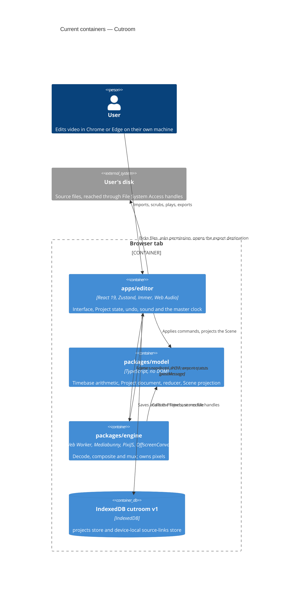

# Architecture map — Cutroom

> The **current** architecture (what exists today), produced by `survey` and read by
> specify / design / data-model / implement. Refresh with `survey` when the repo drifts past
> `reflects_commit`. This is generated; a hand-maintained `docs/architecture.md`, if present, is
> authoritative and reconciled below — not replaced.

Cutroom is a browser-based multi-track video editor. Decoding, compositing and encoding all run
on the user's machine; no media leaves the browser. The application code at `reflects_commit` is
the code of `a49c7f8` on `main` (the SDD migration changed documents only).

## Stack

- Language / runtime: TypeScript `~6`, ES2023 target, ESM only (`package.json:33`,
  `tsconfig.base.json:5`); Node `>=22` and `pnpm@10.27.0` (`package.json:6-9`).
- Frameworks:
  - Engine: Mediabunny `^1.25.3` (demux, decode, encode and mux over WebCodecs) and PixiJS `^8`
    (`packages/engine/package.json:15-16`).
  - Editor: React `^19.2.6` (`apps/editor/package.json:26-27`), Vite `^8`
    (`apps/editor/package.json:41`), Zustand `^5` (`apps/editor/package.json:32`), Immer `^10`
    (`apps/editor/package.json:23`; `packages/model/package.json:18` pins `^10.2.0`), idb `^8`
    (`apps/editor/package.json:22`), Tailwind `^4` (`apps/editor/package.json:30`), shadcn CLI
    `^4.16.1` and `radix-ui` `^1.6.7` (`apps/editor/package.json:28,25`).
- Build / test / lint (root `package.json:11-21`):
  - `pnpm build` runs `pnpm -r build`. The editor's build is `tsc -b && vite build`
    (`apps/editor/package.json:7-13`).
  - `pnpm test` runs Vitest `^3` in `@cutroom/model` and `@cutroom/editor`. `packages/engine` has no
    unit-test script (`packages/engine/package.json:11-13`). It is tested through Playwright.
  - `pnpm test:e2e` runs Playwright `^1.62.1` in Google Chrome.
  - `pnpm test:e2e:slow` runs the `@slow` specs (`CUTROOM_E2E_SLOW=1 playwright test --grep @slow`).
  - `pnpm typecheck` runs `tsc -b && tsc -p scripts`.
  - `pnpm lint` runs `pnpm check:docs && eslint . && prettier --check .`. `check:docs`
    (`scripts/check-docs.mjs`) checks the SDD docs invariants across `docs/features/*`.
  - `pnpm fixtures` runs `node --experimental-strip-types scripts/make-fixtures.ts`.

## C4 — system as it is

## Module inventory

| Module | Path | Layers | Wired at | Responsibility |
|---|---|---|---|---|
| `@cutroom/model` | `packages/model` | domain (`src/timebase.ts`, `src/document/`, `src/commands/`, `src/scene.ts`) | `packages/model/src/index.ts:1-11` (exports map `packages/model/package.json:6-8`) | Framework-free core: rational time maths, the Project document (types, parse, migrations), the single reducer, the Scene projection. No browser APIs. |
| `@cutroom/engine` | `packages/engine` | ports (`src/protocol.ts`, `src/worker.ts`), app (`src/sources/`, `src/compose/`, `src/playback/`, `src/export/`, `src/capabilities.ts`) | worker entry `packages/engine/src/worker.ts:294,357`; exports `.`, `./worker`, `./protocol` (`packages/engine/package.json:6-10`); main-thread export only `forwardingWritable` (`packages/engine/src/index.ts:1-3`) | The Web Worker: attach Sources, decode, PixiJS compositing on an `OffscreenCanvas`, streaming and scrub paths, export pipeline, codec capability probe. No React. |
| `@cutroom/editor` | `apps/editor` | ui (`src/ui/`, `src/components/ui/`), app (`src/store/`, `src/audio/`), infra (`src/storage/`), ports (`src/engine-client/`) | `apps/editor/src/ui/EditorLayout.tsx:81` (panels); worker spawn `apps/editor/src/engine-client/index.ts:52,237` | The interface. Owns Project state, undo, sound and the clock. |
| scripts | `scripts/` | tooling | root `package.json` scripts | `make-fixtures.ts` (test media via the ffmpeg CLI), `check-docs.mjs` (SDD docs invariants). |
| eslint-rules | `eslint-rules/` | tooling | `eslint.config.js:34-40` | `no-import-outside-repo`: fails any import that resolves outside the repository root (ADR 0010). |

Project references build model → engine → editor (`tsconfig.json:3-7`). The engine depends on
the model as a workspace dev dependency (`packages/engine/package.json:18-20`).

## Conventions (cited — the rules a new feature must match)

- **Module wiring / registration:** packages export through `exports` maps. The model has one
  barrel (`packages/model/src/index.ts:1-11`). The editor reaches the worker as
  `@cutroom/engine/worker?worker` (`apps/editor/src/engine-client/index.ts:52`), not by path.
- **Dependency direction:** by layer, not by feature. `model` knows nothing about the browser,
  `engine` knows nothing about React, and `apps/editor` knows about everything. This is
  enforced by:
  - the TypeScript libs: base `["ES2023"]`, no DOM (`tsconfig.base.json:5`); engine
    `["ES2023","DOM","WebWorker"]` (`packages/engine/tsconfig.json:7`); editor
    `["ES2023","DOM"]` (`apps/editor/tsconfig.app.json:5`);
  - ESLint globals: the model gets none (`eslint.config.js:59-65`), the engine gets worker
    globals (`eslint.config.js:67-71`);
  - the model's Vitest node environment (`packages/model/vitest.config.ts:3-15`).

  There is no `no-restricted-imports` rule.
- **Error handling:**
  - The model throws a `RangeError` that names the function, the argument and the value
    (`packages/model/src/timebase.ts:66-81`). The reducer refuses before it writes, with a
    `CommandError` (`packages/model/src/commands/apply.ts:64-74`).
  - In the worker, every throw becomes a strings-only `fatal` message
    (`packages/engine/src/worker.ts:79-91`). On the main thread, a `fatal` rejects every
    outstanding request (`apps/editor/src/engine-client/index.ts:39-43`).
  - In the UI, a failure reads as a plain statement, then the action, then folded detail
    (`apps/editor/src/ui/failure-wording.ts:1-12`). It is rendered by `Notice`, which has a
    failure tone and a state tone (`apps/editor/src/ui/Notice.tsx:1-10,47`).
- **IDs:** the reducer mints no ids and reads no clock (`packages/model/src/commands/index.ts:7-10`).
  The only `crypto.randomUUID()` call is in the UI (`apps/editor/src/ui/SourcesPanel.tsx:90`). It
  is injected as `newId` (`apps/editor/src/store/import-source.ts:36-37`).
- **Time:** Timeline positions are integer Frames (`packages/model/src/document/types.ts:38`) in a
  rational `Timebase` (`packages/model/src/timebase.ts:24,35`). `timebase.ts` is the only place a
  Frame becomes seconds, samples or ticks (ADR 0002).
- **Persistence / DB access:**
  - IndexedDB database `cutroom`, version 1 (`apps/editor/src/storage/db.ts:24,34`). It has two
    stores with in-line keys: `projects` (`id`) and `source-links` (`sourceId`)
    (`apps/editor/src/storage/db.ts:37,40,84-85`).
  - A save writes `parseProject(project)` and commits explicitly
    (`apps/editor/src/storage/projects.ts:195-203`).
  - A load migrates and never writes back (`apps/editor/src/storage/projects.ts:153-163`).
- **Migrations:** no SQL and no migration tool (`migration_tool: ""`).
  - Document migrations are a code ladder keyed by schema version
    (`packages/model/src/document/migrate.ts:40,87,97`), with
    `CURRENT_SCHEMA_VERSION = 1` (`packages/model/src/document/types.ts:30`).
  - The IndexedDB store shape has its own version, upgraded through ordered `if (from < n)`
    blocks (`apps/editor/src/storage/db.ts:79`).
- **Tests:**
  - Vitest runs in a node environment: `test/**/*.test.ts` in the model
    (`packages/model/vitest.config.ts:11-13`) and `src/**/*.test.ts` in the editor
    (`apps/editor/vitest.config.ts:8-10`).
  - Playwright runs in real Google Chrome (`channel: "chrome"`, `apps/editor/playwright.config.ts:58`)
    with `workers: 1` (`apps/editor/playwright.config.ts:39`). The port is `CUTROOM_E2E_PORT`, or
    5191 for `@slow`, or 5173 (`apps/editor/playwright.config.ts:29-32`). `@slow` specs are
    excluded unless `CUTROOM_E2E_SLOW` is set (`apps/editor/playwright.config.ts:46`).
  - The native pickers are replaced by `installFilePicker` through `addInitScript`
    (`apps/editor/e2e/file-picker.ts:292,324`).
  - Fixtures are generated into `packages/engine/test/fixtures` with the ffmpeg CLI
    (`scripts/make-fixtures.ts:5-17,40`), and are gitignored.
- **Inter-module communication:**
  - The main thread and the worker talk only by `postMessage`. Messages to the worker (`ToEngine`)
    and events from it (`EngineEvent`) are typed in `packages/engine/src/protocol.ts:252-262` and
    `packages/engine/src/protocol.ts:433-446`.
  - The editor and the model talk by direct calls.
  - Sound travels as `audio-pcm` from the worker (`packages/engine/src/sources/audio.ts:251`) to the
    Web Audio graph (`apps/editor/src/audio/transport.ts:157-164`, `apps/editor/src/audio/graph.ts:3`).
    The export mix goes back to the worker under acknowledgement backpressure
    (`apps/editor/src/audio/offline-mix.ts:76,110`).
- **State and undo:**
  - Rules are at `apps/editor/src/store/index.ts:23-54`.
  - Every edit goes through `applyCommand` inside `transact` (`apps/editor/src/store/index.ts:420`)
    or `beginTransaction` (`apps/editor/src/store/index.ts:368`).
  - Undo applies Immer inverse patches (`apps/editor/src/store/index.ts:74`).
- **UI / styling:** shadcn on Radix with Tailwind 4 and CSS-variable tokens
  (`apps/editor/components.json:3-21`, `apps/editor/src/index.css:1-86`). Detail is in
  §Frontend / UI foundation below.

## Datastores

| Store | Engine | Accessed via | Notes |
|---|---|---|---|
| `cutroom` / `projects` | IndexedDB (v1) | `apps/editor/src/storage/projects.ts` | One record per Project Document, keyed by `id`. Saves follow the Gesture (ADR 0011), debounced 500 ms / max 2000 ms inside an open Gesture (`projects.ts:258-261`). |
| `cutroom` / `source-links` | IndexedDB (v1) | `apps/editor/src/storage/source-links.ts:113,119,131,150` | `{ sourceId, handle: FileSystemFileHandle }` (`db.ts:52-55`); device-local, never part of the document, never synchronised (ADR 0005). |
| OPFS | — | — | Not used by the app. The e2e tests use it only to obtain real file handles without a picker (`apps/editor/e2e/file-picker.ts:247`). |

## Frontend / UI foundation

- **Component library / design system:** shadcn, style `radix-mira`, base colour neutral, CSS
  variables, lucide icons, `@/` aliases (`apps/editor/components.json:3-21`). The generated
  components live in `apps/editor/src/components/ui/`. The shadcn and migrate-radix-to-base agent
  skills are installed (`skills-lock.json`).
- **Design tokens:** `@theme inline` (`apps/editor/src/index.css:8`), `:root` oklch values
  (`apps/editor/src/index.css:51`, `--primary` at `:58`, `--radius: 0.45rem` at `:75`), `.dark`
  overrides (`apps/editor/src/index.css:86`). Inter is the font (`apps/editor/src/index.css:10`).
- **Styling approach:** Tailwind 4 through CSS imports (`apps/editor/src/index.css:1-4`), with
  the dark variant at `apps/editor/src/index.css:6`. `cn`/`cva` are the class helpers
  (`.prettierrc` `tailwindFunctions`).
- **Shared primitives:** `Button` only (`apps/editor/src/components/ui/button.tsx:1-5`, cva plus
  `Slot` from `radix-ui`). `Notice` is the in-house primitive every failure and state message
  uses (`apps/editor/src/ui/Notice.tsx`).
- **State / data-fetching:** one Zustand store with Immer patches
  (`apps/editor/src/store/index.ts:75,604`). There is no server cache, because there is no server.
- **Closest UI precedent:** `apps/editor/src/ui/SourcesPanel.tsx`. It has store selectors
  (`:67-70`), a picker click leading to `importPickedFile` with injected `newId`/`now`
  (`:76-102`), `data-testid`/`aria-label` (`:109-118`), and `<Notice>` (`:136,155,166`).

## Where things live / closest precedents

- A new reducer command → a `{ type: "…" }` interface in `packages/model/src/commands/index.ts:41-86`, a `case` in `applyCommand` (`packages/model/src/commands/apply.ts:344-355`), tests in `packages/model/test/commands.test.ts`.
- A new worker message → an interface + union member in `packages/engine/src/protocol.ts:106-262`, a `case` in `handle()` (`packages/engine/src/worker.ts:293-340`), a client method or `on(...)` in `apps/editor/src/engine-client/index.ts`.
- A new end-to-end check → `apps/editor/e2e/<behaviour>.spec.ts` using `installFilePicker` and a named fixture, modelled on `apps/editor/e2e/import-smoke.spec.ts:1-15`; store helpers in `apps/editor/e2e/editor-fixtures.ts:14-67`.
- A new screen / UI component → composed from the existing design system (§Frontend), modelled on `apps/editor/src/ui/SourcesPanel.tsx` and mounted from `apps/editor/src/ui/EditorLayout.tsx:81`.

## Constraints & known tech-debt

The project's binding rules are the six principles in [docs/constitution.md](./constitution.md).
Every feature must hold to them:

- **I. The browser is the whole machine.** No server render path. Codec options are discovered at
  runtime (ADR 0001).
- **II. Frames are the unit of time.** One conversion module, with one named exception for
  Source-native time (ADR 0002).
- **III. One engine for Preview and Export.** The same compositing code and the same audio graph
  construction (ADR 0008, 0015).
- **IV. One owner of state, one way to change it.** The main thread owns state, every edit goes
  through the reducer, and undo is inverse patches (ADR 0004).
- **V. Sources are addressed, never copied.** Offline and Relink are normal states (ADR 0005).
- **VI. Effects are data, not branches** (ADR 0009). No Effects exist yet.

Platform and debt items (each cited):

- **Chromium only** (ADR 0006).
  - No File System Access permission can be pre-granted in tests
    (`apps/editor/playwright.config.ts:3-23`).
  - Other browsers are refused on arrival (`apps/editor/src/ui/CapabilityGate.tsx`).
- **Audio is on the main thread** (ADR 0008). A main thread stalled by React work stutters audio.
- **React StrictMode double mount.** The canvas can be transferred only once, so engine teardown
  is reference-counted and deferred by one task (`apps/editor/src/ui/EditorLayout.tsx:17,139`).
- **The fixture generator depends on the host's ffmpeg build.** That build lacks `drawtext`, so
  the Frame counter is drawn from a sprite (`scripts/make-fixtures.ts:13-17`).
- **No unit tests for `packages/engine`.** It is covered only by Playwright
  (`packages/engine/package.json:11-13`).
- **IndexedDB version 2 is planned as one more upgrade block** (`apps/editor/src/storage/db.ts:79`).
- **Server sync is future work** (ADR 0007, `apps/editor/src/storage/db.ts:6`,
  `apps/editor/src/store/index.ts:9`).
- **`pnpm check:docs` guards the SDD docs.** For every `docs/features/<slug>/` it checks the
  `.size`/`.route` values, the `tasks.json` id sequence, deps and task files, dangling task and AC
  references, that every AC has a task and a test-plan row, banned glossary spellings and
  placeholders (`TODO(sdd-migration)` only warns), plus the `docs/adr/` numbering.
- No TODO, FIXME or HACK comments exist in application source.

## Reconciliation with the authored architecture doc

There is no `docs/architecture.md`. The authored references this map reconciles with are:

- [docs/constitution.md](./constitution.md): the six principles plus the platform constraints and
  the workflow rules. It came from Spec Kit's `.specify/memory/constitution.md`. Where it and an
  ADR disagree, the ADR is the detail and the constitution is the rule.
- [docs/adr/](./adr/): the 17 ADRs.
- [CONTEXT.md](../CONTEXT.md): the domain language. Identifiers in code follow it.

Drift found while surveying:

- The constitution's repository list names future `apps/web` and `apps/api`. Neither exists.
- The constitution's Principle I says "`canEncode`/`canDecode`". The export qualities are probed on
  the main thread when the export dialog opens (`decisions.md`, carried into
  `features/import-play-export/sad.md` §8). The engine's `ready` probe still exists
  (`packages/engine/src/capabilities.ts`).
- ADR 0003 says the engine shares one GPU context between Preview and Export. That is narrowed by
  ADR 0015: an Export has its own renderer.
- Neither is a violation. Both are recorded so a reader does not take the older wording as current.
