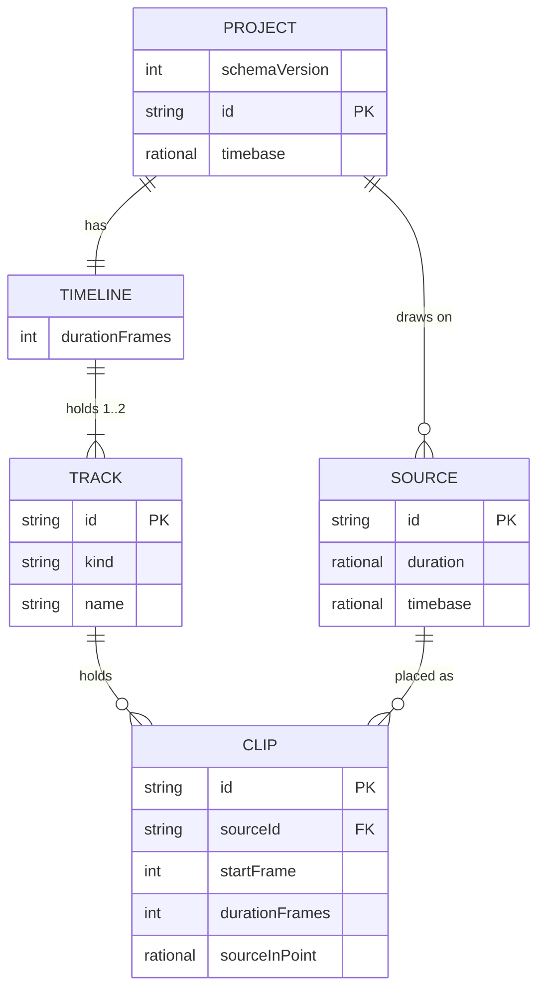

# Data model — editing

Entities use the vocabulary of `CONTEXT.md`. The shapes are the ones in
[import-play-export/data-model.md](../import-play-export/data-model.md). The TypeScript definitions
in `packages/model/src/document/types.ts` are authoritative. This document records only what
editing reads, writes and newly checks.

**No schema change.** The Project Document stays at schema version 1 and IndexedDB stays at
database version 1. Every edit this step adds can already be expressed in version 1:

- a non-zero In-point is any non-negative `Rational` (ADR 0018);
- a second Track is a second entry in `timeline.tracks`, which the parser never limited to one;
- a copy, or a Split's second half, is a Clip with a new id.

So there is nothing to add to the code ladder in `packages/model/src/document/migrate.ts`, no
upgrade block in `apps/editor/src/storage/db.ts`, and no staged migration under
`docs/features/editing/migrations/`. The repository has no SQL database and no migration tool
([architecture-map.md](../../architecture-map.md) §Conventions, `migration_tool: ""`).

What does change is **validation**. `parseProject` gains two checks on load: Source bounds and at
least one Track. Both are stricter than step 1's parser, and no Project step 1 could save fails
them (see §Validation summary).

Two decisions taken during this stage (owner, 2026-10-23):

- **A Source's beginning is container time 0.** SAD §11's open question is closed in favour of
  ADR 0018. A head Trim stops at In-point `0`, not at the first picture's presentation time. No
  `Source.firstPictureTime` field and no schema version 2. A migration could not have learned the
  value for existing Projects without reading every file again. AC-02 is amended to say so.
- **A Project always has at least one Track** is a document invariant, checked on load, and not
  only a refusal of `remove-track` (AC-22).

## ER diagram

Only the fields editing reads or writes are drawn. The full shape, including the device-local
`SOURCE_LINK`, is in the import-play-export ER diagram. Editing never touches the link table (AC-25).

## Entities

### Persisted: the Project document

The single aggregate root is still the `Project`. Every edit is one command on it, applied in one
`transact`, one history entry and one save (ADR 0019, ADR 0020). There is no separate aggregate
for a Track or a Clip: an edit that moves Clips between Tracks, or shifts Clips on several Tracks
(Ripple delete, a two-Track move), must check and write them together.

### `Timeline`

| Column | Type | Constraints | Notes |
|---|---|---|---|
| `tracks` | `Track[]` | **at least one** (new load check); at most two is a refusal of `add-track`, not a document rule | `tracks[0]` is the bottom Track. `add-track` appends, so a new Track goes on top and covers the ones below (sad §4). Lifting the two-Track limit later changes one rule and needs no migration. |
| `durationFrames` | integer | equals the maximum Clip end over every Track | Recomputed by every editing command. A plain delete or a Ripple delete of the last Clip shortens it, and removing a Track can too. |

**Aggregate root:** `Project`.

### `Track`

| Column | Type | Constraints | Notes |
|---|---|---|---|
| `id` | string | unique among Tracks | Minted by the editor's injected `newId` for `add-track`. The reducer mints none. |
| `kind` | `"video"` | union of one | Unchanged. The second Track is a video Track (spec §1). |
| `name` | string | | Given by the editor in the `add-track` command, e.g. `"Video 2"`. Not editable in this step. |
| `clips` | `Clip[]` | ordered by `startFrame`, non-overlapping | Unchanged rule, now exercised by every editing command and by the drag preview's rule functions. |

**Aggregate root:** `Project` (through `Timeline`).
**Writes:** `add-track` appends `{ id, kind: "video", name, clips: [] }`. `remove-track` removes
the Track with all its Clips in one command (AC-21), which one undo restores whole through
Immer's inverse patches.

### `Clip`

| Column | Type | Constraints | Notes |
|---|---|---|---|
| `id` | string | unique among Clips | Kept by a move and by a Trim. New for a Split's second half, for each copy of a Duplicate, and for a placed Source. Each new id is minted by the editor with `newId`. |
| `sourceId` | string | resolves to a Source of the Project | Never changed by an edit. A copy and a Split's second half keep their original's Source. |
| `startFrame` | integer | `≥ 0` | Written by a move, a head Trim, a Ripple delete's shift, a Duplicate and a Split's second half. |
| `durationFrames` | integer | `≥ 1`; **within its Source** (new load check) | Written by a Trim and a Split. |
| `sourceInPoint` | `{ numerator, denominator }` | `≥ 0`, exact ratio, container presentation time (ADR 0018) | Written only by a head Trim and a Split's second half. In both cases it is computed as `frameToSourceTime(project.timebase, inPoint, n)` for a whole number of Project Frames `n`. Nothing in editing does arithmetic on Source time outside `timebase.ts`. |

**Aggregate root:** `Project` (through `Track`).
**Source bounds (new, ADR 0018):**
`durationFrames ≤ framesForDuration(project.timebase, Source.duration − sourceInPoint)`, with
`Source.duration − sourceInPoint ≥ 0`. This is the same ceiling rule the import used to size the
first Clip. A Source spans container time `[0, Source.duration]` as recorded at import, so the
bound is computed for an Offline Source without reading its file (AC-25).

Which command writes which field:

| Command | Clips created | Fields changed on existing Clips | Tracks |
|---|---|---|---|
| `trim-clip` (head) | — | `startFrame`, `durationFrames`, `sourceInPoint` of one Clip | — |
| `trim-clip` (tail) | — | `durationFrames` of one Clip | — |
| `split-clips` | one second half per cut Clip, new id, `sourceInPoint` advanced by the offset | `durationFrames` of each first half | — |
| `move-clips` | — | `startFrame` of each moved Clip; a Clip moved to the other Track leaves one `clips` array for the other | — |
| `delete-clips` | — | with `ripple`, `startFrame` of every later Clip on the same Track | — |
| `duplicate-clips` | one copy per selected Clip, new id, same `sourceId`, `sourceInPoint` and `durationFrames` | — | — |
| `add-clip` (existing, used to place a Source, AC-24) | one Clip of the whole Source, `sourceInPoint = 0`, after the last Clip on `tracks[0]` | — | — |
| `add-track` | — | — | one Track appended |
| `remove-track` | — | — | one Track and its Clips removed |

### `Source`

Read-only to editing. `duration` and `timebase` are what the Source-bounds rule reads. Nothing in
this step writes a Source, and a Clip deleted from the Timeline leaves its Source in the Project, so
it can be placed again (AC-24).

### Runtime only: session state beside the Project

None of the following is part of the Project Document. None of it is saved, posted to the engine,
or recorded in undo history. It lives in the Zustand store (sad §5, §8).

| State | Shape | Rules | Spec |
|---|---|---|---|
| Selection | ordered set of Clip ids | Pruned after every undo and redo to Clip ids that exist. Commands never read it; they receive ids | AC-14, AC-15 |
| Drag preview | the dragged Clip ids, the edge or body grip, the Frame delta, the target Track, and the rule's verdict (can land / reason) | Exists only while a drag is open. Escape or a refused release discards it. While it is open, undo and redo are unavailable | AC-07, AC-18, AC-19, ADR 0020 |
| History | at most 200 entries of `{ label, patches, inversePatches }` | The oldest entry is dropped beyond 200. A Gesture that produces no patches adds no entry. History is empty after every load | AC-16, AC-28, AC-32 |
| Limiter delay | samples, keyed by sample rate | Measured once per sample rate with an impulse through the limiter | AC-23, ADR 0022 |

The `Scene` projection is unchanged. It already lists the Clips of every Track back to front, so a
second Track needs no new field (sad §5; the worker protocol does not change).

### Validation summary

These are the rules `parseProject` and the reducer enforce after this step. Rows marked *new* are
the ones this step adds. Every other row is unchanged from step 1.

| Rule | Enforced where | Spec reference |
|---|---|---|
| Frame values are non-negative integers (so nothing starts before Frame 0) | Parse + every command | AC-03, AC-07 |
| Clips do not overlap on a Track | Parse + every command + the drag preview's rule functions | AC-03, AC-07, AC-13 |
| `durationFrames ≥ 1` | Parse + `trim-clip`, `split-clips` | AC-03 |
| *new* — a Clip stays within its Source: `durationFrames ≤ framesForDuration(timebase, Source.duration − sourceInPoint)` and `sourceInPoint ≤ Source.duration` | Parse + `trim-clip`, `split-clips` (through `editing/limits.ts`) | AC-02, spec §6.1 abuse case |
| *new* — a Timeline has at least one Track | Parse + `remove-track` | AC-22 |
| At most two video Tracks | `add-track` only, a product limit, not a document rule | AC-30 |
| `Timeline.durationFrames` equals the maximum Clip end | Parse + every command | Data integrity |
| Source, Track and Clip ids are unique | Parse + every command that creates one | AC-15 |
| Every Clip's `sourceId` resolves to a Source | Parse | Data integrity |

Neither new load check can refuse a Project that step 1 saved:

- Step 1 sized every Clip with the same `framesForDuration` ceiling at In-point `0`, so it meets
  the Source-bounds rule exactly (sad §11 risk; pinned by a test that loads step-1 Projects).
- `create-project` always creates one Track, and step 1 had no way to remove one.

A Project that fails either check is refused with the reason, and nothing is written (sad Flow 7).

## Indexes

Unchanged. Each IndexedDB store has only its in-line key path, and editing adds no query that would
need a secondary index. Every editing flow writes the same record once per Gesture.

| Index | Columns | Query it serves |
|---|---|---|
| `projects` key path | `id` | Save the Project Document once at the end of each Gesture (sad Flows 1–5, 7, 8, 10, cross-cutting); load it on reload (Flow 7) |

The `source-links` key path is not touched by editing (AC-25).

## Test fixtures

- Model tests build Projects as plain literals and run them through `parseProject`, as in step 1.
  New literals:
  - a two-Track Project with Gaps;
  - a Clip at its Source's end, and a Clip at In-point `0`;
  - a Clip with a non-zero In-point;
  - documents that must be refused: a Clip past its Source's end, an In-point past the Source's
    duration, and a Timeline with zero Tracks.
- **Step-1 Projects.** Documents saved by the step-1 import of each media fixture
  (`sync-1080p30.mp4`, `sync-1080p2997.mp4`, `silent-720p24.mp4`) are kept as literals. They must
  still pass `parseProject` with the new Source-bounds check.
- **Property tests.** Generators for random Project Timebases, Source Timebases, In-points and
  Frame offsets. They assert that a head Trim by N, a Split and a move land on the same Source time
  through `frameToSourceTime`, and that every result passes `parseProject` (QG-1a).
- **E2E.** The heavy fixture Project (two video Tracks, 100 Clips over the 1080p 30 fps fixtures)
  and the edited export-fidelity Project (a Trim, a Split, a moved Clip and a Gap) are built in the
  test through the editing commands, not stored. Media fixtures stay those generated by
  `pnpm fixtures`.
- Track names in fixtures are `"Video 1"` and `"Video 2"`. The fixtures contain no personal data.
