# Software Architecture Document — editing

<!-- 12 Arc42 sections. Empty section → <!-- N/A: <one-line reason> -->. -->
<!-- C4 Context (L1) lives inline in §3. C4 Container (L2) lives inline in §5. -->
<!-- Numbers in §10 come VERBATIM from spec.md §6 NFR — no inventing, no rounding. -->

## 1. Introduction and goals

**Intent.** Step 1 made Cutroom a viewer. This step makes the Timeline editable. A User trims a
Clip from either end, splits Clips at the Playhead, moves them within a Track and onto a second
video Track, duplicates them, and deletes them either leaving a Gap or with a Ripple delete. Every
Gesture is one undo step and one save, and undo and redo are in the interface. Where Clips on the
two Tracks overlap in time, the upper one covers the lower one's picture and both are heard,
mixed through a limiter, in Playback and in the Export. The point of the step is the story in
[spec.md](./spec.md): take three files, cut out what is not wanted, put the rest in order and
export it, without a single Frame of error at any Edit point. The editing commands are also the
ones the agent (roadmap steps 10–11) will issue, so their shape is fixed here.

Technically, the step extends the three existing packages and adds none:

- `packages/model` gets the editing commands, the rules they enforce, and the load-time checks
  for those rules;
- `apps/editor` gets the Timeline interactions, the Selection, the undo and redo controls, the
  drag preview and the mix limiter;
- `packages/engine` keeps its role. It already draws the Scene back to front and sends each Clip's
  sound separately. What it must still prove is that it holds the frame rate across Edit points
  and with two Tracks.

**Top-3 quality goals (1-liners; full scenarios in §10):**

1. Frame accuracy. A head Trim, a Split and a move land on exactly the expected Source Frame, and
   the Export matches the Preview on both sides of every Edit point.
2. Every edit is safe. One Gesture is one undo step and one save, a drag never writes an
   intermediate position, and nothing an edit does is lost on reload.
3. Editing and Playback stay responsive on a heavy Project. A dragged Clip follows the pointer
   within one display frame, the Preview shows the edited Frame promptly after release, and
   Playback holds its rate across Edit points and with two Tracks.

**Stakeholders.**

| Role | Interest | Sign-off owner? |
|---|---|---|
| User (spec §4) | Trims, splits, moves, duplicates and deletes Clips on two Tracks, undoes and redoes, exports the result | No |
| Repo owner / Tech Lead (Dmytro Hopko) | Architecture, SAD and ADR approval | Yes |

<!-- Decision overrides (¶4) — populated by the critic resolution loop, empty otherwise. -->

## 2. Constraints

**Technical.**
- TypeScript `~6`, ES2023, ESM only; Node `>=22`, pnpm `10.27.0` (architecture map §Stack).
- Editor: React `^19.2.6`, Vite `^8`, Zustand `^5`, Immer `^10`, Tailwind `^4`, shadcn on
  `radix-ui` `^1.6.7`. Engine: Mediabunny `^1.25.3`, PixiJS `^8`, in a Web Worker.
- Storage: IndexedDB database `cutroom` v1 (`projects`, `source-links`). Project Document schema
  version 1 (`packages/model/src/document/types.ts:30`).
- Dependency direction by layer: `model` has no DOM, `engine` has no React, `apps/editor` knows
  everything (architecture map §Conventions). Chromium only (ADR 0006).

**Organisational.**
- No deadline. The trigger is sequence: roadmap step 2 opens wave 2, and ten later steps depend on
  it (spec §1).
- One developer (the repo owner) with agent help. Size L, route `full`.
- The implement gate depends on `pnpm test:e2e` being reliably green, which the flaky
  `engine-worker.spec.ts` check currently prevents (spec §8; §11 here).

**Conventions.**
- [docs/constitution.md](../../constitution.md): the six principles. This step leans on II
  (Frames are the unit of time), III (one engine for Preview and Export) and IV (one owner of
  state, one way to change it).
- [CONTEXT.md](../../../CONTEXT.md): identifiers follow the glossary and never use an avoid-list
  word (no `Layer`, `Segment`, `Cut`, `Razor`, `Resize`).
- Every Project change goes through `applyCommand` inside a transaction; the reducer mints no ids
  and reads no clock; it refuses before it writes with a `CommandError`
  (`packages/model/src/commands/apply.ts`).
- ADRs live in `docs/adr/` with one shared numbering (`pnpm check:docs` rule 8). This feature's
  `adr/` folder holds symlinks to them, as `import-play-export/adr/` does.
- Refusals are shown with the `Notice` primitive and the plain-statement wording rule
  (`apps/editor/src/ui/failure-wording.ts`).

**Regulatory / external.**
- None. Spec §6.1: confidential local data, no network surface, no accounts, no new personal
  data. Security review N/A, with the same verdict as step 1.
- Abuse-case controls this design must carry: a crafted Project Document with overlapping Clips,
  negative positions or a Clip longer than its Source is refused on load; the Source-bounds rule
  stops any edit from reading outside a Source; undo history is capped at 200 steps.

## 3. Context and scope

Cutroom still runs entirely in one browser tab. This step adds no external system and no new
trust boundary. Everything new happens inside the tab: the User edits the Timeline, the Project
Document is saved to IndexedDB at the end of each Gesture, and Playback and the Export read the
User's own Source files exactly as in step 1. Editing never asks the browser for file permission
(AC-25). An Offline Source's Clips are edited within what was recorded at import.

<!-- brownfield: docs/architecture-map.md (reflects 53f38c4; HEAD 0a848ee differs only in comment wording) — monorepo model / engine / editor, IndexedDB for Projects and file links, worker-hosted engine, one Zustand store with Immer-patch undo -->

**External systems (in / out):**

| Actor or system | Type | Interaction |
|---|---|---|
| User | Person | Selects, trims, splits, moves, duplicates and deletes Clips; adds and removes a Track; undoes and redoes; plays and exports |
| User's disk (File System Access) | System (external) | Unchanged from step 1: Source files read in place, the Export's destination. Editing never touches it |
| Browser platform (WebCodecs, Web Audio, IndexedDB, permissions) | System (external) | Decoding, the sound mix and its limiter, storage of the Project Document. No permission request is caused by an edit |
| Video players (QuickTime, VLC, Chrome) | System (external) | Play the exported MP4 of an edited Timeline (D1 carried, spec §8) |

**C4 Context (L1):**

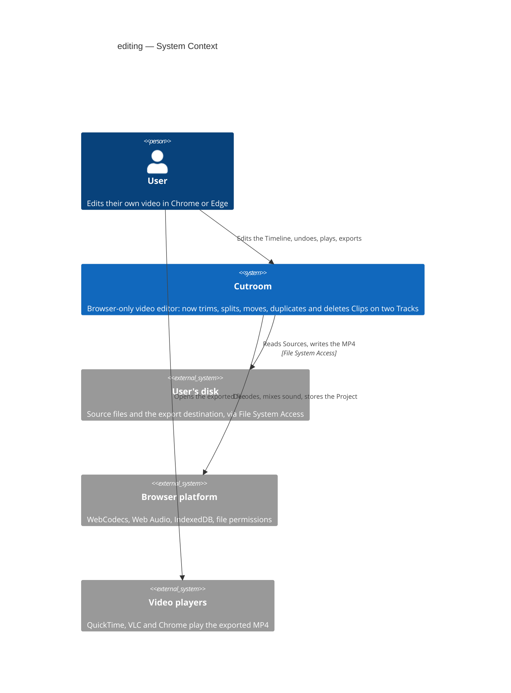

## 4. Solution strategy

**Top strategic choices (the seeds for ADRs):**

1. **Target surfaces: `web-frontend` + `worker` + `library-sdk`, unchanged from step 1.** The
   step extends the three containers that exist and adds none.
   - `web-frontend`: `apps/editor` carries the Timeline interactions, the Selection, the undo and
     redo controls and the mix.
   - `library-sdk`: `packages/model` carries the editing commands and their rules, the contract
     the agent will use later.
   - `worker`: `packages/engine` keeps drawing the Scene back to front and sending each Clip's
     sound. Its work here is to hold the rate across Edit points and with two Tracks.

   The UI architecture is unchanged: a client-side React SPA with one Zustand store and no router.
   Every edit happens on the Editor screen (ux-flows SCR-02). No ADR was spawned for the surfaces,
   because they restate step 1's declaration (ADR 0001, ADR 0003).
2. **Edits are intent commands, and the rules exist once**
   ([ADR 0019](../../adr/0019-edits-are-intent-commands-that-share-their-rules-with-the-preview.md)).
   - **Commands.** Seven new commands in `packages/model`: `trim-clip`, `split-clips`,
     `move-clips`, `delete-clips` (with `ripple`), `duplicate-clips`, `add-track` and
     `remove-track`. Each names its Clips by id, carries a resolved target, and is applied whole
     or refused with a reason.
   - **Rules.** The rules (Trim limits, placement, Duplicate placement, Split targets, Ripple
     shifts) are pure functions in the model. The reducer, the drag preview and the load-time
     check all call them, so the preview cannot promise what the release refuses (AC-07), and the
     agent inherits the same vocabulary.
3. **A drag is a preview, and the Project changes once**
   ([ADR 0020](../../adr/0020-a-drag-is-a-preview-and-the-project-changes-once-on-release.md)).
   - **During the drag.** The drag's state lives beside the Project as runtime state, and a
     pointer move touches neither the Project nor the engine.
   - **On release.** One command runs in one `transact`: one undo step, one save, written at once.
     Escape and a refused release leave nothing behind.
   - **ADR 0011.** Its open-Gesture debounce is retired. Its finished-Gesture rule holds.
   - **Rendering.** The Timeline is DOM, and a pointer move re-renders only the dragged Clips
     ([ADR 0021](../../adr/0021-the-timeline-is-dom-and-a-drag-re-renders-only-the-dragged-clips.md)).
     That keeps a dragged Clip within one display frame of the pointer.
4. **Time stays exact at every Edit point**
   ([ADR 0018](../../adr/0018-the-in-point-stays-in-container-presentation-time.md)).
   - **In-point space.** The In-point stays in container presentation time, as step 1 wrote it, so
     there is no schema change and no migration.
   - **Exact arithmetic.** Head Trim and Split move the In-point only through `frameToSourceTime`,
     by whole Project Frames, so a head Trim by N shows exactly the Frame that was N in.
   - **Source bounds.** The bound is the same ceiling rule the import used:
     `durationFrames ≤ framesForDuration(timebase, Source.duration − inPoint)`.
5. **Two Tracks are one Scene and one mix**
   ([ADR 0022](../../adr/0022-every-clip-is-mixed-through-one-limiter-whose-delay-is-measured.md)).
   - **Picture.** The Scene already lists Clips back to front in Track order, so an upper Track
     covers the lower one with no engine change. A Track added is appended on top, and `tracks[0]`
     stays the bottom Track.
   - **Sound.** Every Clip feeds one master bus with a limiter, in the graph construction that
     Playback and Export share (Principle III). The limiter's delay is measured and compensated so
     sound stays on its picture.

Tactical rules that follow from these and need no ADR:

- **Selection.** It is runtime state in the store: never in the Project, never in history. After
  every undo and redo it is pruned to Clips that exist (AC-15).
- **History.** It keeps 200 entries and drops the oldest. Each entry's label names the Gesture
  ("Trim", "Ripple delete", "Move 3 Clips"), and the controls show it (AC-16).
- **Playback.** Starting any Gesture stops Playback first, on the Frame it reached (AC-31). A drag
  starts when a press on a Clip moves past a few pixels. A plain click only changes the Selection,
  which is not a Gesture (AC-14), so Playback continues. Split, delete, Duplicate, a Track button
  and placing a Source stop Playback at once.
- **Track limit.** At most two video Tracks is a refusal of `add-track`, not a document invariant.
  Schema version 1 already allows any number of Tracks.
- **Export.** An Export keeps the frozen Scene it started with (FR-019, ADR 0015), so edits during
  an Export need nothing new (AC-26).
- **Offline Sources.** An Offline Source's Clips are edited from `Source.duration` as recorded at
  import, and nothing in editing touches a file handle or a permission (AC-25, ADR 0005).

## 5. Building block view

The split stays by dependency direction, not by feature. `model` knows nothing about the browser,
`engine` knows nothing about React, and `apps/editor` knows about everything. This step adds code
inside each package and changes no boundary. The rules go into `model` because both the
interface now and the agent later must obey them. The drag preview, the Selection and the mix go
into `apps/editor` because they are session and platform concerns. There is one C4 container per
declared surface, plus the IndexedDB data store.

**Internal decomposition** (new and changed paths only):

```
packages/model/src/
├── commands/
│   ├── index.ts        # + trim-clip, split-clips, move-clips, delete-clips, duplicate-clips,
│   │                   #   add-track, remove-track; CommandError gains a `reason`
│   └── apply.ts        # + one case per command, each deciding through editing/
├── editing/            # NEW — pure rule functions, exported from the barrel
│   ├── limits.ts       # Trim limits: Source bounds, neighbours, Frame 0, one Frame minimum
│   ├── placement.ts    # can a set of Clips land at a delta / on a Track; Duplicate block placement
│   ├── split.ts        # which Clips a Split at a Frame cuts, given a Selection or none
│   └── ripple.ts       # per-Track shifts after a Ripple delete
└── document/parse.ts   # + Source-bounds and Frame-0 checks on load (the §6.1 abuse cases)

apps/editor/src/
├── store/
│   ├── index.ts        # history capped at 200; undo/redo prune the Selection
│   ├── selection.ts    # NEW — Selection as runtime state: click, modifier-click, all, clear
│   ├── drag.ts         # NEW — the drag preview slice (ADR 0020): open, move, release, cancel
│   └── edit.ts         # NEW — one function per Gesture: stop Playback, mint ids, transact(label, command)
├── storage/projects.ts # − the open-Gesture debounce (ADR 0020)
├── audio/
│   ├── graph.ts        # + master bus and limiter (ADR 0022)
│   └── limiter-delay.ts# NEW — measures the limiter's delay once per sample rate
└── ui/
    ├── timeline/       # NEW — Timeline, TrackRow, TrackHeader (add/remove), ClipView, drag handles
    ├── EditToolbar.tsx # NEW — Split, Duplicate, Ripple delete buttons
    ├── UndoRedo.tsx    # NEW — named undo/redo buttons in the top bar
    └── shortcuts.ts    # NEW — S, ⌘D, Delete/Backspace, ⇧Delete, ⌘Z, ⇧⌘Z, ⌘A, Escape

packages/engine/src/    # no planned change; verified against the two-Track and Edit-point NFRs
```

The interfaces between the blocks stay contracts. `contracts/public-api.md` gains the seven
commands, the refusal reasons and the rule functions (the `library-sdk` surface). The worker
protocol (`contracts/events.md`) does not change, because a Scene with Clips on two Tracks is
already a valid Scene.

**C4 Container (L2):**

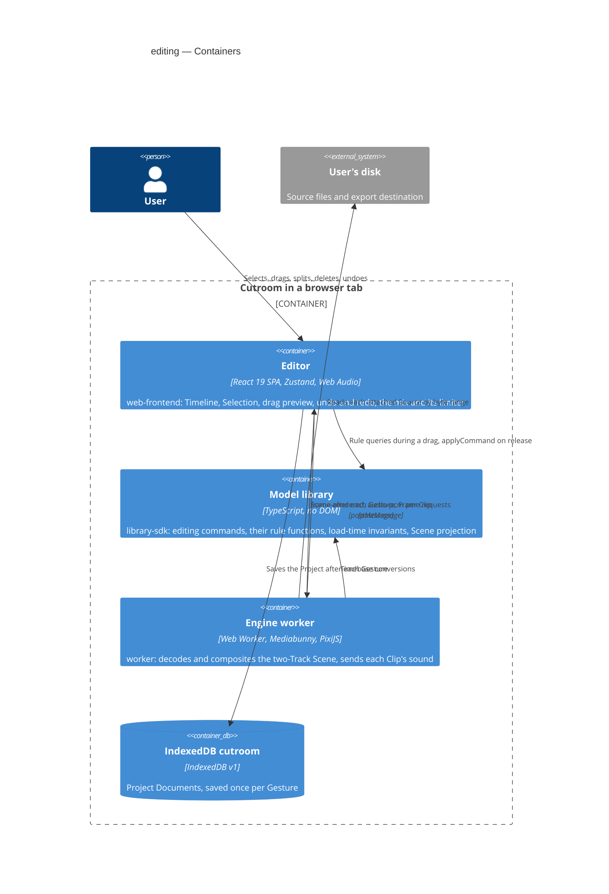

## 6. Runtime view

The participants use SDD's generic vocabulary, mapped to the §5 containers as in step 1:

| Participant | §5 container |
|---|---|
| `user` | the User |
| `ui` | the Editor container (Timeline, store with the drag slice and the Selection, Web Audio graph and limiter) |
| `service` | the Engine worker |
| `data-store` | IndexedDB `cutroom` |
| `external-system` | the User's disk (the Export's destination file) |

The Model library is called inside `ui` and is not drawn: "ask the model" is a call to a rule
function and "apply" is a call to `applyCommand` (ADR 0019). Messages are semantic. Every editing
flow writes the same record, the Project Document, once per Gesture, so the persist notes say
which parts of it change.

### Flow 1 — Trim a Clip from either end (US-01)

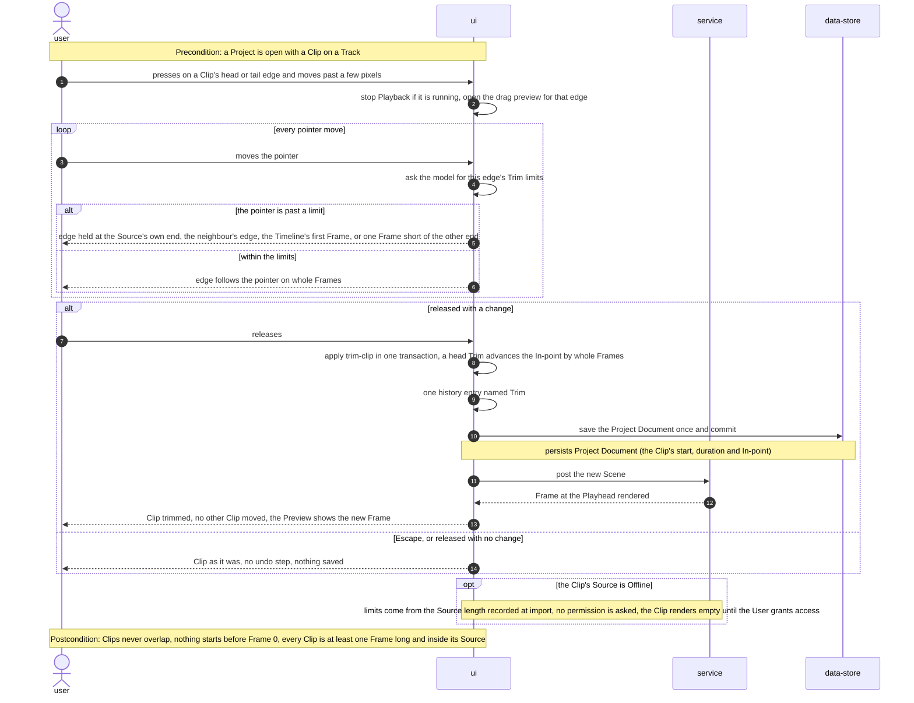

### Flow 2 — Split at the Playhead (US-02)

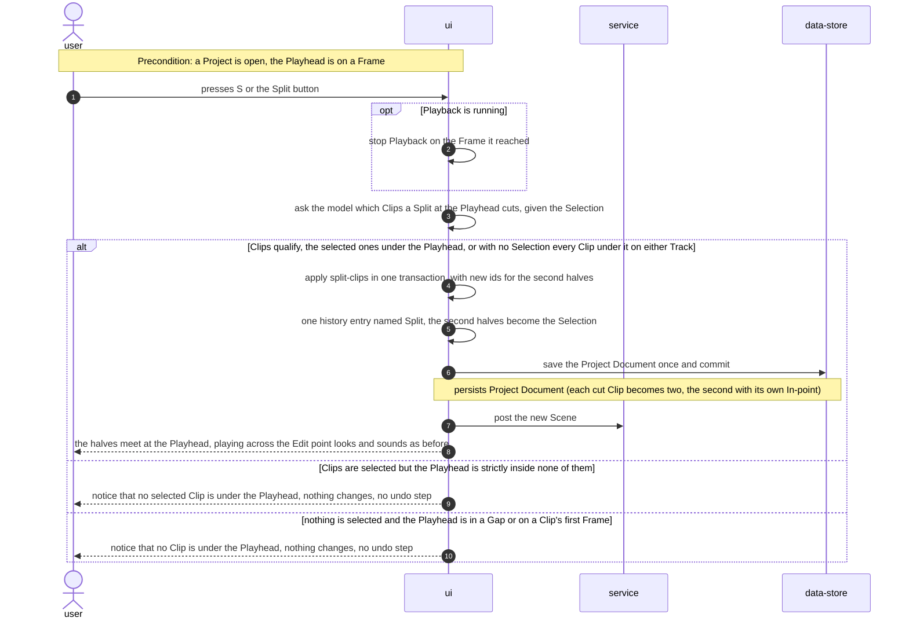

### Flow 3 — Move and reorder Clips (US-03)

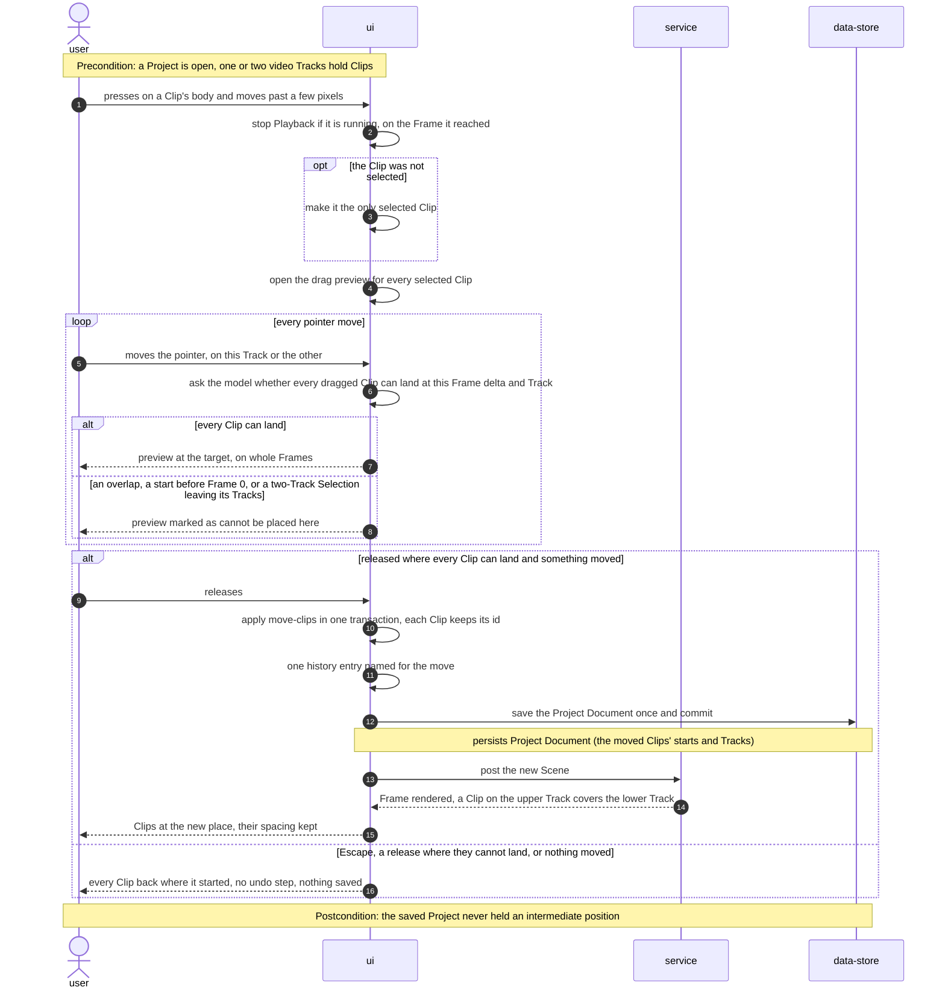

### Flow 4 — Delete Clips, leaving the Gap or closing it (US-04)

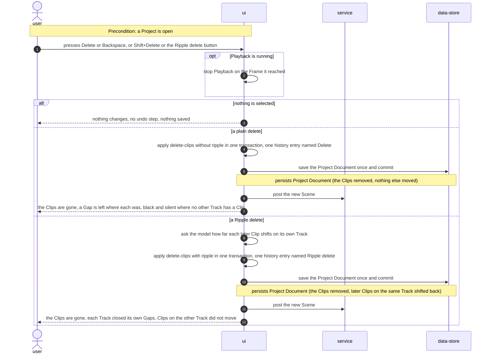

### Flow 5 — Duplicate Clips (US-05)

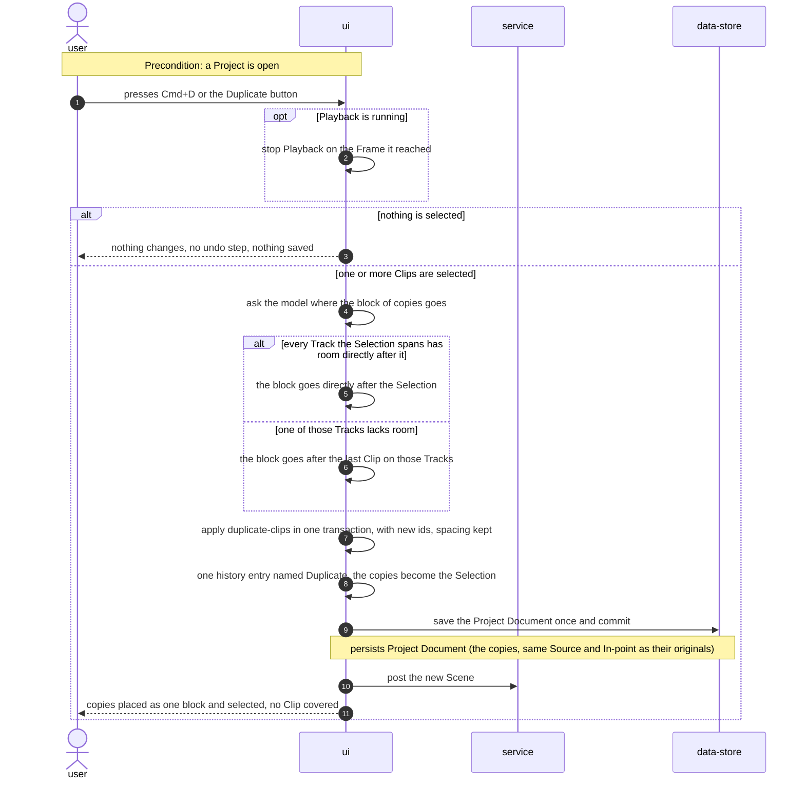

### Flow 6 — Select the Clips an edit acts on (US-06)

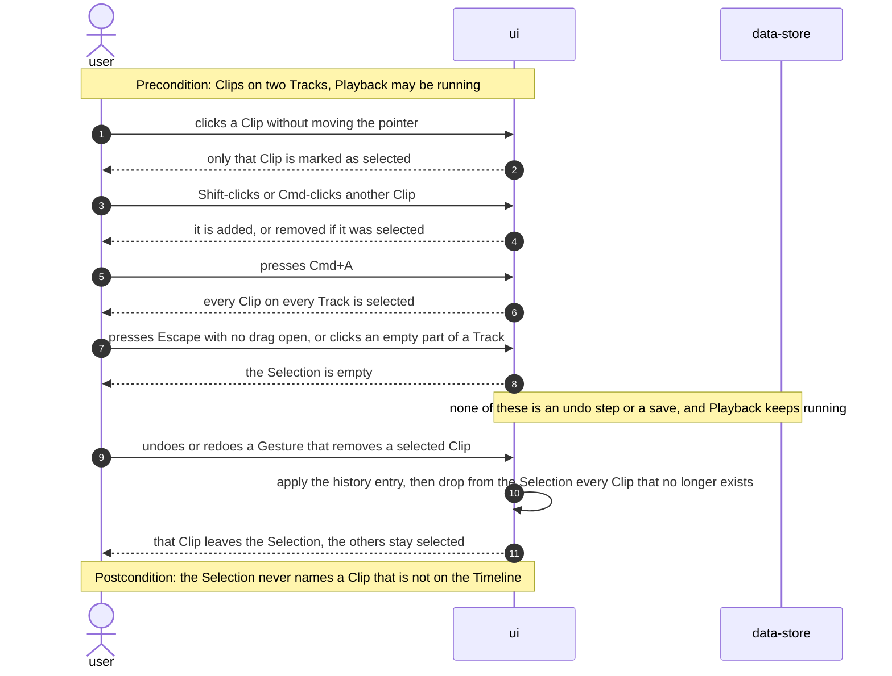

### Flow 7 — Undo, redo and reload (US-07)

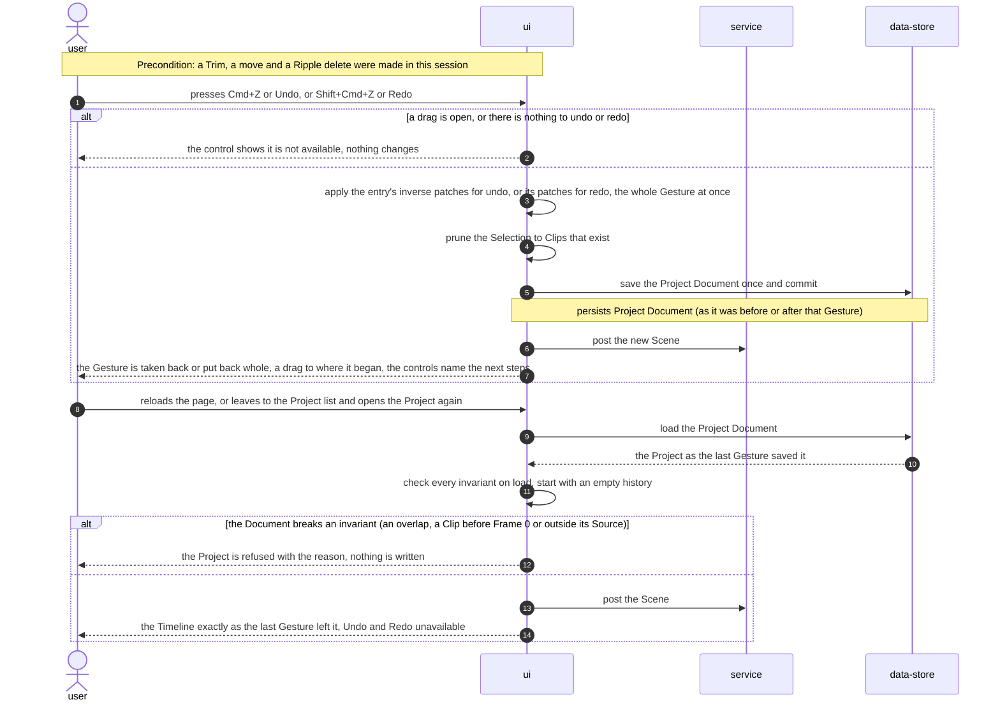

### Flow 8 — Add and remove a video Track (US-08)

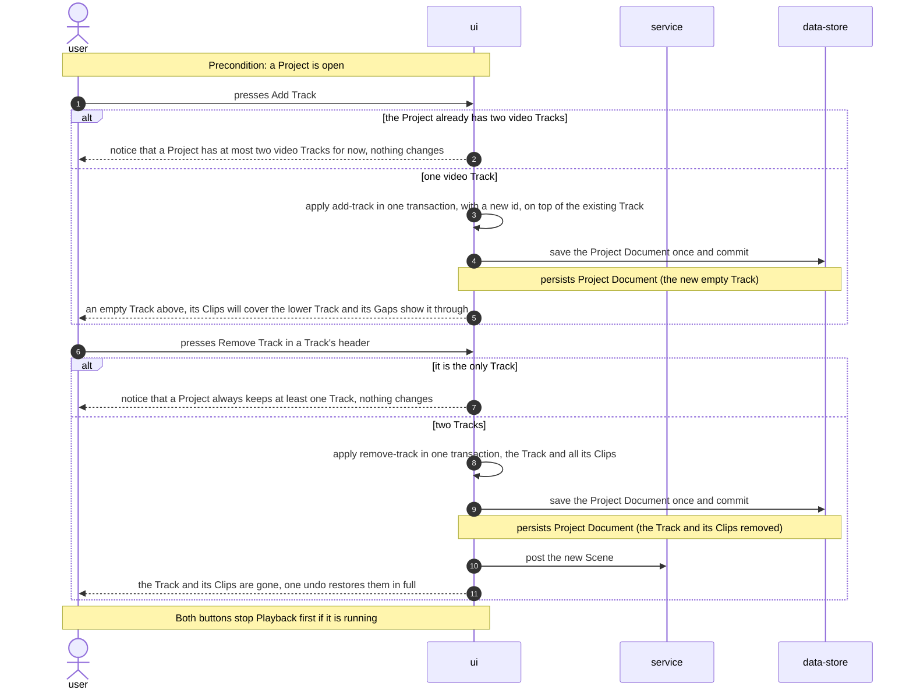

### Flow 9 — Hear every Clip's sound (US-09)

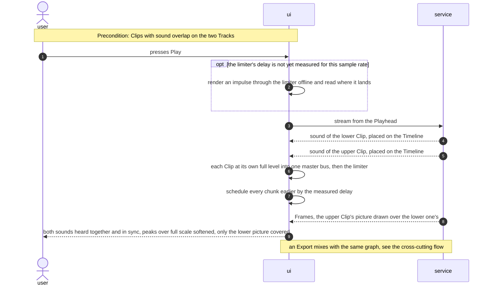

### Flow 10 — Place a Source on the Timeline again (US-10)

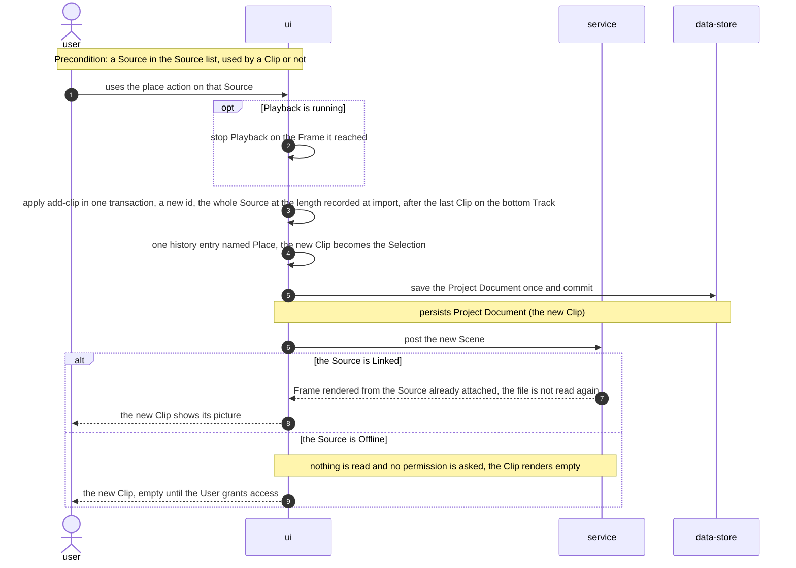

### Cross-cutting: Export while editing (AC-26, AC-27)

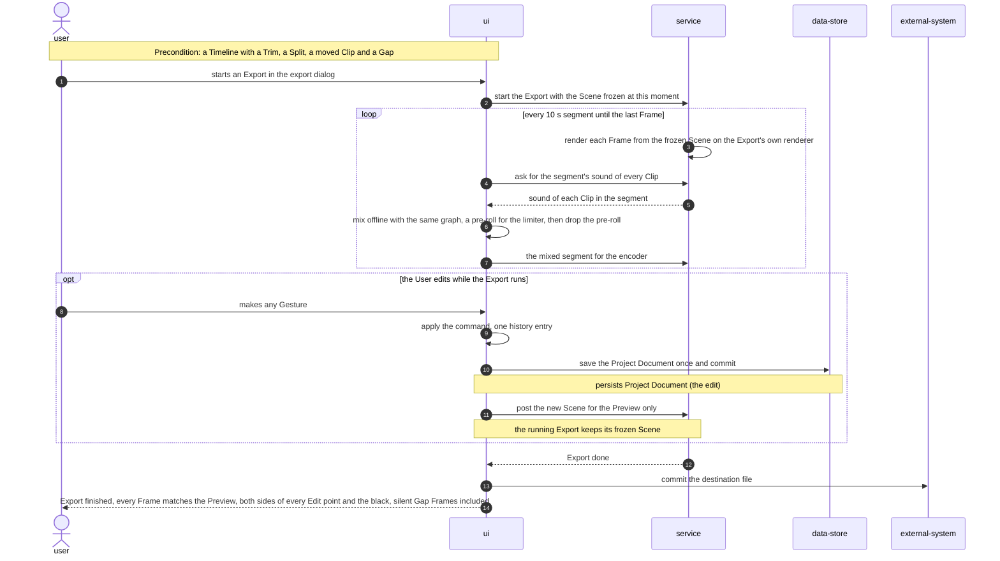

**Use-case and AC coverage.**

| Spec item | Shown in |
|---|---|
| US-01 | Flow 1 |
| US-02 | Flow 2 (export of the result: cross-cutting flow) |
| US-03 | Flow 3 |
| US-04 | Flow 4 (editing during an Export: cross-cutting flow) |
| US-05 | Flow 5 |
| US-06 | Flow 6 |
| US-07 | Flow 7 |
| US-08 | Flow 8 |
| US-09 | Flow 9 and the cross-cutting flow |
| US-10 | Flow 10 |
| AC-01 | Flow 1, released with a change |
| AC-02, AC-03 | Flow 1, the limits branch, and its postcondition |
| AC-04, AC-29 | Flow 2, the Clips-qualify branch |
| AC-05 | Flow 2, the two notice branches |
| AC-06, AC-08, AC-09 | Flow 3, the release branch (upper Track covers lower; the unselected-Clip and two-Track rules) |
| AC-07 | Flow 3, the cannot-be-placed branch and the refused release |
| AC-10 | Flow 4, plain delete |
| AC-11 | Flow 4, Ripple delete |
| AC-12, AC-13 | Flow 5, the two placement branches |
| AC-14 | Flow 6, the Selection steps and their note |
| AC-15 | Flow 6, the prune after undo or redo; Flow 7 |
| AC-16 | Flow 7, the apply branch |
| AC-17 | Flow 3 postcondition and Flow 7 (a drag undoes to where it began) |
| AC-18 | Flow 7, the unavailable branch |
| AC-19 | Flow 3, Escape; Flow 1, Escape |
| AC-20, AC-30 | Flow 8, Add Track |
| AC-21, AC-22 | Flow 8, Remove Track |
| AC-23 | Flow 9 and the cross-cutting flow's mix |
| AC-24 | Flow 10 |
| AC-25 | Flow 1, the Offline note; Flow 10, the Offline branch. The same rule holds for Split, move, Duplicate and delete, which read nothing from the file |
| AC-26, AC-27 | Cross-cutting flow |
| AC-28 | Flow 7, reload |
| AC-31 | Flows 1–5, 8 and 10: every Gesture stops Playback first; Flow 6: a plain click does not |
| AC-32 | Flow 1, released with no change; Flow 3, nothing moved; Flows 4 and 5, nothing selected |

Flagged for design: none. Every participant is a §5 container, and the Model library is drawn
inside `ui` as in step 1. No flow is asynchronous: there is no webhook, queue or callback, so no
idempotency key or dead-letter branch applies. Flow 7's load-refusal branch is spec §6.1's abuse
case, not an AC.

## 7. Deployment view

Unchanged. Cutroom is a static Vite build served to one browser tab, and everything runs on the
User's machine (ADR 0001). This step adds no host, no service and no infrastructure. The Project
Document keeps schema version 1 and IndexedDB keeps version 1, so a deploy needs no migration.

**Monitoring.** There is no telemetry: nothing leaves the User's machine (spec §7). The signals
are local and read by tests:

- the engine's Skipped Frame counter (ADR 0013), read across Edit points and with two Tracks;
- the audio underrun count over 60 s of two-Track Playback;
- Playwright traces of a scripted drag (main-thread long tasks, time per pointer move) and timings
  from release to the Preview's new Frame;
- the `export-fidelity` test over an edited fixture, sampling both sides of every Edit point.

**Scaling thresholds:**

- The heavy Project (two video Tracks, 100 Clips) is the design point for the drag and undo
  budgets. Well beyond it, toward thousands of Clips, the Timeline would need virtualization
  (ADR 0021, accepted debt in §11).
- Undo history is capped at 200 entries. Each entry holds only patches, so its memory grows with
  what the Gesture changed, not with the Project.
- Two video Tracks is a product limit refused by `add-track`. The renderer and the mix already
  handle any number of Tracks, so lifting the limit is a change to one rule.

## 8. Crosscutting concepts

The repo's conventions stand unchanged (architecture map §Conventions). The rows marked *new* are
what this step adds on top.

| Concept | Convention | Where defined |
|---|---|---|
| State and change | Every Project change is a command through `applyCommand` inside `transact`. One Gesture is one command, one history entry and one save | ADR 0004, ADR 0011, ADR 0019 |
| Drag preview (*new*) | Runtime state beside the Project. Never saved, never in history, never posted to the engine. Undo and redo are unavailable while one is open | ADR 0020, `store/drag.ts` |
| Selection (*new*) | Runtime state. Never saved and never undone. Pruned to existing Clips after every undo and redo. Commands never read it: they receive ids | CONTEXT "Selection", ADR 0019 |
| Error handling | The model refuses before it writes with `CommandError`, which now carries a `reason`. The editor maps each reason to a plain statement shown with `Notice` (AC-05, AC-22, AC-30) | `commands/apply.ts`, `ui/failure-wording.ts`, ADR 0019 |
| ID strategy | The reducer mints no ids. The editor mints the ids of a Split's second halves, copies and new Tracks with the injected `newId` (`crypto.randomUUID()`). A moved Clip keeps its id | `commands/index.ts`, architecture map §IDs |
| Time | Timeline positions are integer Frames. The In-point changes only through `frameToSourceTime`. No editing code converts time outside `timebase.ts` | ADR 0002, ADR 0018 |
| Invariants | No overlap on a Track, nothing before Frame 0, no Clip shorter than one Frame or outside its Source. Checked by every command and on every load | ADR 0019, `document/parse.ts` |
| Undo naming (*new*) | Each history entry's label names the Gesture in the interface's words ("Trim", "Split", "Move 2 Clips", "Ripple delete", "Add Track") | `store/edit.ts` |
| Keyboard (*new*) | One shortcut handler on the Editor, ignored while focus is in a text field. The bindings are the ux-flows platform list | ux-flows §Platform decisions, `ui/shortcuts.ts` |
| Playback and Gestures (*new*) | Every Gesture entry point stops Playback first, on the Frame reached. A drag starts once a press moves past a few pixels, and a plain click only selects | AC-14, AC-31, `store/edit.ts` |
| Logging / observability | No logging service. The engine's counters and Playwright traces are the observability (§7) | ADR 0013 |
| Internationalisation | N/A: English interface, as in step 1 | — |
| Authentication | N/A: no accounts. Editing never asks for file permission | spec §6.1, ADR 0005 |

## 9. Architecture decisions

| # | Title | Status | Section |
|---|---|---|---|
| 0018 | The In-point stays in container presentation time | Accepted | §4 |
| 0019 | Edits are intent commands that share their rules with the preview | Accepted | §4 |
| 0020 | A drag is a preview, and the Project changes once on release | Accepted | §4 |
| 0021 | The Timeline is DOM, and a drag re-renders only the dragged Clips | Accepted | §4 |
| 0022 | Every Clip is mixed through one limiter, and its delay is measured | Accepted | §4 |

ADR files live in `docs/adr/` with the repository's shared numbering. This feature's
`docs/features/editing/adr/` holds symlinks to them, as `import-play-export/adr/` does.

Inherited decisions this step builds on, not re-decided: ADR 0002 (integer Frames; narrowed by
0018), ADR 0004 (one reducer, inverse-patch undo), ADR 0005 (Sources addressed, never copied),
ADR 0008 (audio on the main thread), ADR 0011 (saves follow the Gesture; amended by 0020),
ADR 0012 (Timeline-positioned sound), ADR 0013 (Skipped Frame counter), ADR 0015 (an Export has
its own renderer and a frozen Scene) and ADR 0017 (scrub decoder reuse, long-GOP proxy later).

## 10. Quality requirements

Each top-3 goal from §1 expanded into scenarios. Targets are quoted from spec §6 and hold on the
reference machine (MacBook Air M4, Chrome). "Heavy Project" means two video Tracks holding 100
Clips in total, taken from 1080p 30 fps Sources.

**QG-1. Frame accuracy**

- *1a — edits land on the exact Frame.*
  - **When:** a head Trim by N Frames, a Split, or a move, over random Timebases and Source
    Timebases.
  - **Then:** "Zero one-Frame errors: a head Trim by N Frames, a Split and a move each land on
    exactly the expected Source Frame in 100% of model test cases."
  - **How verify:** model property tests (Vitest) over random Timebases, Source Timebases,
    In-points and offsets. They assert `frameToSourceTime` equality before and after each command,
    and that every result passes `parseProject`.
- *1b — the Export matches the Preview at every Edit point.*
  - **When:** an edited Timeline (a Trim, a Split, a moved Clip and a Gap) is exported.
  - **Then:** "Every sampled Frame of the export matches the Preview, and the Frames on either side
    of each Edit point are always sampled (extends SC-007)."
  - **How verify:** the `export-fidelity` test over an edited fixture. The sample set always
    includes `edit − 1` and `edit` for every Edit point and one Frame inside each Gap (black,
    silent).

**QG-2. Every edit is safe**

- *2a — undo depth and speed.*
  - **When:** a session makes more than 200 Gestures on a heavy Project, then undoes or redoes.
  - **Then:** "The last 200 undo steps are kept in a session (the oldest is dropped beyond that),
    and undo or redo of any single step completes within 100 ms p95 on a heavy Project."
  - **How verify:** a store unit test for the cap and the drop order, and Playwright timing from
    the ⌘Z key press to the settled Timeline on the heavy fixture Project.
- *2b — a drag is one step and is never saved half-done.*
  - **When:** a drag passes through many positions and is released, then undone, and the page is
    reloaded in the middle of a second drag.
  - **Then:** one undo returns the Clip to where the drag began. The saved Project held only the
    end position and never an intermediate one. After the reload, the Project is as it was before
    the second drag (AC-17, AC-19, AC-28).
  - **How verify:** an e2e test that reads the IndexedDB record during and after the drag and
    really reloads the page, in the way ADR 0011's tests unload it.

**QG-3. Editing and Playback stay responsive on a heavy Project**

- *3a — drag feedback.*
  - **When:** a move or Trim drag on a heavy Project.
  - **Then:** "the Clip follows the pointer within one display frame (≤ 16.7 ms p95 per pointer
    move)".
  - **How verify:** a Playwright trace of a scripted drag, measuring main-thread long tasks and the
    time per pointer move during the drag.
- *3b — Preview after an edit.*
  - **When:** any Gesture ends.
  - **Then:** "the Preview shows the edited Frame at the Playhead within 300 ms p95".
  - **How verify:** Playwright timing from release to the Preview's new Frame, on the generated
    1080p fixtures, which have a keyframe every two seconds (`scripts/make-fixtures.ts`), as
    ordinary footage has. Long-GOP 1080p (a keyframe every 300 Frames) is measured and recorded
    but does not gate merge. Its backward jumps already take 301–313 ms (ADR 0017). This closes
    spec §8's SC-003 item for this feature, and the long-GOP gap is a §11 risk.
- *3c — Playback across Edit points.*
  - **When:** Playing a Timeline with an Edit point every 2 s for 2 minutes.
  - **Then:** it "keeps picture and sound within one Frame (SC-002's bar) and skips no more than
    1% of Frames at the Edit points".
  - **How verify:** the engine's Skipped Frame counter (ADR 0013) and the A/V sync fixture adapted
    to Edit points, with the limiter in the graph. A level fixture checks that a single Clip
    comes out at the level it had in step 1 (spec §1, ADR 0022).
- *3d — two Tracks at full rate.*
  - **When:** two overlapping 1080p 30 fps Clips, one per Track, play.
  - **Then:** they "play at full rate, skipping no more than 1% of Frames, with no audio
    interruption".
  - **How verify:** the Skipped Frame counter and the audio underrun count over 60 s.

## 11. Risks and technical debt

| Risk / debt | Severity | Mitigation | Owner |
|---|---|---|---|
| Playback may skip more than 1% at Edit points. A Split leaves two Clips of one Source back to back, and the second Clip's stream opens only when it is reached | High | Measure first (QG-3c). If it misses, pre-open the next Clip's stream ahead of its Edit point in `playback/stream.ts`, reusing ADR 0017's walk rule. This would be the step's only engine change | Tech Lead |
| Two 1080p decoders at once may not hold full rate on the reference machine (QG-3d) | Medium | Measure early in implement. ADR 0015 already runs a second set of decoders during an Export, so the cost is known. If it misses, stop and decide before building on it | Tech Lead |
| The limiter's delay compensation relies on unspecified platform behaviour (ADR 0022) | Medium | Measure the delay with an impulse instead of hard-coding it. The A/V sync fixture runs with the limiter in the graph, so a change in Chrome fails a test, not a User | Tech Lead |
| The limiter has state, and the export mix renders in fresh 10 s segments | Medium | A pre-roll per segment, longer than the limiter's release (ADR 0022). Add a test that exports a loud two-Track stretch across a seam and compares it with one continuous render | Tech Lead |
| The new Source-bounds check on load could refuse a step-1 Project if its rule differs from the import's rounding | Medium | The check uses `framesForDuration`, the same ceiling the import used (ADR 0018). Add a test that loads Projects saved by step-1 fixtures | Tech Lead |
| Preview after an edit misses 300 ms p95 on long-GOP 1080p for backward jumps (SC-003 carried) | Medium | Accepted for this step (§10 QG-3b). The fix is ADR 0017's keyframe preview, a later roadmap item | Repo owner |
| The drag budget depends on subscription discipline (ADR 0021): one Clip element subscribing to the whole Project re-renders every Clip | Medium | The Playwright drag-trace test (QG-3a) on the heavy fixture Project runs in the e2e suite | Tech Lead |
| The flaky `engine-worker.spec.ts` check keeps `pnpm test:e2e` from being reliably green (carried from step 1) | High | Diagnose before `/sdd:implement`, as spec §8 sets. This feature's gate depends on the e2e suite | Tech Lead |
| D1: exported files not yet checked in VLC and QuickTime Player (SC-006, carried) | Low | Check once on an edited export at the `/sdd:ship` walk (spec §8) | Repo owner |
| A single Clip now passes through the limiter. Spec §1's "sounds exactly as it did in step 1" holds at the level and timing the fixtures measure, not bit for bit (ADR 0022) | Low | The level fixture and the A/V sync fixture in §10 QG-3c | Tech Lead |
| Open architectural decision: should a head Trim stop at a Source's first picture rather than at container time 0? For files whose first picture has a presentation time above zero, the ADR 0018 bound lets a head Trim reach slightly before it, an exception to AC-02 ("a Clip can show only what its Source holds"). Stopping at the first picture needs that time recorded at import (a new Source field, schema v2) | Open question | Resolve before `/sdd:tasks`; either amend AC-02 to define the Source's beginning as container time 0, or record the first picture time at import | Repo owner |
| The Kino reference lets Clips overlap, and its Timeline code is the behavioural reference | Low | The document wins (spec §1). Every overlap path is refused through ADR 0019's rules, and AC-07 is tested during the drag | Tech Lead |

**Accepted debt (acceptable in v1, plan to fix later):**

- No live Trim picture in the Preview while dragging. The Preview updates after release (ADR 0020).
- No Timeline virtualization. It is enough for the heavy Project, not for thousands of Clips
  (ADR 0021).
- The two-Track limit is a product rule in `add-track`, lifted in roadmap step 6 or 7 without a
  migration.
- Undo history is not kept across sessions (AC-28, by design).

## 12. Glossary

Terms from the repo-root [CONTEXT.md](../../../CONTEXT.md) used in this document. CONTEXT.md is
canonical; this table only restates them.

| Term | Meaning |
|---|---|
| Clip | A placement of part of a Source onto a Track: where it starts, how long it lasts, which region of the Source it shows |
| Track | One horizontal lane of the Timeline holding non-overlapping Clips; the upper Track covers the lower one |
| Gap | A stretch of a Track where no Clip is. Where every Track has a Gap, the Frame renders black and silent |
| In-point | Where in its Source a Clip begins, as a time in the Source (container presentation time, ADR 0018) |
| Trim | Moving one end of a Clip so it shows more or less of its Source. It never moves a neighbouring Clip |
| Split | Cutting one Clip into two at a Frame, the pair showing exactly what the one did |
| Ripple delete | Removing Clips and closing the Gap they leave on the same Track |
| Edit point | The boundary on a Track where one Clip ends and the next begins |
| Selection | The Clips the next edit acts on. Session state: never saved, never undone |
| Gesture | One thing the User did. One undo step and one save |
| Scene | What the Timeline looks like at render time, projected from the Project and sent to the engine |
| Playhead | The Frame currently shown in the Preview |
| Offline Source | A Source whose bytes are unreachable right now; its Clips stay editable |

Terms this document uses that are not in CONTEXT.md:

| Term | Meaning |
|---|---|
| Drag preview | The runtime state of an open drag: which Clips, the target, and whether they can land. Never saved (ADR 0020) |
| Rule function | A pure model function that decides one editing rule, shared by the reducer, the drag preview and the load check (ADR 0019) |
| Master bus | The single point in the audio graph every Clip's sound is summed into before the limiter (ADR 0022) |
| Refusal reason | The machine-readable code on a `CommandError` (`overlap`, `source-bounds`, …) that the interface turns into a notice |
