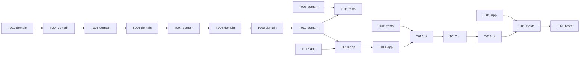

# Epic — editing

> **Spec:** [spec.md](../spec.md) · **Design:** [sad.md](../sad.md) · **Data model:** [data-model.md](../data-model.md) · **API:** [public-api.md](../contracts/public-api.md) · **Screens:** [screens.md](../screens.md) · **ADRs:** [adr/](../adr/)

## Goal

A User turns several imported files into the Timeline they want: trim, split, move, duplicate and
delete Clips on up to two video Tracks, undo and redo every Gesture, and export the result without
a single Frame of error at any Edit point (spec §2). The editing commands built here are also the
ones the agent will issue in roadmap steps 10–11.

## Scope

- **In:** `packages/model` (editing rules, seven commands, `placeSourceCommand`, `wholeFramesIn`,
  two load checks); `apps/editor` (Selection, drag preview, Gesture functions, master-bus limiter,
  the Timeline rebuilt under `ui/timeline/`, toolbar, named Undo and Redo, shortcuts, Place);
  e2e and property tests; the step-1 flaky e2e check, first.
- **Out:** snapping, marquee, nudge, zoom and pan (step 12); drag from a library (step 14);
  transform, opacity, Track lock and hide (step 6); audio-only Tracks, volume, fades (step 7);
  Ripple Trim, roll, slip, slide; overlapping Clips on a Track (spec §3). `packages/engine` has no
  planned change unless T020 measures a miss (sad §11).

## Task map

Parallel branches: T001 (the flaky check), T002 → model chain, T003 (load checks), T012 (store
history and Selection) and T015 (limiter) all start in wave 1. The model tasks T004–T010 share
`commands/apply.ts` and `commands/index.ts`, so they run as one serialized lane.

## Tasks

See [tracker.md](./tracker.md) for status. Machine contract: [tasks.json](../tasks.json).

| # | Task | Layer | Blocked by | DoD (short) |
|---|---|---|---|---|
| T001 | Diagnose and fix the flaky engine-worker e2e check before any feature work | tests | — | engine-worker.spec.ts passes 50 consecutive repeat runs (or a documented quarantine decision with evidence exi… |
| T002 | Give CommandError a machine-readable refusal reason across every existing refusal | domain | — | every CommandError thrown by apply.ts and import.ts carries a tested RefusalReason, and RefusalReason + MAX_VI… |
| T003 | Refuse Clips outside their Source and a Timeline with no Track when a Project loads | domain | — | parseProject refuses a Clip outside its Source and a zero-Track Timeline, and the step-1 fixture Projects stil… |
| T004 | Add wholeFramesIn, the trimRange rule and the trim-clip command | domain | T002 | wholeFramesIn, trimRange and trim-clip are exported and unit-tested for AC-01..AC-03 and AC-25, and every trim… |
| T005 | Add the splitTargets rule and the split-clips command | domain | T004 | splitTargets and split-clips are exported and unit-tested for AC-04, AC-05 and AC-29 with exact second-half In… |
| T006 | Add the checkMove placement rule and the move-clips command | domain | T005 | checkMove and move-clips are exported and unit-tested for AC-06..AC-09, all-or-none, ids kept |
| T007 | Add the rippleShifts rule and the delete-clips command, plain and ripple | domain | T006 | rippleShifts and delete-clips (plain and ripple) are exported and unit-tested for AC-10 and AC-11, inverse pat… |
| T008 | Add the duplicateDelta rule and the duplicate-clips command | domain | T007 | duplicateDelta and duplicate-clips are exported and unit-tested for AC-12 and AC-13, copies never overlap a Cl… |
| T009 | Add the add-track and remove-track commands with the two-Track limit | domain | T008 | add-track and remove-track are unit-tested for AC-20, AC-21, AC-22 and AC-30 with track-limit and last-track r… |
| T010 | Add placeSourceCommand and make importCommands reuse it | domain | T009 | placeSourceCommand is exported, importCommands uses it, add-clip refuses source-bounds, AC-24 unit-tested |
| T011 | Pin Frame accuracy and rule-command pairing with model property tests | tests | T010, T003 | model property tests prove Frame-exact head Trim, Split and move, rule/command pairing, and empty patches for … |
| T012 | Cap history at 200 named steps and add the Selection, pruned after undo and redo | app | — | store keeps at most 200 labelled history entries, exposes next undo/redo labels, and has a Selection slice pru… |
| T013 | Add the drag-preview slice and retire the open-Gesture save debounce | app | T012, T010 | drag slice previews trims and moves through trimRange/checkMove, commits once on release, cancels on Escape, b… |
| T014 | Write one store function per Gesture, stopping Playback first, with refusal wording | app | T013 | store/edit.ts exposes split, delete, ripple delete, duplicate, add/remove Track and place Source, each stoppin… |
| T015 | Mix every Clip through one limiter with its measured delay, in Playback and Export | app | — | every Clip feeds one limiter whose measured delay is compensated in Playback and Export, export segments use a… |
| T016 | Rebuild the Timeline as Track rows of selectable Clip views with Track headers | ui | T014, T001 | the Timeline renders Track rows of selectable ClipViews with Track headers (add/remove, refusal notice), per-C… |
| T017 | Drive Trim and move drags from Clip handles and bodies through the drag slice | ui | T016 | Trim and move drags work through handles and bodies with live refusal marks and Escape cancel; e2e editing-dra… |
| T018 | Add the edit toolbar, named Undo and Redo, keyboard shortcuts and the Place action | ui | T017 | EditToolbar, named UndoRedo, shortcuts.ts and the Place button drive the Gesture functions; e2e editing-comman… |
| T019 | Prove the edited Export matches the Preview at every Edit point, with both sounds mixed | tests | T018, T015 | e2e proves the edited Export matches the Preview on both sides of every Edit point and in Gaps (SC-007 extende… |
| T020 | Measure the drag, Preview, undo and two-Track playback budgets on a heavy Project | tests | T019 | e2e measures drag p95 ≤16.7 ms, Preview after edit p95 ≤300 ms, undo p95 ≤100 ms, ≤1% skipped Frames at Edit p… |

## Risks / Hard rules

- Never weaken a spec §6 target to pass: a miss in T020 stops for a decision (sad §11).
- No editing code converts time outside `timebase.ts` (ADR 0002, ADR 0018).
- The reducer mints no ids and reads no clock; commands never read the Selection (ADR 0019).
- Nothing is saved while a drag is open; one Gesture is one history entry and one save (ADR 0020).
- Clip elements subscribe only to their own Clip and drag state (ADR 0021).
- Editing never touches a file handle or a permission (AC-25, ADR 0005).
- `pnpm test:e2e` must be trustworthy before feature work: T001 first (spec §8).
- D1 / SC-006 (VLC and QuickTime) needs the owner at the reference machine; it stays open at ship.
