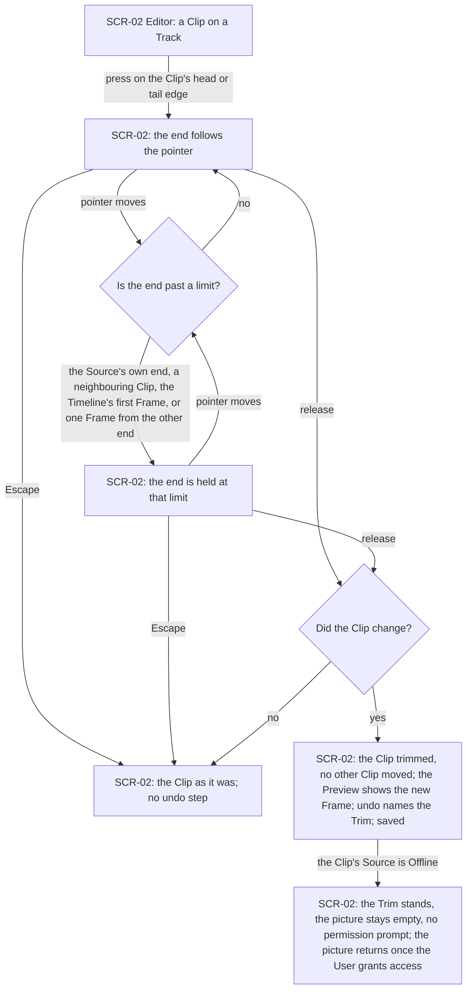
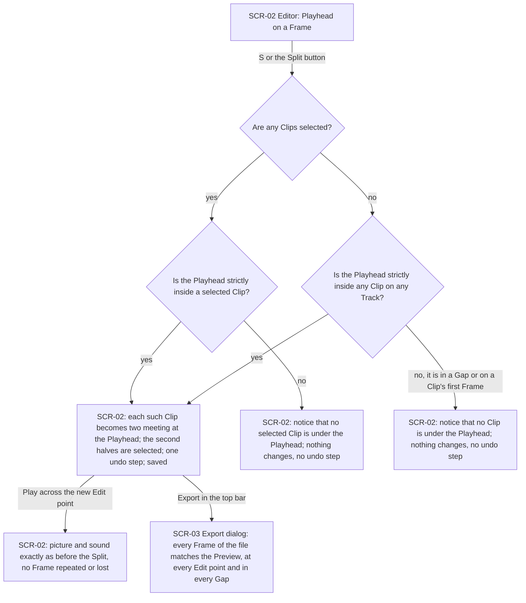
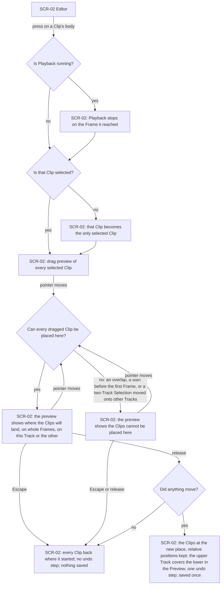
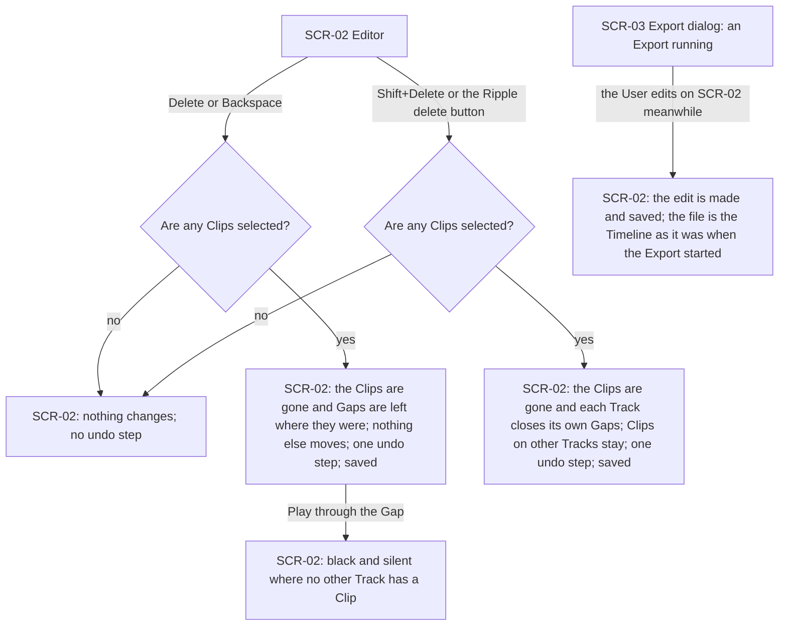
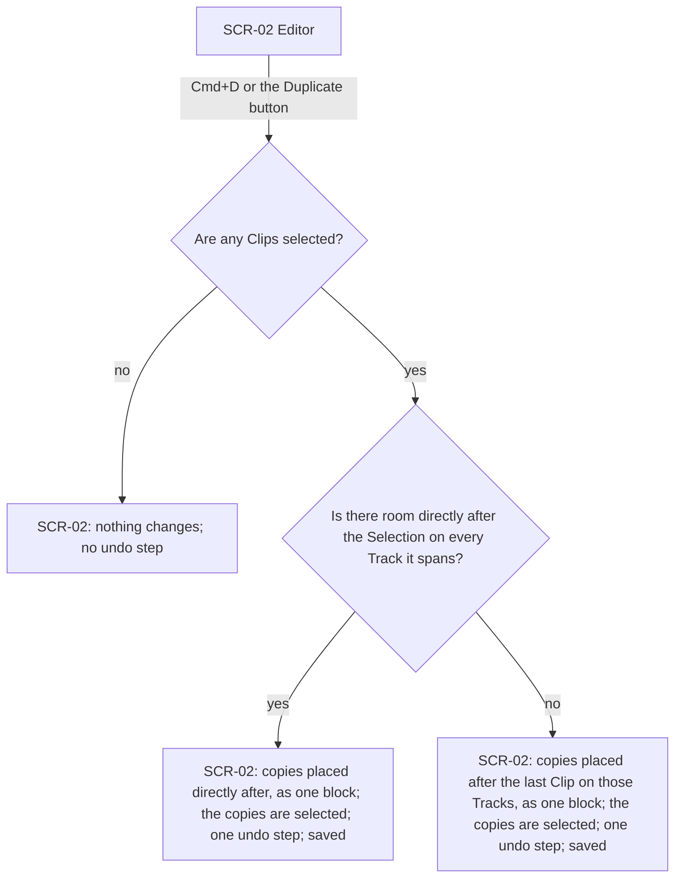
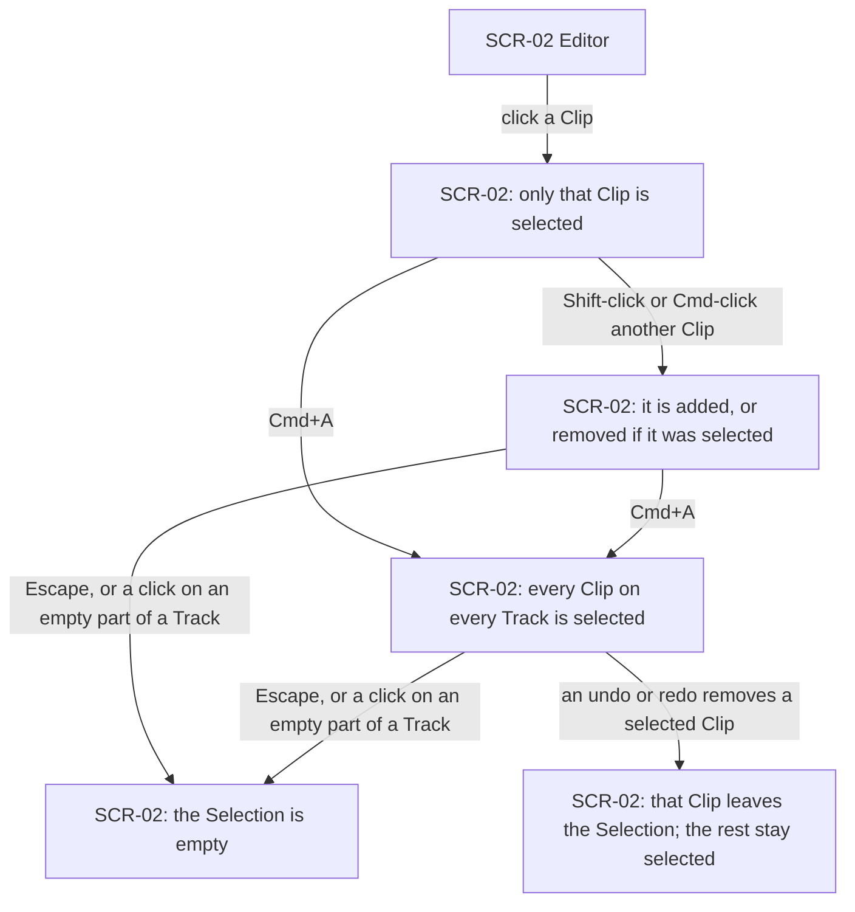
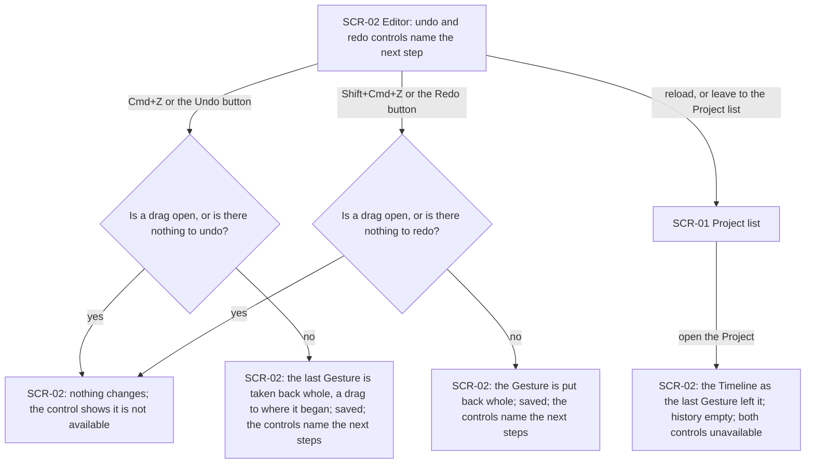
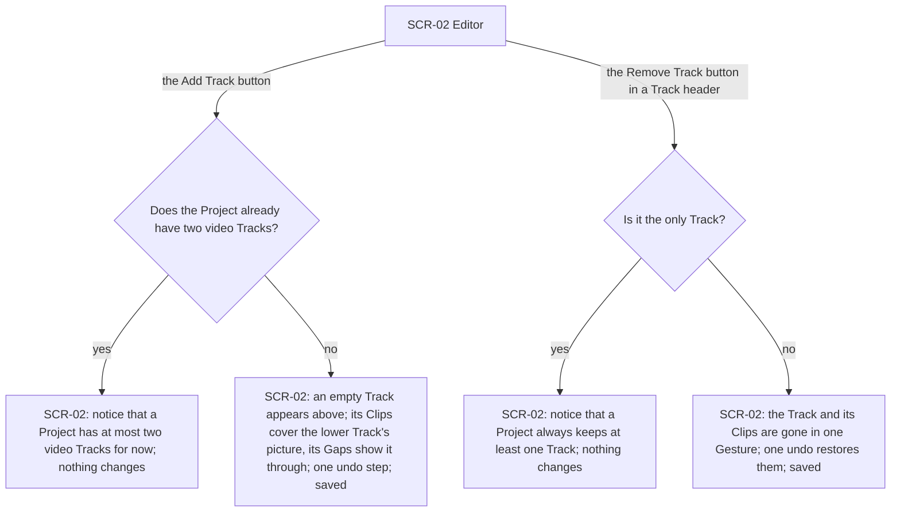
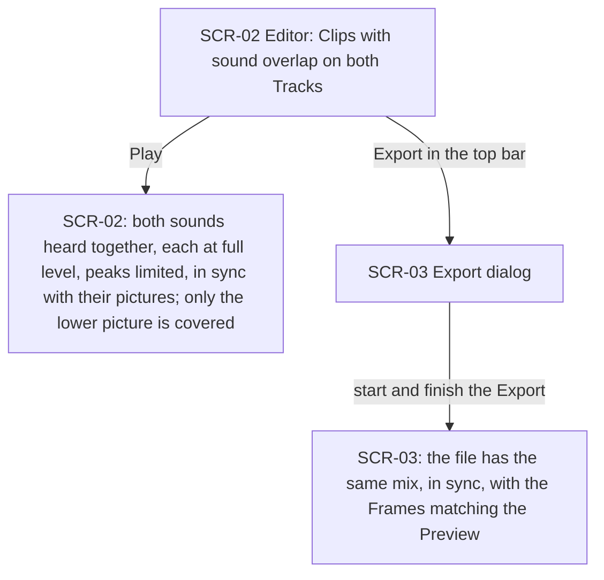
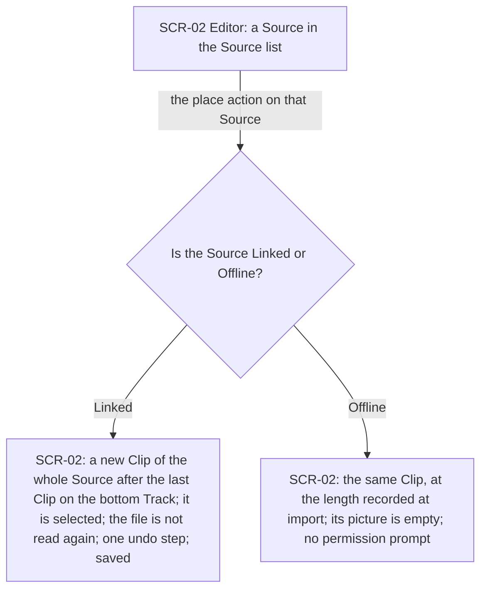

# UX flows — editing

> User flows for every UI-touching §4 user story of [spec.md](./spec.md), produced by `ux-flows`
> (after `clarify`, before `design`) and read by `design` (evidence for the target-surface and
> UI-architecture decisions), `sequences` (UI-driven flows align on SCR ids), `screens` (details
> every inventory row) and `plan-tests` (the e2e-through-UI paths). Markdown and mermaid
> `flowchart` only: this is the movement between screens, not their content.

## Platform decisions

- **Posture:** desktop-first — Chrome on a laptop or desktop, with a pointer and a keyboard, as
  in step 1 and on the §6 reference machine. There is no `docs/design-system.md` yet, so this was
  chosen here (owner, 2026-10-23); touch and small screens are not drawn.
- **One screen for every edit.** Every edit happens on the Editor (SCR-02), directly on the
  Timeline. No edit opens a dialog or a new screen. A refused edit is told to the User as a
  notice on the Editor, and nothing changes.
- **Triggers, from the Kino reference where it has them** (spec A20 for the rest): Split is S
  or a toolbar button; Duplicate is ⌘D or a toolbar button; Delete or Backspace deletes and leaves
  a Gap; Shift+Delete or a toolbar button makes a Ripple delete; ⌘Z and ⇧⌘Z undo and redo, next
  to Undo and Redo buttons that name their step; ⌘A selects every Clip; Shift-click or ⌘-click
  adds or removes a Clip; Escape cancels an open drag and otherwise clears the Selection; adding
  and removing a Track are buttons in the Track header.
- **Every Gesture stops Playback first** (spec AC-31). This holds in every flow below and is
  drawn once, in the move flow.
- **The Export does not hold the Editor.** The export dialog (SCR-03) stops being modal once an
  Export runs, as built in step 1, so the User can keep editing while it runs (spec AC-26).
- **Drag is a preview until release** (spec §1). While a drag is open the Timeline shows where
  the Clips would land, or that they cannot land there; the Project changes once, on release.

## Screen inventory

| ID | Screen | Purpose | Entry | Exit |
|---|---|---|---|---|
| SCR-01 | Project list | The Projects stored in this browser (step 1) | Starting Cutroom, or leaving a Project | Opening a Project → SCR-02 |
| SCR-02 | Editor | The Source list, the Preview, the Timeline with its Tracks, the top bar, and the undo and redo controls; every edit in this feature happens here | Opening a Project from SCR-01 | Back to SCR-01; Export → SCR-03 |
| SCR-03 | Export dialog | Settings, progress and result of an Export (step 1); not modal once the Export runs | Export in SCR-02's top bar | Closing it → SCR-02 |

## Flows

### Flow: US-01 — Trim a Clip from either end

The User presses on either edge of a Clip, and the edge follows the pointer. If the edge reaches
a limit, it stays there however far the pointer goes: the Source's own first or last Frame, the
edge of the Clip next to it, the Timeline's first Frame, or one Frame from the Clip's other end.
Escape at any point puts the Clip back as it was, with no undo step. Releasing without a change
records nothing. Releasing with a change leaves the Clip trimmed, moves no other Clip, shows the
new Frame in the Preview, adds an undo step named for the Trim, and saves. If the Clip's Source
is Offline, the Trim still happens within what was recorded at import, no permission prompt
appears, and the picture comes back only after the User grants access themselves.

### Flow: US-02 — Split a Clip at the Playhead

The User presses S or the Split button. With Clips selected, every selected Clip that the
Playhead is strictly inside becomes two Clips meeting at the Playhead. With nothing selected,
every Clip under the Playhead on every Track is split. Either way it is one undo step, the second
halves become the Selection, and the Project is saved. If no Clip qualifies, a notice says why
and nothing changes. The two cases are no selected Clip under the Playhead, and no Clip under it
at all, which covers the Playhead in a Gap or on a Clip's first Frame. After a Split, Playback
across the new Edit point looks and sounds as it did before. An Export of the edited Timeline
matches the Preview Frame for Frame, including the Frames on either side of every Edit point and
the black, silent Frames of each Gap.

### Flow: US-03 — Move and reorder Clips

The User presses on the body of a Clip. If Playback is running, it stops first on the Frame it
reached. This rule holds for every Gesture in this feature. If the Clip was not selected, it
becomes the only selected Clip; otherwise every selected Clip comes along. While the pointer
moves, the Timeline previews where the Clips will land, on whole Frames, on the same Track or the
other one, and the Project itself is not touched. If any dragged Clip would overlap another, start
before the Timeline's first Frame, or, for a Selection on both Tracks, leave its Tracks, the
preview shows that they cannot be placed there. Escape, or a release at a refused place, puts
every Clip back with no undo step and nothing saved. So does a release where nothing moved. A
release at an allowed place moves all of them together, keeping their spacing, as one undo step
and one save. A Clip dropped on the upper Track covers the lower Track's picture in the Preview.

### Flow: US-04 — Delete Clips, leaving the Gap or closing it

Delete or Backspace removes the selected Clips and leaves a Gap the length of each. Nothing else
moves, and the Gap plays black and silent where no other Track has a Clip there. Shift+Delete, or
the Ripple delete button, removes them and closes the Gaps. Each Track pulls its own later Clips
back by the total length deleted before them, and Clips on the other Track stay put. Each kind of
delete is one undo step and one save. With nothing selected, neither does anything. While an
Export is running in the export dialog, the User can keep editing. Each edit is made and saved as
usual, and the file being written is still the Timeline as it was when the Export started.

### Flow: US-05 — Duplicate a Clip

The User presses ⌘D or the Duplicate button. With nothing selected, nothing happens. Otherwise
the copies keep their positions relative to each other and land as one block. The block goes
directly after the Selection when every Track it spans has room there. Otherwise it goes after the
last Clip on those Tracks, so it never covers a Clip. The copies become the Selection, and it is
one undo step and one save.

### Flow: US-06 — Select the Clips an edit acts on

A click selects one Clip alone. Shift-click or ⌘-click adds a Clip, or takes it out if it was
already selected. ⌘A selects every Clip on both Tracks. Escape, when no drag is open, or a click
on an empty part of a Track clears the Selection. None of these is an undo step and none saves
the Project, because the Selection belongs to the session. When an undo or a redo takes away a
Clip that was selected, the Clip leaves the Selection, so the next edit never acts on a Clip that
is not there.

### Flow: US-07 — Undo and redo any edit

The Undo and Redo controls always name the Gesture they would act on next. ⌘Z or Undo takes back
the last Gesture whole. A drag goes back to where it began, not to some point along the way. ⇧⌘Z
or Redo puts the Gesture back. Each undo or redo is saved at once, and the controls then name the
next steps. While a drag is open, or when there is nothing left to undo or redo, the control
shows that it is unavailable and nothing happens. After a reload, or after leaving to the
Project list and opening the Project again, the Timeline is exactly as the last Gesture left it.
The history starts empty, and both controls are unavailable.

### Flow: US-08 — Work with a second video Track

The Add Track button adds an empty video Track above the existing one. Wherever the new Track has
a Clip, it covers the picture below, and wherever it has a Gap, the lower Track shows through. If
the Project already has two video Tracks, a notice says that is the most for now and nothing
changes. The Remove Track button in a Track's header removes that Track and all its Clips in one
Gesture, which a single undo restores in full. If it is the only Track, a notice says a Project
always keeps at least one, and nothing changes.

### Flow: US-09 — Hear every Clip's sound

Where Clips with sound overlap on the two Tracks, Playback plays both sounds together. Each is at
its own full level, and a limiter softens only the peaks that would distort. Each sound stays in
sync with its picture, and the upper Clip covers only the lower Clip's picture. An Export from
the top bar writes the same mix into the file, in sync, and the exported Frames match the Preview.

### Flow: US-10 — Place a Source on the Timeline again

The User uses the place action on any Source in the Source list, including one no Clip uses any
more. A new Clip of the whole Source is added after the last Clip on the bottom Track, without
reading or importing the file again. It becomes the Selection, and it is one undo step and one
save. An Offline Source can be placed too, at the length recorded at import. Its picture stays
empty and no permission prompt appears.

## AC coverage

| AC | Shown by | Notes |
|---|---|---|
| AC-01 | Flow US-01 → release with a change (G) | The Preview's new first Frame |
| AC-02 | Flow US-01 → held at a limit (D), the Source's own end | |
| AC-03 | Flow US-01 → held at a limit (D), a neighbour, the first Frame, or one Frame short | |
| AC-04 | Flow US-02 → selected Clip under the Playhead (C → E) | Second half selected |
| AC-05 | Flow US-02 → notices F and G | Nothing changes, no undo step |
| AC-06 | Flow US-03 → release at an allowed place (H) | Whole Frames; undo in Flow US-07 |
| AC-07 | Flow US-03 → cannot be placed (R) → back (N) | Shown during the drag, not only on release |
| AC-08 | Flow US-03 → H, onto the other Track | Upper covers lower in the Preview |
| AC-09 | Flow US-03 → B/C and E | All or none; an unselected Clip moves alone; a two-Track Selection stays on its Tracks |
| AC-10 | Flow US-04 → plain delete (D) → Gap plays black and silent (G) | |
| AC-11 | Flow US-04 → Ripple delete (E) | Each Track closes its own Gaps |
| AC-12 | Flow US-05 → room after the Selection (D) | |
| AC-13 | Flow US-05 → no room (E) | |
| AC-14 | Flow US-06 → B, C, D, E | No undo step, no save |
| AC-15 | Flow US-06 → removed by undo or redo (F) | |
| AC-16 | Flow US-07 → D and E, controls name the next step | |
| AC-17 | Flow US-07 → D, a drag goes back to where it began | The single save is in Flow US-03 → H |
| AC-18 | Flow US-07 → unavailable (N) | |
| AC-19 | Flow US-03 → Escape (F → N) | |
| AC-20 | Flow US-08 → add (D) | |
| AC-21 | Flow US-08 → remove (G) | |
| AC-22 | Flow US-08 → only Track (F) | |
| AC-23 | Flow US-09 → B and D | |
| AC-24 | Flow US-10 → Linked (C) | Bottom Track, selected |
| AC-25 | Flow US-01 → Offline (H); Flow US-10 → Offline (D) | Holds for Split, move, Duplicate and delete alike; drawn once |
| AC-26 | Flow US-04 → X → Y | The export dialog is not modal while the Export runs |
| AC-27 | Flow US-02 → I | Also Flow US-09 → D |
| AC-28 | Flow US-07 → F → G | |
| AC-29 | Flow US-02 → nothing selected, Clips under the Playhead (D → E) | Second halves selected |
| AC-30 | Flow US-08 → already two Tracks (C) | |
| AC-31 | Flow US-03 → P → Q | Holds for every Gesture; drawn once |
| AC-32 | Flow US-01 → F "no"; Flow US-03 → G "no"; Flows US-04 and US-05 → N | |
