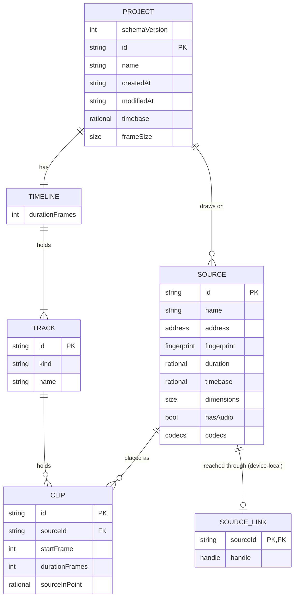

# Data model — import-play-export

Entities use the vocabulary of `CONTEXT.md`. The types below describe the shapes. The TypeScript
definitions in `packages/model/src/document/types.ts` are authoritative.

There is **no SQL database and no migration tool** in this repository
([architecture-map.md](../../architecture-map.md) §Conventions, `migration_tool: ""`). Persistence
works like this:

- The Project Document is plain, versioned JSON stored in IndexedDB (ADR 0007).
- A shape change is a code migration in `packages/model/src/document/migrate.ts`, keyed by
  `schemaVersion`.
- A store-shape change is an upgrade block in `apps/editor/src/storage/db.ts`.

So there are no staged `migrations/*.up.sql` / `*.down.sql` pairs for this feature. SDD's
"Indexes" are IndexedDB key paths, and the "types" are JSON shapes.

## ER diagram



## Entities

### Persisted: the Project document

Plain JSON, versioned, stored in IndexedDB (ADR 0007). It contains nothing device-specific.

### `Project`

| Column | Type | Constraints | Notes |
|---|---|---|---|
| `schemaVersion` | integer | `= CURRENT_SCHEMA_VERSION` (1); a newer version is refused, never coerced | Drives migrations. Version 1 is the first shape that carries this field; a document without one is version 0, the shape from before versioning existed, and only `migrateProject` opens it. |
| `id` | string | unique, in-line key of the `projects` store | Stable across renames and storage moves. |
| `name` | string | | User-facing. |
| `createdAt` / `modifiedAt` | ISO string | calendar-valid (checked against a `Date.UTC` round trip, T018) | Timestamps are strings, not `Date`, to stay serializable. |
| `timebase` | `{ numerator, denominator }` | both `> 0` | Exact frame rate, e.g. `{ 30000, 1001 }`. Never a float. |
| `frameSize` | `{ width, height }` | | Pixels. Not named `canvas` — `CONTEXT.md` reserves that word (it is the wrong name for the Preview). |
| `sources` | `Source[]` | ids unique | |
| `timeline` | `Timeline` | | |

**Aggregate root:** root. A Project owns its Sources and its Timeline.
**Access patterns:** list all Projects (Project list) and load one by `id`. Both go through the
`projects` store's key path (see Indexes).
**Constraints:**

- `timebase.denominator > 0`, `numerator > 0`.
- Changing `timebase` after Clips exist is a migration of every Frame value, not an edit
  (ADR 0002). That is out of scope for this slice: the Timebase is set once, on first import.
- Unknown fields are refused rather than dropped, because dropping them would lose a future
  version's data on the next save (T018).

### `Source`

| Column | Type | Constraints | Notes |
|---|---|---|---|
| `id` | string | unique; referenced by Clips | Never reused. |
| `name` | string | | Original file name, shown to the user. |
| `address` | `{ kind: "local-file" }` | discriminated union | `{ kind: "cloud-object", url }` arrives later (ADR 0005). The handle itself is **not** here. |
| `fingerprint` | `{ size, lastModified }` | | Used to confirm a Relink points at the same file. |
| `duration` | `{ numerator, denominator }` | exact ratio | Source-native duration as an exact ratio of seconds, in the Source's own timescale — never the Project's Frames and never a float. This is Principle II's one exception (constitution 1.1.0, ADR 0002): a Source's media time is not the Project's to renumber. |
| `timebase` | `{ numerator, denominator }` | exact ratio | The Source Timebase — its own rate as an exact ratio, measured from its packets (ADR 0016). May differ from the Project's Timebase. Not named `frameRate`: `CONTEXT.md` lists "frame rate" under `_Avoid_`. |
| `dimensions` | `{ width, height }` | | |
| `hasAudio` | boolean | | A Source without audio is valid (spec AC-19). |
| `codecs` | `{ video?, audio? }` | | Recorded at import for diagnostics and for reporting why a Source cannot be used. |

**Aggregate root:** `Project`.
**Constraints:**

- A Source is immutable once imported, with one exception: a Relink may correct its `name` and
  `fingerprint`, because the file it addresses can legitimately be renamed or replaced by the same
  content at another path. Nothing else about a Source ever changes — re-importing the same file
  creates a second Source rather than modifying this one.
- `address` says where it lives, never how to reach it on this machine.

### `Timeline`

| Column | Type | Constraints | Notes |
|---|---|---|---|
| `tracks` | `Track[]` | | This slice: exactly one video Track. That is a property of the slice, deliberately not enforced by the parser, so a later slice can relax it without a migration (T018). |
| `durationFrames` | integer | equals the maximum Clip end | Derived, stored for cheap listing. |

**Aggregate root:** `Project`.

### `Track`

| Column | Type | Constraints | Notes |
|---|---|---|---|
| `id` | string | unique | |
| `kind` | `"video"` | union of one | `"audio"`, `"text"` follow later. |
| `name` | string | | |
| `clips` | `Clip[]` | ordered by `startFrame`, non-overlapping | |

**Aggregate root:** `Project` (through `Timeline`).

### `Clip`

| Column | Type | Constraints | Notes |
|---|---|---|---|
| `id` | string | unique | |
| `sourceId` | string | must resolve to a Source of the same Project | Survives the Source going Offline (spec AC-36). |
| `startFrame` | integer | `≥ 0` | Position on the Timeline, in the Project's Timebase. |
| `durationFrames` | integer | `> 0` | |
| `sourceInPoint` | `{ numerator, denominator }` | exact ratio | Where in the Source the Clip begins (the In-point), in the **Source's** timescale — an address inside the Source, not a position on the Timeline, and so the second half of Principle II's exception. Zero for this slice (no trimming). Its time space (container time vs. time from the first sample) is an open question (spec §8). |

**Aggregate root:** `Project` (through `Track`).
**Constraints:**

- `startFrame ≥ 0`, integers only. No sub-Frame positions can be expressed (spec AC-06).
- Clips on one Track must not overlap: for adjacent clips, `a.startFrame + a.durationFrames ≤
  b.startFrame`. Adjacency is integer equality, so butt joins are exact.
- A Clip whose Source is Offline stays on the Timeline and renders as empty.

### Device-local: the link table (`SourceLink`)

This is a second IndexedDB store. It is persisted, but it is never part of the Project Document
and never synchronised (ADR 0005). It is keyed by `sourceId` and holds a `FileSystemFileHandle`.
A handle is structured-cloneable, so it survives a reload.

| Column | Type | Constraints | Notes |
|---|---|---|---|
| `sourceId` | string | in-line key of `source-links` | The Source this handle reaches. |
| `handle` | `FileSystemFileHandle` | | Written only after a successful link or Relink, so a mistaken pick cannot cost the good link (T028). |

**Two states, derived on every check, never stored:**

```
                 user picks a file, permission granted
   Offline ──────────────────────────────────────────▶ Linked ──▶ readable
      ▲                                                   │
      └───────────────────────────────────────────────────┘
              permission lapses, or the file moves
```

- `Linked` needs both an entry in this table *and* a granted read permission. Requesting
  permission needs a user gesture (spec AC-33), so reopening a Project always lands in `Offline`
  until the user acts. That is the browser's rule, not a defect to design around.
- `Offline` covers every way of not being readable, including never having been linked on this
  machine. Which of those it is belongs in the *reason* shown to the user, not in a third state —
  and "Unlinked" is not a word to use, since CONTEXT.md keeps it out of the vocabulary. The
  reasons in code are `needs-permission`, `never-linked-here`, `unreachable` and `unreadable`.
- A **Relink** ends in `Linked`. It verifies the picked file's **size** against
  `Source.fingerprint` and then corrects `name` and `lastModified` in the Document. Only size is
  verified, because verifying `lastModified` too would make the correction of `lastModified`
  impossible, and would refuse a copy of the right file. The name is never verified: quickstart's
  Relink check renames the fixture on disk on purpose.

A Relink is split across the two stores on purpose. The handle and its permission go to the
device-local link table, and only the Source's `name` and `fingerprint` are part of the Project
Document. A Relink that finds the document already correct therefore changes nothing and produces
no patches. It must not put an entry on the undo stack that would undo nothing.

### Runtime only: the `Scene`

This is what crosses into the worker (ADR 0003). It is derived from the Project, never edited
there and never persisted.

| Column | Type | Constraints | Notes |
|---|---|---|---|
| `timebase` | `{ numerator, denominator }` | | |
| `frameSize` | `{ width, height }` | | |
| `clips` | `SceneClip[]` | back to front | `timeline.tracks[0]` is the backmost Track and each later one draws over it. The Timeline shows Tracks the other way up, so the reversal lives in the interface where presentation belongs. |

`SceneClip` = `{ clipId, sourceId, startFrame, durationFrames, sourceInPoint }`.

There is no `transform`. Schema version 1 gives a Clip no position, scale or rotation, so
projecting a constant identity would put a field in the protocol that no Project can vary and no
renderer can trust. It arrives with `Clip.transform` (see [future.md](../../future.md)), and a
test in `scene.test.ts` fails on that day to say so.

A Clip whose Source is Offline stays in the Scene and renders empty. Link status is runtime state
in the store, not part of the Project. If the projection filtered Offline Clips out, granting
permission to a file would look like an edit to the picture and force a needless repost.

It is named `SceneClip` because that is what each one is: a Clip as the renderer needs to see it.
It is not named `SceneLayer`, and not `SceneItem` either. `CONTEXT.md` lists "Layer" under the
words to avoid for a Track, and "Item" under the words to avoid for a Clip. Both are the commonest
wrong names in editors, which is exactly why they are listed.

**Rules**

- It contains only what affects the picture. Names, selection, panel sizes and undo history do not
  cross.
- It is posted on change, throttled during continuous gestures. A Frame request is just an integer.

### Runtime only: playback and export state

This lives in the store but outside the Project document, and is never undoable.

| Column | Type | Constraints | Notes |
|---|---|---|---|
| `playheadFrame` | integer | | |
| `transport` | `"stopped" \| "playing"` | | |
| `sourceStatus` | `Record<sourceId, "linked" \| "offline">` | | Never saved, never undone (spec AC-38). |
| `export` | `{ state, framesDone, framesTotal }` \| null | | One at a time (spec §3). |

### Validation summary

This is the single list of what `parseProject` accepts ([contracts/public-api.md](./contracts/public-api.md) §Document points here).

| Rule | Enforced where | Spec reference |
|---|---|---|
| Frame values are integers | Model, at document parse and on every reducer write | AC-06 (FR-006) |
| Clips do not overlap on a Track | Reducer + parse | Data integrity |
| `durationFrames > 0` | Reducer + parse | Data integrity |
| `Timeline.durationFrames` equals the maximum Clip end | Reducer + parse | Data integrity |
| Source and Clip ids are unique | Reducer + parse | Data integrity |
| Every Clip's `sourceId` resolves to a Source | Parse | Data integrity |
| Timebase is a positive ratio | Migration + parse | ADR 0002 |
| Document contains no handles or class instances | Parse (structural clone round-trip in tests) | ADR 0004, 0005 |
| Relinked file matches fingerprint | Link table write path | AC-35 (FR-021) |

## Indexes

There are no secondary indexes. Each store has only its in-line key path
(`apps/editor/src/storage/db.ts:37,40`).

| Index | Columns | Query it serves |
|---|---|---|
| `projects` key path | `id` | Load one Project (Flow 5 in [sad.md](./sad.md) §6); save after a Gesture (Flow 1) |
| `source-links` key path | `sourceId` | Read or write a Source's handle on open, import and Relink (Flows 1, 5) |

There is deliberately **no index on `modifiedAt`**. An IndexedDB index silently omits records that
lack its key path, so a Project whose timestamp went missing would vanish from the list rather than
appear as one needing attention. The Project list sorts in memory, by `Date.parse` (T027).

## Test fixtures

- Model tests build Projects as plain literals and run them through `parseProject`. The input is
  untrusted by definition, so a fixture only TypeScript could have produced would not exercise the
  parser (T020). A hand-written version-0 document pins the 0 → 1 migration.
- Media fixtures are generated by `pnpm fixtures` (`scripts/make-fixtures.ts`) into
  `packages/engine/test/fixtures/`. They are gitignored and deterministic, and each moving fixture
  carries a burned-in Frame counter and a click on every whole second:
  - `sync-1080p30.mp4`, `sync-1080p2997.mp4` and `sync-1080p30-10min.mp4`;
  - `silent-720p24.mp4` and `long-1080p30-70min.mp4`;
  - `audio-only.m4a`, `still.png` and `broken.mp4`.

  The list with each fixture's purpose is in [_evidence/quickstart.md](./_evidence/quickstart.md).
- The e2e file handles come from OPFS, only as a way to obtain real handles without a native
  picker (`apps/editor/e2e/file-picker.ts`). The app itself copies nothing into browser storage.
- The fixtures contain no personal data.
