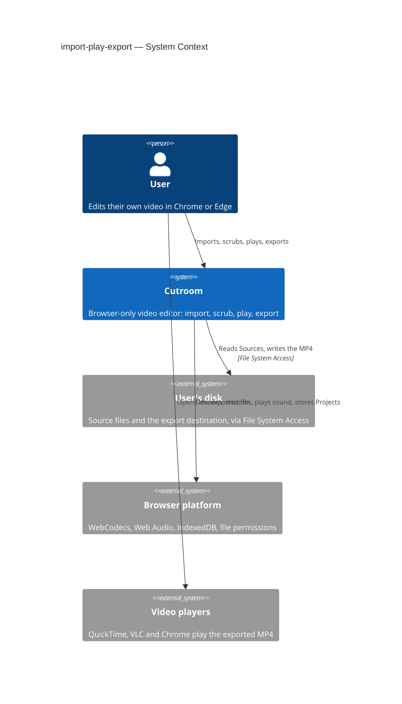
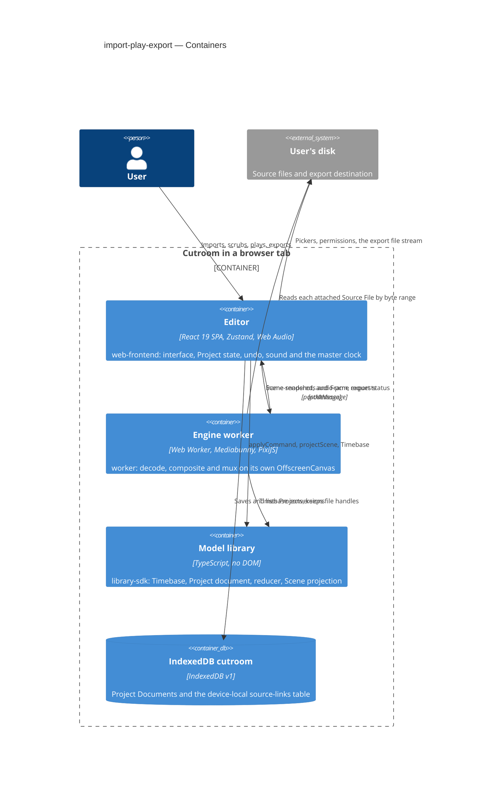
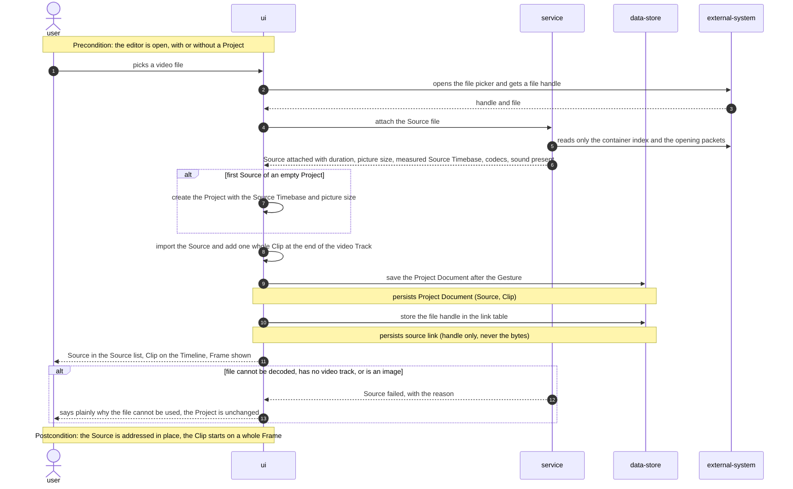
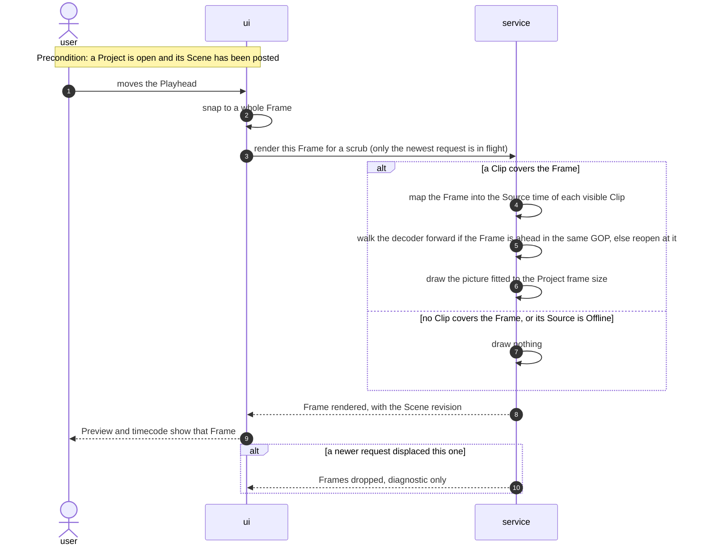
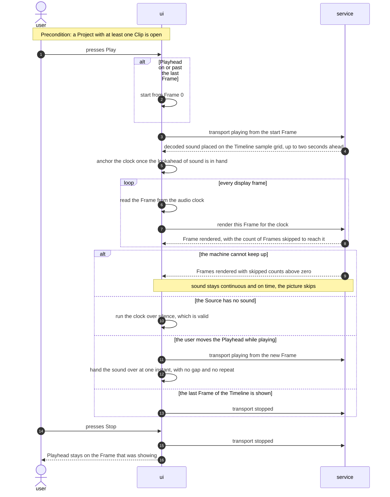
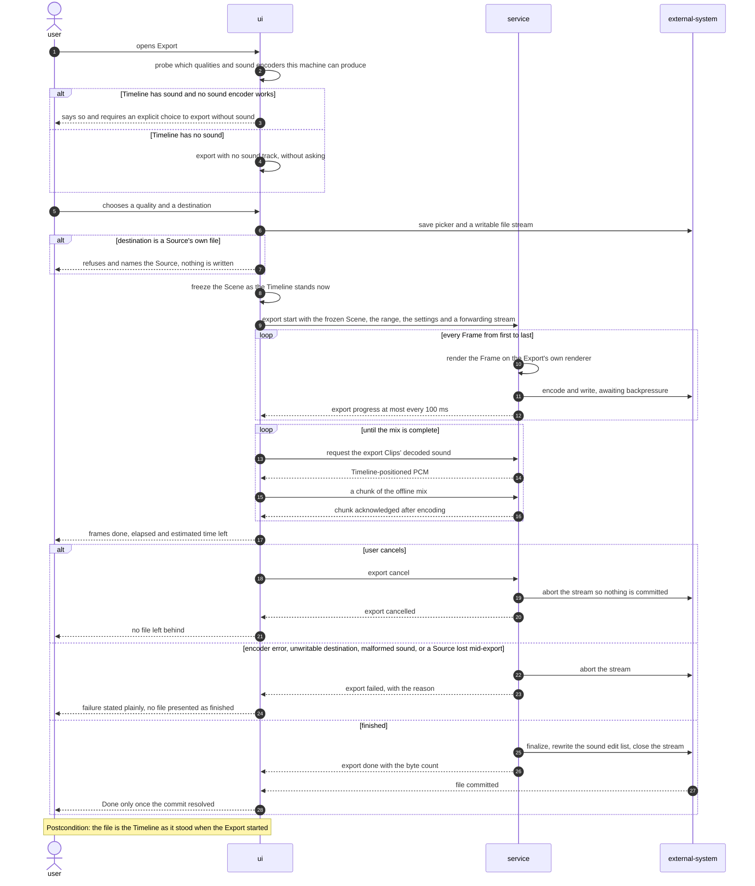
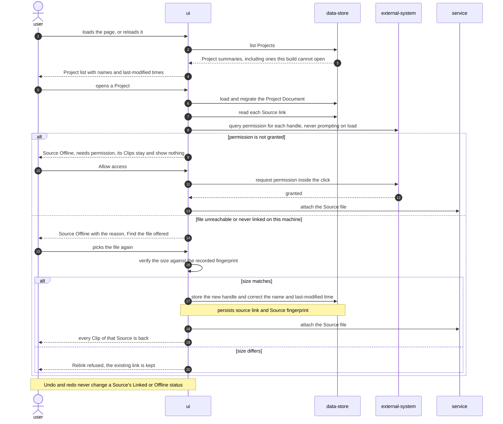
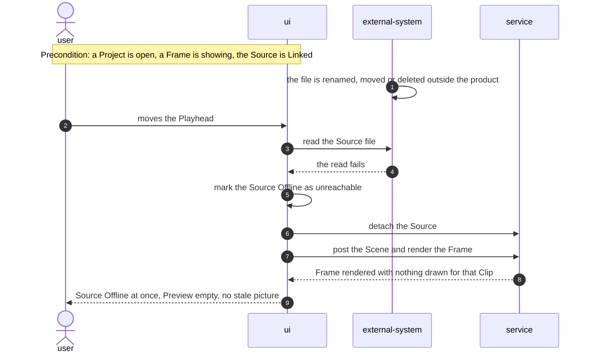
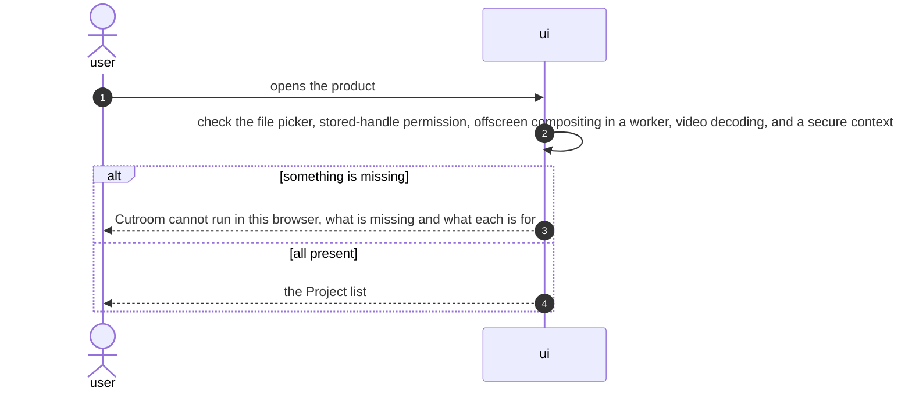

# Software Architecture Document — import-play-export

## 1. Introduction and goals

**Intent.** This is the first vertical slice. A user picks a video file from their machine, sees
it as one Clip on the Timeline, plays it back with sound in sync, and exports the result as an MP4
that matches what they saw. The point is not the feature set. The point is that every risky layer
is exercised end to end before anything is built on top of it:

- reading a user-chosen file through a persisted handle;
- decoding on demand in a worker;
- compositing on the GPU;
- driving the picture from the audio clock;
- muxing straight to disk.

Technically, the slice is a pnpm monorepo:

- `packages/model`, framework-free: Timebase arithmetic, the Project document, the reducer and the
  Scene projection;
- `packages/engine`, the worker: Mediabunny decode, PixiJS compose and Mediabunny mux;
- `apps/editor`, a React app that drives both and owns state, sound and the clock.

**Top-3 quality goals (1-liners; full scenarios in §10):**

1. Sound never yields to picture. Playback stays continuous and in sync, and under load the
   picture skips Frames instead of the sound stalling.
2. Preview and Export agree. The exported file contains exactly what the Preview showed, and plays
   in ordinary players.
3. Responsiveness on the user's own footage. The first picture appears promptly, and a scrubbed
   Frame shows within the scrub budget.

**Stakeholders.**

| Role | Interest | Sign-off owner? |
|---|---|---|
| User (spec §4) | Imports, scrubs, plays, exports and comes back to their own footage | No |
| Repo owner / Tech Lead (Dmytro Hopko) | Architecture, SAD and ADR approval | Yes |

**Provenance.** This SAD was migrated from Spec Kit:

- `plan.md` (renamed to this file);
- `research.md` (Phase 0: nine questions resolved against current Mediabunny and PixiJS
  documentation, now §4);
- `decisions.md` (decisions taken while building, now §4, §8 and §11);
- the risk table (now §11).

The Spec Kit phases were Phase 0 research, Phase 1 design and contracts, and Phase 2 tasks. Phase
2 produced 95 tasks across six phases, reviewed by three `/speckit-analyze` passes whose findings
and closures are recorded in [_review/spec-quality-checklist.md](./_review/spec-quality-checklist.md).
There are now 96 tasks, in [tasks/](./tasks/_epic.md).

<!-- Decision overrides (¶4) — none from an SDD critic pass; this SAD was migrated, not walked. -->

## 2. Constraints

**Technical.**

- TypeScript `~6`, pinned identically at the root and in every workspace package, so one
  `pnpm typecheck` means one compiler. ES2023 target, ESM only.
- Mediabunny (demux, decode, encode and mux over WebCodecs), PixiJS 8 (compositing,
  `WebWorkerAdapter`), React 19 + Vite 8, Zustand + Immer (single reducer, inverse patches),
  Tailwind 4 + shadcn/Radix (UI), and `idb` (the IndexedDB wrapper). Exact versions are in
  [architecture-map.md](../../architecture-map.md#stack).
- Storage is IndexedDB, with one store for Project documents and one for the device-local
  `sourceId → FileSystemFileHandle` link table. No OPFS in this slice, because nothing derived is
  kept yet. Source bytes are never copied (ADR 0005).
- Target platform: Chromium desktop (Chrome, Edge), per ADR 0006. Other browsers get an explicit
  unsupported notice on arrival (spec AC-39).
- Project type: a client-only web application in a monorepo, with a worker-hosted media engine.
- Sound must never be interrupted by picture (spec AC-17).
- Export memory must not grow with output length: the file streams to disk through
  `StreamTarget`.
- Every `VideoFrame` and pooled canvas must be released on a defined path, or a long Timeline
  exhausts memory.
- Scale and scope: one Project open at a time, one video Track, one export at a time. Each Source
  becomes one Clip. The data model is sized for the multi-track editor that follows, but this slice
  exercises the smallest path through it.

**Organisational.**

- Effort budget, deadline and team composition: TODO(sdd-migration). None was recorded in the Spec
  Kit plan. The git history shows one author, Dmytro Hopko, from `35a3596` (2026-07-31) to
  `a49c7f8` (2026-10-23).

**Conventions.**

- [docs/constitution.md](../../constitution.md): six principles, the platform constraints and the
  development workflow.
- [CONTEXT.md](../../../CONTEXT.md) is the vocabulary of the code. Identifiers must not use a term
  under its avoid lists.
- A decision that is hard to reverse, surprising without context and the result of a real
  trade-off gets an ADR in `docs/adr/` *before* the code that depends on it lands. A domain term
  the code introduces enters `CONTEXT.md` in the same change. This was the standing rule of the
  Spec Kit breakdown. T094 audited it, and the lapses are in
  [_review/audit-t094.md](./_review/audit-t094.md).
- Work is sequenced so that the risky layers (decode, sync, mux) are exercised end to end early,
  rather than deferred behind UI progress.
- The Lovable UI prototype is a visual reference kept outside the repository, and nothing here
  imports from it (ADR 0010). The UI in this slice was written from scratch.

**Constitution check** (carried from the Spec Kit plan; the gate was passed before and after design):

| Principle | Gate | Status (pre-design) | Status (post-design) |
|---|---|---|---|
| I. The browser is the whole machine | No server-side render path; codec options discovered at runtime | PASS — no backend in this slice | PASS — export settings built from `canEncode` probes (research R5), returned to the UI in the worker's `ready` message |
| II. Frames are the unit of time | Timeline positions are integer Frames; one conversion module | PASS | PASS, with the exception recorded — `packages/model` Timebase is the single converter (R7) and the worker protocol carries integers only. `Source.duration` and `Clip.sourceInPoint` hold Source-native time as exact rationals of seconds, which is the one exception Principle II names (constitution 1.1.0, ADR 0002). Nothing on the Timeline is expressed that way |
| III. One engine for Preview and Export | Same compositing code for both | PASS | PASS — one PixiJS scene in the worker; Preview and Export differ only in what advances the Frame (contract `render-frame` vs `export-start`) |
| IV. One owner of state, one way to change it | Main thread owns state; reducer + inverse patches; state stays serializable | PASS | PASS — worker receives Scene snapshots, never a Project, and returns no state (worker-protocol invariant 1) |
| V. Sources are addressed, never copied | No copying into browser storage; Offline and Relink designed for | PASS | PASS — main thread resolves handle and permission, hands a `File` to the worker; link table separate from the document |
| VI. Effects are data, not branches | Registry-driven Effects | N/A — no Effects in this slice | N/A — the `SceneClip` shape leaves room for an `effects` array without restructuring |

Platform constraints check:

- A worker plus OffscreenCanvas for video, and Web Audio on the main thread (ADR 0008). This is
  reflected in research R3 and the worker protocol.
- The monorepo layout is as mandated.
- Document migrations exist from schema version 1 (`packages/model` contract).
- The Lovable prototype is not imported (ADR 0010).

Result: no violations. Two later changes narrowed this table. ADR 0015 gave the Export its own
renderer and decoders. The export qualities are now probed on the main thread when the dialog
opens (§8).

**Regulatory / external.**

- N/A. No data leaves the user's machine and there are no accounts (spec §6.1).

## 3. Context and scope

Cutroom runs entirely in one browser tab. A user brings in video files that stay on their own
disk. The product reads them through File System Access handles, and writes an exported MP4 back
to a location the user chooses. That file is then played in ordinary video players. Nothing is
uploaded, and there is no server in this slice.

<!-- brownfield: docs/architecture-map.md (reflects 53f38c4) — monorepo model / engine / editor, IndexedDB for Projects and file links, worker-hosted engine -->

**External systems (in / out):**

| Actor or system | Type | Interaction |
|---|---|---|
| User | Person | Picks files, scrubs, plays, exports, relinks |
| User's disk (File System Access) | System (external) | Source files read by byte range through persisted handles; the Export's destination file |
| Browser platform (WebCodecs, Web Audio, IndexedDB, permissions) | System (external) | Decoding and encoding, sound output, storage, the per-file read permission |
| Video players (QuickTime, VLC, Chrome) | System (external) | Play the exported MP4 (SC-006) |

**C4 Context (L1):**



## 4. Solution strategy

**Top strategic choices (the seeds for ADRs):**

1. **Target surfaces: `web-frontend` + `worker` + `library-sdk`.** These are derived from the
   code. The Spec Kit plan named no surface.
   - `web-frontend`: `apps/editor` is a client-side SPA, so there is no SSR.
   - `worker`: `packages/engine` is a Web Worker that consumes messages and has no
     request/response surface of its own.
   - `library-sdk`: `packages/model` is a framework-free library whose public signatures are a
     contract, and the future backend will reuse it (ADR 0007).

   The split itself is ADR 0001 (client-only rendering) and ADR 0003 (engine in a worker). The UI
   architecture is a React SPA with one Zustand store, which holds the Project list or the open
   Project. There is no router. No ADR was spawned for the surface declaration, because it
   restates ADR 0001 and ADR 0003.
2. **Everything renders in the browser, and the picture is one engine** (ADR 0001, ADR 0003). One
   PixiJS scene in a worker serves both Preview and Export. They differ only in what advances the
   Frame. The Export has its own canvas, renderer and decoders (ADR 0015).
3. **Time is integer Frames, and sound is the clock** (ADR 0002, ADR 0008). The Timebase module in
   `packages/model` is the single converter. Audio plays on the main thread, and
   `audioContext.currentTime` decides which Frame is drawn.
4. **Sources are addressed, and Projects are portable versioned JSON** (ADR 0005, ADR 0007). Sources
   are read in place through handles kept in a device-local table. The document is saved
   automatically at the end of each Gesture (ADR 0011) and migrated by schema version.
5. **State has one owner** (ADR 0004). The main thread holds the Project, every edit goes through
   one reducer, and undo is Immer's inverse patches. The worker receives Scene snapshots only.

Each tactical decision below traces to one of these seeds.

### Research decisions (Spec Kit Phase 0, verbatim)

All findings below were checked against current Mediabunny and PixiJS documentation rather than
recalled. Architectural decisions already settled in `docs/adr/` are not re-litigated
here; this section resolves the unknowns those decisions leave open.

**R1. Getting a Clip's picture to the compositor**

*Decision*: Per active Clip, hold a Mediabunny `CanvasSink` over the Source's video track. During
playback, pull from `sink.canvasesAtTimestamps(...)` driven by the Frames the clock asks for;
while scrubbing, drop the iterator and call `sink.getCanvas(t)`. Wrap the returned canvas in a
PixiJS texture whose source is updated each Frame.

*Rationale*: `CanvasSink` already does the decode-and-draw step and hands back an
`OffscreenCanvas`, which PixiJS can adopt as a texture source directly. Going through
`VideoSampleSink` and uploading a `VideoFrame` to a texture is likely faster but depends on PixiJS
accepting a `VideoFrame` as an image source, which is not documented as supported and would need
proving first. Correctness before throughput on the first slice.

*Alternatives considered*: `VideoSampleSink` + `sample.draw(ctx)` into our own canvas (one more
copy than `CanvasSink`, no benefit); `VideoSampleSink` + direct `VideoFrame` texture upload (the
optimisation to try once the slice works end to end).

*Caveat to respect*: `CanvasSink` pools its canvases. A canvas handed to us may be reused for a
later Frame, so it must be drawn into the scene before the next pull, never retained across
Frames.

**R2. Seeking versus streaming**

*Decision*: Two modes, one owner. Playback keeps a live async iterator per active Clip and
never seeks. Scrubbing and stepping abandon the iterator and use random access. Entering playback
opens a fresh iterator at the target Frame.

*Rationale*: Random access per Frame risks a seek to the previous keyframe plus a re-decode of
everything between, which is the difference between smooth playback and none. A live iterator is
exactly what a decoder is good at. Mediabunny exposes both shapes (`sink.samples(start, end)` /
`canvasesAtTimestamps(...)` for sequential, `getCanvas(t)` / `getSample(t)` for random), so no
custom machinery is needed.

*Open risk*: the cost of the first Frame after a scrub is bounded by keyframe spacing in the
Source, which we do not control. If SC-003 (300 ms) is missed on long-GOP material, the fallback
is a scrub-quality path (lower resolution decode), not a change to the model. *(Superseded in part
by ADR 0017: scrubs now walk forward from the decoder's position when the Frame is ahead within the
same GOP; keyframe preview and proxies are the next steps.)*

**R3. Audio playback and the clock**

*Decision*: Decode audio in the worker with `AudioSampleSink`, transfer the PCM to the main
thread, and schedule it on the main thread as `AudioBufferSourceNode`s a fixed lookahead ahead of
`audioContext.currentTime`. The clock is `audioContext.currentTime`, converted to a Frame index
and posted to the worker as the Frame to render.

*Rationale*: `AudioContext` is exposed to Window only (ADR 0008), so scheduling cannot move into
the worker. Decoding can, and should, because it is the expensive part. Deriving the Frame from
the audio clock — rather than from a timer — is what makes drift structurally impossible rather
than merely small.

*Alternatives considered*: `AudioWorklet` fed by a ring buffer from the worker (more control over
underruns, considerably more machinery; revisit if scheduling proves lumpy under load).

**R4. Export pipeline**

*Decision*: `Output` with `Mp4OutputFormat`, writing through `StreamTarget` wrapped around the
`FileSystemWritableFileStream` from `showSaveFilePicker()`. Video comes from a `CanvasSource` over
the renderer's `OffscreenCanvas`, advanced Frame by Frame with
`add(frameToSeconds(timebase, frame), frameToSeconds(timebase, 1))` — through the conversion
module, never by dividing by a rate at the call site (Principle II). Audio
is mixed on the main thread into PCM by `OfflineAudioContext`, transferred to the worker as
`Float32Array`s, and added as `AudioSample`s through an `AudioSampleSource`. `output.finalize()`
closes the stream.

*Rationale*: `StreamTarget` over a file handle gives constant memory for arbitrarily long
exports — the file is never assembled in RAM. Audio cannot use `AudioBufferSource`, because
`AudioBuffer` is Window-only and the muxer lives in the worker; `AudioSample` accepts raw bytes
(`AudioSampleInit { data, format, numberOfChannels, sampleRate, timestamp }`), which is exactly the
worker-safe path.

*Backpressure*: both `videoSource.add()` and `audioSource.add()` return promises that resolve
when the encoder and writer are ready for more. They must be awaited, not fired and forgotten, or
memory grows without bound.

*(As built: Chrome refuses to transfer a `FileSystemWritableFileStream` to a worker, so the main
thread keeps it and the worker writes through a forwarding `WritableStream`; the file is committed
once — ADR 0015. The AAC track carries a measured edit list — ADR 0014.)*

**R5. Choosing export settings**

*Decision*: Build the offered settings at the moment the export dialog opens, from
`canEncode('avc')` / `canEncodeVideo('avc', { width, height, bitrate })` and the audio equivalent.
Nothing is hardcoded (Principle I). If AAC is unavailable, the product says so rather than
failing at finalize.

*Rationale*: WebCodecs codec availability varies by browser and machine, and Mediabunny's own
docs treat it as a runtime question with polyfill extensions for the gaps.

*(As built: the qualities are probed on the main thread when the dialog opens — see §8.)*

**R6. PixiJS inside the worker**

*Decision*: Call `DOMAdapter.set(WebWorkerAdapter)` before constructing anything, then init the
renderer against the transferred `OffscreenCanvas`. One scene graph, rendered on demand: for
Preview when the clock asks, for Export once per Frame.

*Rationale*: This is the documented way to run PixiJS in a worker, and it keeps a single render
path for both Preview and Export (Principle III).

*Constraint it imposes*: nothing in the scene may depend on DOM measurement or events. Overlays
that need the DOM (selection handles, guides) belong in the React layer above the canvas, not in
the scene.

**R7. Where Frames and time convert**

*Decision*: One module in `packages/model` owns the Timebase: `frameToSeconds`,
`secondsToFrame`, `frameToSampleIndex`, `framesForDuration`, `frameToSourceTime`, and the rational
rate itself. Every call into Mediabunny or Web Audio passes through it, including the one that maps
a Project Frame into a Source whose own Timebase differs — that is where the temptation to
improvise is strongest and where drift would be hardest to see. Lint rule or review check: no rate
arithmetic outside that module.

*Rationale*: Principle II says rounding outside this module is a defect. OpenReel demonstrates
the failure mode — `Math.round(time * frameRate) / frameRate` reimplemented independently in its
frame cache, render bridge and motion timing.

**R8. Testing strategy** — now [test-plan.md](./test-plan.md) §Levels.

*Decision*: Two tiers.

- **Vitest, node environment** — everything in `packages/model`: Timebase conversions, the reducer
  and its inverse patches, Project document migrations, Scene projection. No media, no browser.
- **Playwright against Chromium** — everything that touches WebCodecs, OPFS, file handles and
  audio: import a fixture file, assert a Frame renders, assert export produces a playable file,
  assert A/V sync using a fixture with a known sync mark.

*Rationale*: WebCodecs cannot be meaningfully faked; a unit test that mocks the decoder proves
nothing about the risky part. Conversely the arithmetic that must never drift is pure and
deserves fast tests. Fixtures are generated by `pnpm fixtures` and gitignored rather than
committed — `make-fixtures.ts` is deterministic, and the ten-minute fixture SC-002 needs has no
business in git history. They include one whose Source Timebase differs from the Project's (edge
case in the spec), one with no audio track, one audio-only and one image (both must be refused),
and one long enough to prove that import does not read the whole file.

**R9. Storage in this slice**

*Decision*: IndexedDB only — one store for Project documents, one for the Source link table
(`sourceId → FileSystemFileHandle`). OPFS is not used yet; it arrives with thumbnails, waveforms
and proxies, none of which are in this slice.

*Rationale*: ADR 0005 reserves OPFS for derived data. This slice derives nothing worth keeping.

## 5. Building block view

The split is by dependency direction, not by feature. `model` knows nothing about the browser,
`engine` knows nothing about React, and `apps/editor` knows about everything. This is what lets
`model` be lifted into the backend later without untangling it, and what keeps the worker
boundary honest. It is a pnpm workspace, as the constitution mandates. There is one C4 container
per declared surface, plus the IndexedDB data store.

**Internal decomposition** (as in the Spec Kit plan; paths verified against `53f38c4`):

```
packages/
├── model/                      # No browser APIs, no framework. Reused by the future backend.
│   ├── src/
│   │   ├── timebase.ts         # The only place Frames become seconds or samples
│   │   ├── document/           # Project types, parse, migrations
│   │   ├── commands/           # Single reducer + command definitions
│   │   └── scene.ts            # Project → Scene projection
│   └── test/                   # Vitest
└── engine/                     # The worker. Mediabunny + PixiJS. No React.
    ├── src/
    │   ├── worker.ts           # Message boundary; every throw becomes `fatal`
    │   ├── sources/            # Attach a File, read metadata, own the sinks
    │   ├── compose/            # PixiJS scene, WebWorkerAdapter init, render one Frame
    │   ├── playback/           # Streaming iterators, scrub path, frame dropping
    │   └── export/             # Output, StreamTarget, backpressure, cancel
    └── test/fixtures/          # Generated media fixtures

apps/
└── editor/                     # React 19 + Vite. Owns state, sound, the clock.
    ├── src/
    │   ├── store/              # Zustand + Immer, transactions, undo stack
    │   ├── audio/              # Web Audio graph, scheduling, master clock
    │   ├── storage/            # IndexedDB: project store + source link table
    │   ├── engine-client/      # Typed wrapper over the worker protocol
    │   └── ui/                 # ProjectList, TopBar, SourcesPanel, Preview, Timeline (fresh)
    └── e2e/                    # Playwright

scripts/
└── make-fixtures.ts            # Generates the fixtures both tiers rely on; output is gitignored

docs/
└── adr/                        # At the repository root: the ADRs govern the whole monorepo
CONTEXT.md                      # Likewise — the domain language is not the editor app's alone
```

The Lovable UI prototype is deliberately absent from this tree. It lives outside the repository,
so reaching it would mean climbing out of the source root (ADR 0010).

How the repository was created. Cutroom started as a fresh repository rather than growing out of
the old scaffold:

- The previous `videoEditor/` Vite app was copied in as `apps/editor`. It was a starter page, so
  nothing of substance moved.
- `CONTEXT.md`, `docs/adr/`, `specs/` and `.specify/` came with it. The last two are now retired:
  they became `docs/features/` and `docs/constitution.md` in the SDD migration.
- The original folder stays outside the repository as scratch.

The interfaces between the blocks are contracts:

- [contracts/events.md](./contracts/events.md): the main thread ↔ engine worker protocol. It is
  the `worker` surface.
- [contracts/public-api.md](./contracts/public-api.md): the `packages/model` functions. It is the
  `library-sdk` surface.
- [data-model.md](./data-model.md): the persisted and runtime shapes.

**C4 Container (L2):**



## 6. Runtime view

The participants use SDD's generic vocabulary, mapped to the §5 containers:

| Participant | §5 container |
|---|---|
| `user` | the User |
| `ui` | the Editor container (interface, store, Web Audio graph and clock) |
| `service` | the Engine worker |
| `data-store` | IndexedDB `cutroom` |
| `external-system` | the user's disk and the browser's file permission |

The Model library is called inside `ui` and `service`, and is not drawn. Messages are semantic.
The exact message shapes are in [contracts/events.md](./contracts/events.md).

### Flow 1 — Import a file (US-01)



### Flow 2 — Scrub to a Frame (US-01)



### Flow 3 — Playback with sound as the clock (US-02)



### Flow 4 — Export (US-03)



### Flow 5 — Reopen a Project and Relink (US-04)



### Flow 6 — A Source vanishes mid-session (US-04)



### Flow 7 — Arrival in an unsupported browser (US-05)



**Use-case and AC coverage.**

| Spec item | Shown in |
|---|---|
| US-01 | Flows 1, 2 |
| US-02 | Flow 3 |
| US-03 | Flow 4 |
| US-04 | Flows 5, 6 |
| US-05 | Flow 7 |
| AC-01, AC-02, AC-03, AC-08 | Flow 1, happy path, first-Source branch, persist notes |
| AC-09, AC-10 | Flow 1, refusal branch |
| AC-12 | Flow 1: only the index and opening packets are read |
| AC-04, AC-05, AC-07, AC-11 | Flow 2: Source-time mapping, fit to frame size, nothing drawn |
| AC-06 | Flow 2 (snap to a whole Frame); otherwise non-runtime: enforced by the model's types, parser and reducer |
| AC-13, AC-14, AC-15, AC-16, AC-17, AC-19, AC-20 | Flow 3 and its branches |
| AC-18 | Flow 3: the Frame is read from the audio clock. Measured by the ten-minute sync test, not a separate flow |
| AC-21, AC-22, AC-23, AC-24, AC-25, AC-26, AC-27, AC-28, AC-29, AC-30 | Flow 4 and its branches |
| AC-31 | Non-runtime: a property of the written file (edit list, ADR 0014), checked by `export-duration.spec.ts` and the SC-006 player check |
| AC-32, AC-33, AC-34, AC-35, AC-38 | Flow 5 |
| AC-36, AC-37 | Flows 5 and 6 |
| AC-39 | Flow 7 |

Flagged for design: none. Every participant is a §5 container. The sequences stage was not run
interactively. These flows were derived from the contracts, the Spec Kit tasks and the code during
the SDD migration.

## 7. Deployment view

<!-- N/A: no deployment unit exists yet. The slice runs from the Vite dev server (`pnpm dev`, http://localhost:5173) or a static `pnpm build` bundle; no hosting, replicas or monitoring are defined. The product is client-only (ADR 0001), so scaling is the user's own machine — bounded by browser memory and the encoders the browser exposes. -->

## 8. Crosscutting concepts

| Concept | Convention | Where defined |
|---|---|---|
| Time | Integer Frames in a rational Timebase. `packages/model/src/timebase.ts` is the only converter, and it has one tie rule (nearest, an exact half rounding up). Source-native time is exact rationals of seconds (the Principle II exception). | ADR 0002, ADR 0016, [contracts/public-api.md](./contracts/public-api.md) §Timebase |
| State and undo | One store and one reducer. A Gesture is one undo step and one save. `transact` and `beginTransaction` join rather than nest. Runtime state (Playhead, transport, Source status, export progress) is outside the document and is never undone. | ADR 0004, ADR 0011, `apps/editor/src/store/index.ts:23-54` |
| Persistence | The Project Document is versioned JSON in IndexedDB, migrated on load and never rewritten by a load. File handles live in a separate device-local table. | ADR 0005, ADR 0007, [data-model.md](./data-model.md) |
| IDs and clocks | The caller passes ids and timestamps in (`crypto.randomUUID()`, `new Date()` in the UI). The reducer generates neither. | [contracts/public-api.md](./contracts/public-api.md) §Reducer |
| Error handling | The model throws a `RangeError` or `CommandError` that names its argument. Worker throws become `fatal`, and a `fatal` settles every pending request. UI failures follow "plain statement, then the action, then Details", through one `Notice` component, red for something that did not happen and amber for a state needing attention. | [_evidence/failures.md](./_evidence/failures.md), `apps/editor/src/ui/failure-wording.ts` |
| Authorization | The only permission is the browser's per-file read permission. It is queried on load, requested only inside a user gesture, and a lapse is an Offline state, not an error. | ADR 0005, Flow 5 |
| Capabilities | Codec support is a runtime question. The engine's `ready` reports every codec Mediabunny knows, with what the browser answered, and does not choose. The export qualities are probed on the main thread when the dialog opens, because the `ready` probe runs before a Project exists, at the wrong size and bitrate. The cost is mirroring Mediabunny's encoder config. A `probe-export` engine message is the better long-term home (decision, agent, accepted, T073). | ADR 0006, research R5 |
| Resource lifetimes | Every `VideoFrame` is closed, every pooled `CanvasSink` canvas is drawn before the next pull and never retained, and decoders are torn down on detach. A stopped Preview keeps its scrub decoder for 3 s, about 45 decoded Frames (≈140 MB at 1080p, ≈560 MB at 4K). The 3 s idle releases it, which relaxes T090's "a stopped Preview holds no decoder" to "after 3 s" (decision, autonomous, T092). | [_evidence/memory-trace.md](./_evidence/memory-trace.md), ADR 0017 |
| Exported sound | The AAC track carries a measured edit list and a `roll` group. Opus, the fallback, carries no edit list: its pre-skip is honoured by Chrome and ffmpeg, and AVFoundation's 6.5 ms lateness is accepted for a fallback (decision, autonomous). | ADR 0014 |
| Language | Identifiers use the canonical `CONTEXT.md` terms and never an avoided one. `anchor` (clock) and `segment` (offline mix) are kept: they name a clock reference point and a slice of mix time, not a Keyframe or a Clip, and live only inside `apps/editor/src/audio/` (decision, autonomous, T094). `importSequence` and `framesPerSecond` were renamed to `importCommands` and `timebaseAsNumber` (verified in `packages/model/src/index.ts`). | [CONTEXT.md](../../../CONTEXT.md), [_review/audit-t094.md](./_review/audit-t094.md) |
| Test environment | `@slow` measurements always run on a fresh dev server. The reused server hot-reloads into the page under test, which corrupted earlier numbers. `CUTROOM_E2E_SLOW` picks port 5191 and never reuses a server, and `CUTROOM_E2E_PORT` gives any run a fresh one (decision, autonomous). | [test-plan.md](./test-plan.md), `apps/editor/playwright.config.ts:29-46` |
| Internationalisation | N/A: the UI copy is English only. | — |
| Observability | `frames-dropped` and `frame-rendered.skipped` are diagnostics (ADR 0013). There is no telemetry: nothing leaves the machine. | ADR 0013 |
| Effects | N/A in this slice. `SceneClip` leaves room for an `effects` array. | ADR 0009 |

## 9. Architecture decisions

| # | Title | Status | Section |
|---|---|---|---|
| 0001 | All rendering happens in the browser, on Mediabunny + PixiJS | Accepted | §4 |
| 0002 | Timeline time is measured in integer frames | Accepted | §4 |
| 0003 | The engine runs in a Worker, the UI never renders | Accepted | §4 |
| 0004 | Every edit goes through one reducer; undo is inverse patches | Accepted | §8 |
| 0005 | Sources are addressed, never copied | Accepted | §4 |
| 0006 | Chromium-first; cross-browser arrives with cloud Sources | Accepted | §2 |
| 0007 | The Project document is portable versioned JSON in a local library | Accepted | §8 |
| 0008 | Audio stays on the main thread, and owns the clock | Accepted | §4 |
| 0009 | Effects are registry entries; any numeric parameter can be animated | Accepted | §8 |
| 0010 | The Lovable prototype is a reference, not a codebase | Accepted | §2 |
| 0011 | Saves follow the gesture, and every write commits explicitly | Accepted | §8 |
| 0012 | Playback sound is placed on the Timeline by the worker | Accepted | §6 |
| 0013 | The worker counts the Frames playback skips | Accepted | §6 |
| 0014 | Exported AAC carries an edit list, measured per export | Accepted | §8 |
| 0015 | An Export has its own renderer, and its file is committed once | Accepted | §5 |
| 0016 | The Source Timebase is measured, not read | Accepted | §8 |
| 0017 | Scrubbing reuses the decoder's position; long-GOP footage gets a proxy later | Accepted | §6 |

ADR files live at the repository level, under [`docs/adr/NNNN-<title>.md`](../../adr/), not under
this feature's `adr/`. 0001–0010 are the project's foundational decisions, made with this slice.
0011–0017 were made while building it, and the T094 audit marked them as after-the-fact. They were
kept in one numbered sequence so their numbers did not change.

## 10. Quality requirements

The numbers in "Then" are spec §6, verbatim. The measured results come from the Spec Kit task
records and [_evidence/validation.md](./_evidence/validation.md), on the reference machine.

**QG-1. Sound never yields to picture**

- **When:** a 1080p file plays for ten minutes, or plays while the CPU is starved.
- **Then:** "Picture and sound stay in sync within one Frame over 10 minutes of continuous
  playback of a 1080p file" (SC-002). "A 1080p 30 fps Source of up to 10 minutes plays back at
  full rate on the reference machine named in quickstart.md, with no audio interruption"
  (SC-004). Under load, the picture skips and the sound is unbroken (spec AC-17).
- **How verify:**
  - `av-sync.spec.ts` (`@slow`): worst drift 0.62 Frames over 18 000 Frames; sound one run of
    600.000000 s; all 600 clicks at +7 samples.
  - `playback-rate.spec.ts` (`@slow`): 18 000 shown, 0 skipped, 0 dropped; Frame interval p50
    33.3 ms every minute.
  - `degrades-picture-not-sound.spec.ts`: at 20× on the page, 77 of 900 skipped and sound one
    30 000.000 ms run; with the worker ≈90 % busy, 300 of 900 skipped and sound as clean.
  - Under the 20× throttle, the end-of-Timeline stop may be noticed up to 3 Frames late (measured
    1.22). The engine-load test keeps 1 Frame (decision, autonomous, T070).

**QG-2. Preview and Export agree**

- **When:** a Timeline is exported and the file is opened.
- **Then:**
  - "Every Frame of an exported file matches the Preview of that Frame, verified by comparing
    sampled Frames" (SC-007).
  - "An exported file opens and plays correctly in three named players — the operating system's own
    player (QuickTime on the reference machine), VLC, and Chrome — with the same duration as the
    Timeline. All three are checked; two passing is a failure" (SC-006).
  - "Exporting one minute of 1080p 30 fps material completes in under two minutes on that same
    machine" (SC-005).
  - "Cancelling an export stops it within 2 seconds" (SC-009).
- **How verify:**
  - `export-fidelity.spec.ts`: 12 sampled Frames across a 30 fps + 29.97 fps join.
  - `export-duration.spec.ts`: box durations exact, clicks at lag 0.
  - `export-throughput.spec.ts`: 7.81–7.84 s for 60 s.
  - `export-cancel.spec.ts`: 15–24 ms; 6.6 ms in the T096 walk.
  - SC-006 is **not closed**. Chrome passes, QuickTime passes by AVFoundation proxy, and VLC has not
    been checked (spec §8).

**QG-3. Responsiveness on the user's own footage**

- **When:** the page loads and a file is imported, or the Playhead is moved on 1080p material.
- **Then:**
  - "A user can go from opening the product to a Clip visible on the Timeline in under 15 seconds"
    (SC-001).
  - "Moving the Playhead to a new Frame shows that Frame within 300 ms for 1080p material" (SC-003).
- **How verify:**
  - `page-load-to-frame-0.spec.ts`: 652, 486 and 483 ms.
  - `scrub-latency.spec.ts` on the fixtures.
  - Long-GOP 1080p H.264 (GOP 300), measured in
    [_evidence/performance-baseline.md](./_evidence/performance-baseline.md): forward steps about
    1 ms after ADR 0017; backward steps and far jumps 301–313 ms worst. SC-003 is accepted as met
    for forward gestures only on that material (decision, autonomous, T092; spec §8).

## 11. Risks and technical debt

| Risk / debt | Severity | Mitigation | Owner |
|---|---|---|---|
| Scrub latency on long-GOP footage: SC-003 depends on keyframe spacing we do not control | Medium | Measured (T092). The forward walk is built (ADR 0017). Keyframe preview and proxies are next, with their own spec and ADR | Repo owner |
| `CanvasSink` pooling: a retained canvas silently becomes a later Frame | Low | Draw-before-next-pull is enforced in the compose layer and asserted in tests (T043, T090) | Tech Lead |
| PixiJS texture upload per Frame could dominate frame time at 1080p | Low | Profiled in isolation (T091). `renderScene` < 0.7 ms p99 with 8 Clips. The upload is ≈1 ms per 1080p layer. The full-Frame p99 with 4 Clips is ≈13 ms ([_evidence/performance-baseline.md](./_evidence/performance-baseline.md)) | Tech Lead |
| Audio scheduling gaps under load would break the one property this slice exists to prove | Medium | The CPU-throttled playback check is a required gate. It passed at 20× and with the worker ≈90 % busy. Playback starts only when its sound is in hand (ADR 0012 amendment) | Tech Lead |
| Export backpressure ignored: memory grows until the tab dies on long exports | Low | Every `add()` is awaited and sound chunks are acknowledged. A long-export memory trace showed no growth ([_evidence/memory-trace.md](./_evidence/memory-trace.md)) | Tech Lead |
| No timer fallback for clock Frame requests. A compositor-side stall with the main thread idle can still skip one Frame: one 50 ms gap was seen before T072's fix, and none in two ten-minute runs after it | Low | Deferred (decision, autonomous). SC-004 holds as measured. A `setTimeout` at each Frame boundary is a small, contained change if a later measurement shows the gap, at the price of a second requester the latest-wins guard has to reconcile with | Tech Lead |
| Open architectural decision: SC-006 in VLC and QuickTime Player is unverified | Open question | Resolve before the slice's definition of done is claimed. A person runs the check in `_evidence/validation.md` §Needs a human | Repo owner |
| Open architectural decision: Chrome's save picker may empty an existing file when it is picked, before the overwrite guard runs | Open question | Resolve with a manual walk in a visible Chrome. If it does, warn by name before the picker can be accepted | Repo owner |
| Open architectural decision: the time space of `sourceInPoint` (container time or time from the first sample) | Open question | Resolve with an ADR before trimming lands (the editing slice's `/sdd:design`) | Architect |
| Open architectural decision: the intermittent `engine-worker.spec.ts` failure (one in the T096 full run) | Open question | Resolve before the next feature's `/sdd:implement`: diagnose the test race or the stale-Scene resize | Tech Lead |

**Accepted debt (acceptable in v1, plan to fix later):**

- SC-003 is met for forward gestures only on 1080p GOP 300. Backward steps and far jumps measure
  301–313 ms worst, and 4K long-GOP is outside the budget. Two attempts to shave the
  iterator-open cost made it worse (ADR 0017, T092).
- Opus exports carry no edit list. AVFoundation plays them 6.5 ms late (ADR 0014).
- A file whose rate changes after its first 120 Frames is mapped at the opening rate (ADR 0016).
- Under a 20× main-thread throttle, the end-of-Timeline stop can be noticed up to 3 Frames late. A
  stricter end needs an end detector that does not wait for an animation frame, which is not worth
  its complexity in this slice (T070).
- The parked scrub decoder holds ≈140 MB at 1080p (≈560 MB at 4K) for 3 s after a scrub (§8).
- The export qualities are probed on the main thread, mirroring Mediabunny's encoder config,
  until a `probe-export` engine message exists (§8).
- `packages/engine` has no unit tests. It is covered only through Playwright
  ([architecture-map.md](../../architecture-map.md)).
- Engine failure wording: the engine's own reasons are shown under Details, and some end in a
  parenthesised platform message ([_evidence/failures.md](./_evidence/failures.md) §Known gaps).

## 12. Glossary

The domain terms (Project, Project Document, Source, Offline Source, Linked Source, Relink, Clip,
Track, Timeline, Frame, In-point, Timebase, Source Timebase, Scene, Playhead, Timecode, Scrub,
Playback, Transport, Skipped Frame, Dropped Frame, Preview, Gesture, Project list, Export, Export
quality and Render) are canonical in [CONTEXT.md](../../../CONTEXT.md) and are not repeated here.
The terms below are engineering vocabulary this SAD uses, internal to one module each:

| Term | Meaning |
|---|---|
| Link table | The device-local IndexedDB store `source-links` mapping a Source id to a file handle. It is never part of the Project Document. |
| Scene revision | The monotonically increasing number on each posted Scene. The worker ignores a Scene no newer than the one it holds. |
| Latest-wins guard | The engine client keeps one Frame request in flight and replaces any queued one with the newest. |
| Walk rule | Continue a Clip's decoder when the requested Frame is ahead of it, within 30 Frames or in the same GOP, and reopen it otherwise (ADR 0017). |
| Forwarding writable | The plain `WritableStream` the worker writes into. The main thread forwards it to the real file stream and commits once (ADR 0015). |
| Butt join | Two Clips adjacent on a Track with no gap, which is exact because positions are integers. |
