# Epic — import-play-export

> **Spec:** [spec.md](../spec.md) · **Design:** [sad.md](../sad.md) · **Data model:** [data-model.md](../data-model.md) · **API:** [events.md](../contracts/events.md), [public-api.md](../contracts/public-api.md) (no `openapi.yaml`: no HTTP surface) · **ADRs:** [docs/adr/](../../../adr/) (repository-level)

## Goal

Shipping this epic delivers the first vertical slice (spec §2):

- the user's own footage on screen Frame-accurately;
- playback where sound sets the pace and the picture yields;
- an MP4 Export that matches the Preview;
- Projects that keep themselves, with Offline Sources the user can recover.

Every risky layer is exercised end to end before anything is built on top of it: persisted
handles, worker decode, PixiJS compositing in a worker, the audio clock, and muxing to disk.

## Scope

- **In:** `packages/model` (domain), `packages/engine` (the worker), `apps/editor` (ui, app, infra
  and ports), the test harnesses and fixtures, the docs check, and the README.
- **Out** (spec §3): editing beyond whole-Source Clips, non-video media, Effects, export choices
  beyond one MP4, browsers other than Chromium, cloud and accounts, more than one open Project or
  running Export, and undo as a feature.

## Task map

The edges are the Spec Kit breakdown's "Key blocking edges", carried exactly into `deps`. The
phase order (Phase 1 → 2 → 3 → 4 → 5 → 6, with no user-story work before Phase 2 completes) is a
gate on top of these edges. It is shown by the subgraphs and is **not** expanded into per-task
`deps`, which would add more than a thousand edges that say nothing new.

```mermaid
flowchart LR
    subgraph P1["Phase 1 - Setup (Shared Infrastructure)"]
        T001[T001]
        T002[T002]
        T003[T003]
        T004[T004]
        T005[T005]
        T006[T006]
        T007[T007]
        T008[T008]
        T009[T009]
        T010[T010]
        T011[T011]
        T012[T012]
        T013[T013]
        T014[T014]
    end
    subgraph P2["Phase 2 - Foundational (Blocking Prerequisites)"]
        T015[T015]
        T016[T016]
        T017[T017]
        T018[T018]
        T019[T019]
        T020[T020]
        T021[T021]
        T022[T022]
        T023[T023]
        T024[T024]
        T025[T025]
        T026[T026]
        T027[T027]
        T028[T028]
        T029[T029]
        T030[T030]
        T031[T031]
        T032[T032]
        T033[T033]
        T034[T034]
        T035[T035]
        T036[T036]
        T037[T037]
    end
    subgraph P3["Phase 3 - User Story 1 — Bring a video in and see it (Priority: P1) 🎯 MVP"]
        T038[T038]
        T039[T039]
        T040[T040]
        T041[T041]
        T042[T042]
        T043[T043]
        T044[T044]
        T045[T045]
        T046[T046]
        T047[T047]
        T048[T048]
        T049[T049]
        T050[T050]
        T051[T051]
        T052[T052]
        T053[T053]
        T054[T054]
        T055[T055]
        T056[T056]
        T057[T057]
        T058[T058]
    end
    subgraph P4["Phase 4 - User Story 2 — Playback with sound in sync (Priority: P2)"]
        T059[T059]
        T060[T060]
        T061[T061]
        T062[T062]
        T063[T063]
        T064[T064]
        T065[T065]
        T066[T066]
        T067[T067]
        T068[T068]
        T069[T069]
        T070[T070]
        T071[T071]
        T072[T072]
    end
    subgraph P5["Phase 5 - User Story 3 — Export a finished file (Priority: P3)"]
        T073[T073]
        T074[T074]
        T075[T075]
        T076[T076]
        T077[T077]
        T078[T078]
        T079[T079]
        T080[T080]
        T081[T081]
        T082[T082]
        T083[T083]
        T084[T084]
        T085[T085]
        T086[T086]
        T087[T087]
        T088[T088]
        T089[T089]
    end
    subgraph P6["Phase 6 - Polish & Cross-Cutting Concerns"]
        T090[T090]
        T091[T091]
        T092[T092]
        T093[T093]
        T094[T094]
        T095[T095]
        T096[T096]
    end
    T013 --> T053
    T013 --> T054
    T013 --> T055
    T013 --> T056
    T013 --> T057
    T013 --> T058
    T013 --> T069
    T013 --> T070
    T013 --> T071
    T013 --> T072
    T013 --> T085
    T013 --> T086
    T013 --> T087
    T013 --> T088
    T013 --> T089
    T015 --> T017
    T015 --> T018
    T015 --> T019
    T015 --> T020
    T015 --> T021
    T015 --> T022
    T015 --> T023
    T015 --> T024
    T015 --> T025
    T015 --> T044
    T015 --> T045
    T015 --> T061
    T015 --> T079
    T015 --> T086
    T021 --> T041
    T022 --> T041
    T027 --> T037
    T029 --> T030
    T029 --> T031
    T029 --> T032
    T029 --> T033
    T031 --> T046
    T031 --> T047
    T031 --> T079
    T032 --> T073
    T032 --> T074
    T034 --> T038
    T034 --> T051
    T034 --> T076
    T035 --> T038
    T035 --> T048
    T036 --> T038
    T036 --> T048
    T043 --> T044
    T043 --> T063
    T060 --> T062
    T060 --> T066
    T060 --> T077
    T061 --> T062
    T061 --> T066
    T061 --> T077
    T076 --> T088
    T078 --> T079
    T078 --> T080
    T078 --> T081
    T078 --> T082
    T078 --> T083
    T078 --> T084
```

## Tasks

See [tracker.md](./tracker.md) for status. Machine contract: [tasks.json](../tasks.json). Task
ids are the Spec Kit ids (`T001`–`T096`), unchanged, so every reference in the ADRs, the code
comments and `_evidence/` still resolves. 95 tasks are `done`. **T096 is `blocked`**, because
SC-006 still needs a person (spec §8).

| # | Task | Layer | Blocked by | DoD (short) |
|---|---|---|---|---|
| T001 | Initialise the git repository at the Cutroom root so `specs/`, `docs/`, `.specify/`, `.claude/`, `packages/`… | wiring | — | Done as recorded in the Spec Kit note (Phase 1, commits 35a3596, f554804, 78604a6, d8af2fe, 565b695). |
| T002 | Create the pnpm workspace at the root | wiring | — | Done as recorded in the Spec Kit note (Phase 1, commits 35a3596, f554804, 78604a6, d8af2fe, 565b695). |
| T003 | Bring the existing Vite app in as `apps/editor`, keeping its Vite, Tailwind and shadcn configuration | wiring | — | Done as recorded in the Spec Kit note (Phase 1, commits 35a3596, f554804, 78604a6, d8af2fe, 565b695). |
| T004 | Move `CONTEXT.md` and the ADRs out of the app and up to the repository root, since they describe the whole… | wiring | — | Done as recorded in the Spec Kit note (Phase 1, commits 35a3596, f554804, 78604a6, d8af2fe, 565b695). |
| T005 | Create `tsconfig.base.json` at the root with ES2023, `moduleResolution | wiring | — | Done as recorded in the Spec Kit note (Phase 1, commits 35a3596, f554804, 78604a6, d8af2fe, 565b695). |
| T006 | Create the `packages/model` package skeleton (`package.json`, `tsconfig.json`, `src/index.ts`) with no… | wiring | — | Done as recorded in the Spec Kit note (Phase 1, commits 35a3596, f554804, 78604a6, d8af2fe, 565b695). |
| T007 | Create the `packages/engine` package skeleton with `mediabunny` and `pixi.js` as its only runtime dependencies | wiring | — | Done as recorded in the Spec Kit note (Phase 1, commits 35a3596, f554804, 78604a6, d8af2fe, 565b695). |
| T008 | Add `zustand`, `immer` and `idb` to `apps/editor`, and wire it to `@cutroom/model` and `@cutroom/engine` via… | wiring | — | Done as recorded in the Spec Kit note (Phase 1, commits 35a3596, f554804, 78604a6, d8af2fe, 565b695). |
| T009 | Configure ESLint and Prettier at the root, including a rule that forbids importing from outside the… | wiring | — | Done as recorded in the Spec Kit note (Phase 1, commits 35a3596, f554804, 78604a6, d8af2fe, 565b695). |
| T010 | Add `scripts/check-docs.mjs` and wire it into `pnpm lint` — machine-checks the invariants that kept… | docs | — | Done as recorded in the Spec Kit note (Phase 1, commits 35a3596, f554804, 78604a6, d8af2fe, 565b695). |
| T011 | Configure Vitest for `packages/model` with a node environment and no DOM shims, so a browser API used there… | tests | — | Done as recorded in the Spec Kit note (Phase 1, commits 35a3596, f554804, 78604a6, d8af2fe, 565b695). |
| T012 | Configure Playwright in `apps/editor/e2e/` to run against Chromium only, with permissions for the File System… | tests | — | Done as recorded in the Spec Kit note (Phase 1, commits 35a3596, f554804, 78604a6, d8af2fe, 565b695). |
| T013 | Write `scripts/make-fixtures.ts` producing the fixtures listed in quickstart.md (`sync-1080p30.mp4`,… | tests | — | Done as recorded in the Spec Kit note (Phase 1, commits 35a3596, f554804, 78604a6, d8af2fe, 565b695). |
| T014 | Name the reference machine in quickstart.md — the exact CPU, GPU, RAM and OS that SC-004 and SC-005 are… | docs | — | Done as recorded in the Spec Kit note (Phase 1, commits 35a3596, f554804, 78604a6, d8af2fe, 565b695). |
| T015 | Implement the Timebase module in `packages/model/src/timebase.ts` | domain | — | Done as recorded in the Spec Kit note (Phase 2, commits 748e8a6, 0cf95a9, bd0cf89, 044f944, ee962d5, c9f21d2,… |
| T016 | Write Timebase unit tests in `packages/model/test/timebase.test.ts` covering exact-Frame, half-Frame either… | tests | — | Done as recorded: `timebase.test.ts` is in the suite and passing at the phase checkpoint. |
| T017 | Define the Project document types in `packages/model/src/document/types.ts` per data-model.md (Project,… | domain | T015 | Done as recorded in the Spec Kit note (Phase 2, commits 748e8a6, 0cf95a9, bd0cf89, 044f944, ee962d5, c9f21d2,… |
| T018 | Implement `parseProject` in `packages/model/src/document/parse.ts` rejecting non-integer Frames, overlapping… | domain | T015 | Done as recorded in the Spec Kit note (Phase 2, commits 748e8a6, 0cf95a9, bd0cf89, 044f944, ee962d5, c9f21d2,… |
| T019 | Implement the migration chain in `packages/model/src/document/migrate.ts` with `CURRENT_SCHEMA_VERSION = 1`,… | domain | T015 | Done as recorded in the Spec Kit note (Phase 2, commits 748e8a6, 0cf95a9, bd0cf89, 044f944, ee962d5, c9f21d2,… |
| T020 | Write document tests in `packages/model/test/document.test.ts` | tests | T015 | Done as recorded: `document.test.ts` is in the suite and passing at the phase checkpoint. |
| T021 | Implement the command reducer in `packages/model/src/commands/apply.ts` returning `{ project, patches,… | domain | T015 | Done as recorded in the Spec Kit note (Phase 2, commits 748e8a6, 0cf95a9, bd0cf89, 044f944, ee962d5, c9f21d2,… |
| T022 | Define the commands this slice needs in `packages/model/src/commands/index.ts` | domain | T015 | Done as recorded in the Spec Kit note (Phase 2, commits 748e8a6, 0cf95a9, bd0cf89, 044f944, ee962d5, c9f21d2,… |
| T023 | Write reducer tests in `packages/model/test/commands.test.ts` asserting that every command's inverse patches… | tests | T015 | Done as recorded: `commands.test.ts` is in the suite and passing at the phase checkpoint. |
| T024 | Implement `projectScene` in `packages/model/src/scene.ts` producing `SceneClip[]` — not `SceneLayer` and not… | domain | T015 | Done as recorded in the Spec Kit note (Phase 2, commits 748e8a6, 0cf95a9, bd0cf89, 044f944, ee962d5, c9f21d2,… |
| T025 | Write Scene tests in `packages/model/test/scene.test.ts` asserting determinism and that a non-visual edit… | tests | T015 | Done as recorded: `scene.test.ts` is in the suite and passing at the phase checkpoint. |
| T026 | Implement the IndexedDB schema in `apps/editor/src/storage/db.ts` | infra | — | Done as recorded in the Spec Kit note (Phase 2, commits 748e8a6, 0cf95a9, bd0cf89, 044f944, ee962d5, c9f21d2,… |
| T027 | Implement the Project store in `apps/editor/src/storage/projects.ts` | infra | — | Done as recorded in the Spec Kit note (Phase 2, commits 748e8a6, 0cf95a9, bd0cf89, 044f944, ee962d5, c9f21d2,… |
| T028 | Implement the Source link table in `apps/editor/src/storage/source-links.ts` | infra | — | Done as recorded in the Spec Kit note (Phase 2, commits 748e8a6, 0cf95a9, bd0cf89, 044f944, ee962d5, c9f21d2,… |
| T029 | Define the protocol types in `packages/engine/src/protocol.ts` exactly as specified in… | ports | — | Done as recorded in the Spec Kit note (Phase 2, commits 748e8a6, 0cf95a9, bd0cf89, 044f944, ee962d5, c9f21d2,… |
| T030 | Implement the worker entry in `packages/engine/src/worker.ts` | ports | T029 | Done as recorded in the Spec Kit note (Phase 2, commits 748e8a6, 0cf95a9, bd0cf89, 044f944, ee962d5, c9f21d2,… |
| T031 | Initialise PixiJS in `packages/engine/src/compose/renderer.ts` | app | T029 | Done as recorded in the Spec Kit note (Phase 2, commits 748e8a6, 0cf95a9, bd0cf89, 044f944, ee962d5, c9f21d2,… |
| T032 | Implement the runtime capability probe in `packages/engine/src/capabilities.ts` using `canEncode` /… | app | T029 | Done as recorded in the Spec Kit note (Phase 2, commits 748e8a6, 0cf95a9, bd0cf89, 044f944, ee962d5, c9f21d2,… |
| T033 | Implement the typed client in `apps/editor/src/engine-client/index.ts` | ports | T029 | Done as recorded in the Spec Kit note (Phase 2, commits 748e8a6, 0cf95a9, bd0cf89, 044f944, ee962d5, c9f21d2,… |
| T034 | Create the Zustand store in `apps/editor/src/store/index.ts` wrapping `applyCommand`, with a transaction API… | app | — | Done as recorded in the Spec Kit note (Phase 2, commits 748e8a6, 0cf95a9, bd0cf89, 044f944, ee962d5, c9f21d2,… |
| T035 | Implement the unsupported-browser gate in `apps/editor/src/ui/CapabilityGate.tsx` | ui | — | Done as recorded in the Spec Kit note (Phase 2, commits 748e8a6, 0cf95a9, bd0cf89, 044f944, ee962d5, c9f21d2,… |
| T036 | Build the three-panel application shell in `apps/editor/src/ui/EditorLayout.tsx` (Source list, Preview,… | ui | — | Done as recorded in the Spec Kit note (Phase 2, commits 748e8a6, 0cf95a9, bd0cf89, 044f944, ee962d5, c9f21d2,… |
| T037 | Build the Project list in `apps/editor/src/ui/ProjectList.tsx` | ui | T027 | Done as recorded in the Spec Kit note (Phase 2, commits 748e8a6, 0cf95a9, bd0cf89, 044f944, ee962d5, c9f21d2,… |
| T038 | Implement the Source list in `apps/editor/src/ui/SourcesPanel.tsx` — named for what it holds, since… | ui | T034, T035, T036 | Done as recorded in the Spec Kit note (Phase 3, commits 7f5efea). |
| T039 | Implement `attach-source` in `packages/engine/src/sources/attach.ts` | app | — | Done as recorded in the Spec Kit note (Phase 3, commits 7f5efea). |
| T040 | Implement refusal in the same module | app | — | Done as recorded in the Spec Kit note (Phase 3, commits 7f5efea). |
| T041 | Implement Project creation on first import as a pure command sequence in… | domain | T021, T022 | Done as recorded in the Spec Kit note (Phase 3, commits 7f5efea). |
| T042 | Write a unit test in `packages/model/test/import.test.ts` for the adopt-Timebase-and-add-Clip command… | tests | — | Done as recorded: `import.test.ts` is in the suite and passing at the phase checkpoint. |
| T043 | Implement per-Source `CanvasSink` management in `packages/engine/src/sources/canvas-sink.ts`, sized to the… | app | — | Done as recorded in the Spec Kit note (Phase 3, commits 7f5efea). |
| T044 | Implement the scrub render path in `packages/engine/src/playback/scrub.ts` | app | T015, T043 | Done as recorded in the Spec Kit note (Phase 3, commits 7f5efea). |
| T045 | Implement Frame-to-Source-time mapping in `packages/engine/src/playback/mapping.ts` as a thin call into… | app | T015 | Done as recorded in the Spec Kit note (Phase 3, commits 7f5efea). |
| T046 | Draw one `SceneClip` in `packages/engine/src/compose/scene-clip.ts` | app | T031 | Done as recorded in the Spec Kit note (Phase 3, commits 7f5efea). |
| T047 | Render nothing where no Clip covers the Frame, so the Preview goes empty past the end of the Clip instead of… | app | T031 | Done as recorded in the Spec Kit note (Phase 3, commits 7f5efea). |
| T048 | Build the Timeline in `apps/editor/src/ui/Timeline.tsx` | ui | T035, T036 | Done as recorded in the Spec Kit note (Phase 3, commits 7f5efea). |
| T049 | Wire the Playhead to `render-frame` with `reason | ports | — | Done as recorded in the Spec Kit note (Phase 3, commits 7f5efea). |
| T050 | Display the timecode in `apps/editor/src/ui/TopBar.tsx`, derived from the Frame through the Timebase module… | ui | — | Done as recorded in the Spec Kit note (Phase 3, commits 7f5efea). |
| T051 | Implement Source status as a plain store action outside the undo history in… | app | T034 | Done as recorded in the Spec Kit note (Phase 3, commits 7f5efea). |
| T052 | Build the Relink flow in `apps/editor/src/ui/RelinkPrompt.tsx` | ui | — | Done as recorded in the Spec Kit note (Phase 3, commits 7f5efea). |
| T053 | Write the Playwright test `apps/editor/e2e/import-and-scrub.spec.ts` | tests | T013 | Done as recorded: `import-and-scrub.spec.ts` is in the suite and passing at the phase checkpoint. |
| T054 | Write `apps/editor/e2e/refuses-unusable-files.spec.ts` covering all three refusals the spec names —… | tests | T013 | Done as recorded: `refuses-unusable-files.spec.ts` is in the suite and passing at the phase checkpoint. |
| T055 | Write `apps/editor/e2e/long-source-imports-promptly.spec.ts` | tests | T013 | Done as recorded: `long-source-imports-promptly.spec.ts` is in the suite and passing at the phase checkpoint. |
| T056 | Write `apps/editor/e2e/reopen-and-relink.spec.ts` | tests | T013 | Done as recorded: `reopen-and-relink.spec.ts` is in the suite and passing at the phase checkpoint. |
| T057 | Write `apps/editor/e2e/source-vanishes-mid-session.spec.ts` | tests | T013 | Done as recorded: `source-vanishes-mid-session.spec.ts` is in the suite and passing at the phase checkpoint. |
| T058 | Assert in `apps/editor/e2e/undo-does-not-touch-status.spec.ts` that undo after an import restores the… | tests | T013 | Done as recorded: `undo-does-not-touch-status.spec.ts` is in the suite and passing at the phase checkpoint. |
| T059 | Implement audio decode in `packages/engine/src/sources/audio.ts` using `AudioSampleSink`, emitting… | app | — | Done as recorded in the Spec Kit note (Phase 4, commits 90b0009). |
| T060 | Implement the Web Audio graph in `apps/editor/src/audio/graph.ts` | app | — | Done as recorded in the Spec Kit note (Phase 4, commits 90b0009). |
| T061 | Implement the master clock in `apps/editor/src/audio/clock.ts` | app | T015 | Done as recorded in the Spec Kit note (Phase 4, commits 90b0009). |
| T062 | Drive the Preview from the clock in `apps/editor/src/audio/transport.ts` | app | T060, T061 | Done as recorded in the Spec Kit note (Phase 4, commits 90b0009). |
| T063 | Implement streaming playback in `packages/engine/src/playback/stream.ts` | app | T043 | Done as recorded in the Spec Kit note (Phase 4, commits 90b0009). |
| T064 | Implement request coalescing and Frame dropping in `packages/engine/src/playback/scheduler.ts` | app | — | Done as recorded in the Spec Kit note (Phase 4, commits 90b0009). |
| T065 | Implement transport controls in `apps/editor/src/ui/TopBar.tsx` (play/stop button and spacebar), starting… | ui | — | Done as recorded in the Spec Kit note (Phase 4, commits 90b0009). |
| T066 | Handle seeking during playback | app | T060, T061 | Done as recorded in the Spec Kit note (Phase 4, commits 90b0009). |
| T067 | Handle a Source with no audio track | app | — | Done as recorded in the Spec Kit note (Phase 4, commits 90b0009). |
| T068 | Stop playback at the end of the Timeline rather than running into empty space (US2 scenario 6) | app | — | Done as recorded in the Spec Kit note (Phase 4, commits 90b0009). |
| T069 | Write `apps/editor/e2e/av-sync.spec.ts` | tests | T013 | Done as recorded: `av-sync.spec.ts` is in the suite and passing at the phase checkpoint. |
| T070 | Write `apps/editor/e2e/degrades-picture-not-sound.spec.ts` | tests | T013 | Done as recorded: `degrades-picture-not-sound.spec.ts` is in the suite and passing at the phase checkpoint. |
| T071 | Write `apps/editor/e2e/scrub-latency.spec.ts` measuring time from Playhead move to `frame-rendered` on the… | tests | T013 | Done as recorded: `scrub-latency.spec.ts` is in the suite and passing at the phase checkpoint. |
| T072 | Write `apps/editor/e2e/playback-rate.spec.ts` | tests | T013 | Done as recorded: `playback-rate.spec.ts` is in the suite and passing at the phase checkpoint. |
| T073 | Build the export dialog in `apps/editor/src/ui/ExportDialog.tsx` | ui | T032 | Done as recorded in the Spec Kit note (Phase 5, commits 34d6197). |
| T074 | Handle the no-audio-encoder case in the same dialog | ui | T032 | Done as recorded in the Spec Kit note (Phase 5, commits 34d6197). |
| T075 | Implement destination selection | app | — | Done as recorded in the Spec Kit note (Phase 5, commits 34d6197). |
| T076 | Freeze the Scene at export start in `apps/editor/src/store/export.ts` and send it inside `export-start`, so… | app | T034 | Done as recorded in the Spec Kit note (Phase 5, commits 34d6197). |
| T077 | Mix the audio on the main thread in `apps/editor/src/audio/offline-mix.ts` with `OfflineAudioContext`, using… | app | T060, T061 | Done as recorded in the Spec Kit note (Phase 5, commits 34d6197). |
| T078 | Implement the export pipeline in `packages/engine/src/export/run.ts` | app | — | Done as recorded in the Spec Kit note (Phase 5, commits 34d6197). |
| T079 | Step the Frame loop from `fromFrame` to `toFrame`, rendering each Frame through the same `renderScene` used… | app | T015, T031, T078 | Done as recorded in the Spec Kit note (Phase 5, commits 34d6197). |
| T080 | Await backpressure on every `videoSource.add()` and `audioSource.add()`, and acknowledge audio chunks with… | app | T078 | Done as recorded in the Spec Kit note (Phase 5, commits 34d6197). |
| T081 | Report progress as `export-progress` and render it in the dialog with elapsed and estimated remaining time… | ui | T078 | Done as recorded in the Spec Kit note (Phase 5, commits 34d6197). |
| T082 | Implement cancellation | app | T078 | Done as recorded in the Spec Kit note (Phase 5, commits 34d6197). |
| T083 | Handle export failure — the destination becoming unwritable or the encoder erroring — by reporting… | app | T078 | Done as recorded in the Spec Kit note (Phase 5, commits 34d6197). |
| T084 | Finalize with `output.finalize()`, which closes the stream, and report `export-done` with the byte count | app | T078 | Done as recorded in the Spec Kit note (Phase 5, commits 34d6197). |
| T085 | Write `apps/editor/e2e/export-fidelity.spec.ts` | tests | T013 | Done as recorded: `export-fidelity.spec.ts` is in the suite and passing at the phase checkpoint. |
| T086 | Write `apps/editor/e2e/export-duration.spec.ts` asserting the exported duration equals… | tests | T013, T015 | Done as recorded: `export-duration.spec.ts` is in the suite and passing at the phase checkpoint. |
| T087 | Write `apps/editor/e2e/export-cancel.spec.ts` asserting cancellation within two seconds and no complete file… | tests | T013 | Done as recorded: `export-cancel.spec.ts` is in the suite and passing at the phase checkpoint. |
| T088 | Write `apps/editor/e2e/export-ignores-later-edits.spec.ts` | tests | T013, T076 | Done as recorded: `export-ignores-later-edits.spec.ts` is in the suite and passing at the phase checkpoint. |
| T089 | Write `apps/editor/e2e/export-throughput.spec.ts` | tests | T013 | Done as recorded: `export-throughput.spec.ts` is in the suite and passing at the phase checkpoint. |
| T090 | Audit resource lifetimes across `packages/engine` | tests | — | Done as recorded in the Spec Kit note (Phase 6, commits a49c7f8). |
| T091 | Profile the compose step in isolation at 1080p and record the per-Frame budget, so later Effects work has a… | tests | — | Done as recorded in the Spec Kit note (Phase 6, commits a49c7f8). |
| T092 | Measure first-Frame-after-seek on long-GOP material and record whether SC-003 holds without a scrub-quality… | tests | — | Done as recorded in the Spec Kit note (Phase 6, commits a49c7f8). |
| T093 | Make every failure the user can hit legible | ui | — | Done as recorded in the Spec Kit note (Phase 6, commits a49c7f8). |
| T094 | Audit that the standing rule below held | docs | — | Done as recorded in the Spec Kit note (Phase 6, commits a49c7f8). |
| T095 | Write `README.md` at the root | docs | — | Done as recorded in the Spec Kit note (Phase 6, commits a49c7f8). |
| T096 | Walk the manual validation list in quickstart.md end to end in Chrome and record the result | tests | — | Every quickstart manual step walked in Chrome and recorded in validation.md, with SC-006 confirmed by a person in… |

## Risks / Hard rules

- The constitution's six principles ([docs/constitution.md](../../../constitution.md)) are the
  hard rules. No task may violate them. The most often relevant are:
  - integer Frames, with conversion only in `packages/model/src/timebase.ts` (Principle II);
  - one engine for Preview and Export (III);
  - every edit through the reducer, with undo as inverse patches (IV);
  - Sources never copied (V).
- Sound is never interrupted or slowed for the picture (spec AC-17). The CPU-throttled check is a
  gate, not an observation.
- Export memory must not grow with output length: every `add()` is awaited and sound chunks are
  acknowledged (sad.md §2, §11).
- A decision meeting the ADR bar gets its ADR *before* the code that depends on it. A new domain
  term enters `CONTEXT.md` in the same change (the standing rule below; audited by T094).
- The open risks are in [sad.md](../sad.md) §11.

## Spec Kit breakdown notes (verbatim)

What follows is the non-task text of the Spec Kit `tasks.md` at `a49c7f8`: its preamble, the
numbering rule, each phase's purpose, goal, independent test and checkpoint, the dependency
notes, the parallel examples and the implementation strategy. It is kept unchanged, with headings
moved down one level. The task lines themselves live in the task files, each carried verbatim
under "Inlined context".

**Input**: Design documents from `/specs/001-import-play-export/`

**Prerequisites**: plan.md, spec.md, research.md,
data-model.md, contracts/, quickstart.md

**Tests**: Test tasks ARE included. They are not optional here: the slice exists to prove
properties that cannot be judged by looking at the screen (A/V drift over ten minutes, export
matching Preview, sound surviving CPU starvation), and `quickstart.md` names those checks as
gates.

### Numbering

IDs are sequential with no gaps and no letter suffixes: `T001`, `T002`, … Inserting a task
renumbers everything after it, and every reference to a task — the dependency graph, the parallel
sets, the MVP scope, quickstart.md, checklists/requirements.md — is rewritten in the same change.

This is stated because it was broken twice: tasks added after the first numbering were given
letter suffixes to avoid the renumbering churn, and both times the list stopped being sequential. The churn is the cost of the convention, not a reason to abandon it. Renumber with a
single mapping applied in one pass, or the shifts overlap and land on each other.

### Format: `[ID] [P?] [Story] Description`

- **[P]**: Can run in parallel (different files, no dependencies on incomplete tasks)
- **[Story]**: Which user story this task belongs to (US1, US2, US3)
- Paths follow the monorepo layout in plan.md

---

### Phase 1: Setup (Shared Infrastructure)

**Purpose**: Turn the current single app into the monorepo the constitution mandates, and get the
repository root right before history accumulates.

**Checkpoint**: `pnpm install`, `pnpm typecheck` and `pnpm lint` succeed at the root; `pnpm fixtures` actually runs and leaves all eight files in `packages/engine/test/fixtures/`; the dev server serves an empty `apps/editor`. The fixtures are part of the checkpoint rather than a Phase 3 errand because three later phases stall without them.

**Checkpoint reached**, with one thing short of the wording above: `pnpm install`, `pnpm typecheck`, `pnpm lint`, `pnpm test` and `pnpm test:e2e` all pass, and `pnpm fixtures` builds all eight files from an empty directory in four and a half minutes. What the dev server serves is not an empty `apps/editor` but the Vite starter page — T003 already records that its `App.tsx` is replaced in T036, and nothing in Phase 2 depends on the difference.

---

### Phase 2: Foundational (Blocking Prerequisites)

**Purpose**: The model, the storage, and the two ends of the worker boundary. Nothing user-facing
works until this is in place.

**⚠️ CRITICAL**: No user story work can begin until this phase is complete.

#### The model (`packages/model`)

#### Storage (`apps/editor/src/storage`)

#### The worker boundary

**Checkpoint**: `pnpm test` is green for `packages/model`; the app boots to the Project list, opening one spawns the worker, and an empty Preview renders at the Project's frame size.

**Checkpoint reached.** 218 unit tests in `packages/model` and 35 in `apps/editor` (the store,
the engine client against a stand-in worker, and the capability check), 48 Playwright specs, `pnpm lint` and `pnpm typecheck` all
green. The app boots to the Project list, a Project opened from it spawns the worker, and the
Preview renders opaque black at 640×360 after being created at 1920×1080 — the resize is the
worker's, which is what makes it evidence. One wording in the checkpoint no longer fits and the
task list now says why: opening a Project is not the only way into the shell, because a Project
created from the list has no document until its first import (T037).

---

### Phase 3: User Story 1 — Bring a video in and see it (Priority: P1) 🎯 MVP

**Goal**: A user picks a file and sees it on the Timeline, with the Preview showing the Frame under
the Playhead.

**Independent test**: Choose `sync-1080p30.mp4`, confirm a Clip appears whose length matches the
file, drag the Playhead to several counter marks and confirm the Preview shows the matching
Frames.

**Checkpoint**: US1 is independently demonstrable — the product is already useful as a Frame-accurate viewer.

---

### Phase 4: User Story 2 — Playback with sound in sync (Priority: P2)

**Goal**: Picture and sound advance together from the Playhead, sound never yields to picture.

**Independent test**: Play a fixture with a click on every whole second and confirm click and
counter land together at the start and after ten minutes.

**Checkpoint**: US2 is independently demonstrable, and the property this slice exists to prove is measurable.

---

### Phase 5: User Story 3 — Export a finished file (Priority: P3)

**Goal**: An MP4 of the whole Timeline whose picture and sound match the Preview, with progress
and cancellation.

**Independent test**: Export a Project with one Clip, open the output in an ordinary player, and
confirm duration, picture and sound match.

**Checkpoint**: all three stories work; the slice is complete end to end.

---

### Phase 6: Polish & Cross-Cutting Concerns

---

### Dependencies

**Phase order**: Phase 1 → Phase 2 → (Phase 3 → Phase 4 → Phase 5) → Phase 6

The three user stories are sequenced rather than parallel, because each depends on the previous
one's machinery: US2 needs the Frame-to-Source mapping and the compose path built in US1; US3
renders through the same path US1 and US2 established and mixes audio with the graph US2 built.
They remain independently *testable* and independently *demonstrable*, which is what the slice
needs.

**Key blocking edges inside phases**:

- T013 (fixtures) blocks every Playwright task — T053, T054, T055, T056, T057, T058, T069–T072, T085–T089. It is the one Phase 1 task whose lateness stays invisible until Phase 3, which is why the Phase 1 checkpoint runs it rather than merely writing it
- T015 (Timebase) blocks T017–T025, T044–T045, T061, T079, T086 — everything that converts time
- T029 (protocol types) blocks T030–T033 and every message-sending task
- T031 (PixiJS init) blocks T046, T047, T079
- T032 (capability probe) blocks T073–T074 — the export dialog has nothing to offer until the probe answers
- T021–T022 (reducer and commands) block T041 — the import sequence is pure model code, not store code
- T027 (project store) blocks T037 — the Project list has nothing to list until the store can enumerate
- T034 (store) blocks T038, T051, T076
- T035–T036 (capability gate and shell) block T038, T048 — the panels need somewhere to live
- T043 (CanvasSink management) blocks T044, T063
- T060–T061 (audio graph and clock) block T062, T066, T077
- T076 (frozen Scene) blocks T088
- T078 (export pipeline) blocks T079–T084

### Parallel execution examples

**Phase 1** — `T009, T011, T012, T013` can run together (T001–T008 and T014 are done).

**Phase 2** — the model, storage and worker skeleton touch different packages:
`T015 + T026 + T029` can run together; then `T016, T020, T023, T025` (all tests, separate files)
can run together.

**Phase 3** — `T042, T053, T054, T055, T056, T057, T058` are separate test files with no shared
state.

**Phase 4** — `T069, T070, T071, T072` are separate spec files.

**Phase 5** — `T085, T086, T087, T088, T089` are separate spec files.

**Phase 6** — `T091, T092, T093, T094, T095` touch different areas.

### Implementation strategy

**Standing rule, not a phase**: a decision meeting the ADR bar gets its entry in `docs/adr/`
*before* the code that depends on it lands, and a domain term the code introduces enters
`CONTEXT.md` in the same change that introduces it (constitution, Development Workflow). Neither is
deferrable to Phase 6 — an ADR written after the fact records a decision nobody could have argued
with, which is not what the rule is for. T094 verifies this happened; it is not where it happens.

**MVP scope**: Phases 1–3 (T001–T058, including T037, T055 and T057). That delivers a
Frame-accurate viewer of the user's own
footage, which already proves the riskiest half of the architecture: persisted handles, worker
decode, PixiJS compositing in a worker, and the Timebase discipline.

**Increment 2**: Phase 4. This is where the slice earns its keep — playback that degrades picture
rather than sound is the property everything later depends on.

**Increment 3**: Phase 5. Export closes the loop and validates Principle III by comparing exported
Frames against Preview renders.

**Stop-and-reconsider signals**: if T092 shows scrub latency far outside SC-003 on ordinary
footage, or T070 cannot be made to pass without restructuring, that is a finding about the design
and belongs in an ADR before more is built on top.
