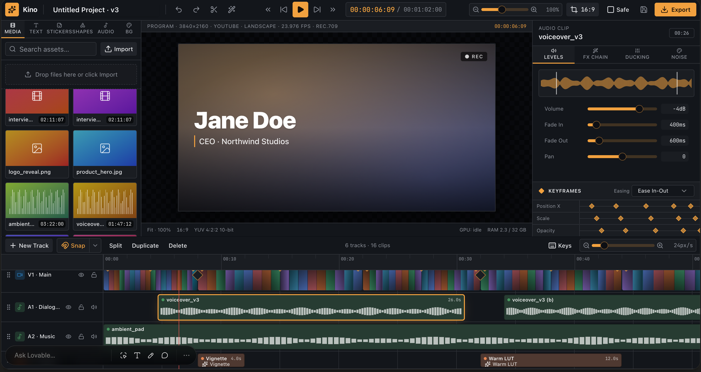

# Reference — the Kino prototype

The Lovable prototype "Kino" is the **target end state of Cutroom's interface**: the layout, the
panels and how the Timeline behaves. It is a reference and not a codebase
([ADR 0010](../adr/0010-the-lovable-prototype-is-a-reference-not-a-codebase.md)). We write the
interface from scratch and read the prototype only to see what it should look like and do.

- **The screenshot above is committed.** It is what ADR 0010 asks for: the prototype captured in
  `docs/`, not vendored back in.
- **The code is a local, gitignored copy** at `docs/reference/kino-prototype/` (10 files, about
  2,600 lines of React). Recreate it with
  `cp -R ../lovable_test_ui/editor_files/. docs/reference/kino-prototype/`. ESLint skips the copy,
  and `cutroom/no-import-outside-repo` fails any import that resolves into it.
- It does not build on its own: it imports `@tanstack/react-router` and shadcn components from the
  Lovable project, which are not in the copy.

This file records what the prototype **does**, read from its code on 2026-10-23. A lot of it is
drawn but not wired, so each section says which. "Works" means real interaction state in the
prototype. It never means real media: the prototype has no `<video>`, no `AudioContext` and no
file reading. Its Clips are fixtures, and its preview is one static frame.

## Layout

Works. A top bar, then three resizable panels side by side: the library on the left, the preview
in the middle, the Inspector on the right. Under them is the Timeline, resizable against the panels
above. Dark theme with an orange accent.

The "Ask Lovable…" bar in the screenshot belongs to Lovable's own editor. It is not part of the
prototype.

## Timeline editing

Works, and it is the strongest part of the prototype (`Timeline.tsx`, about 900 lines).

- Clips move by drag, also onto another Track and several at once, and trim from either edge.
- Selection: click, Shift or ⌘-click to add, marquee over an empty lane, ⌘A, Esc.
- Snap, with a toggle (N) and settings: Clip edges, the Playhead, sequence start and end, a time
  grid, and a pixel threshold. A guide line shows the snap target.
- Split at the Playhead, Duplicate and Delete, from the toolbar, from a Clip's context menu and by
  key (S, ⌘D, Del or Backspace).
- Nudge by one Frame (← →) or one second (Shift + ← →).
- Zoom with + and − or a px/s slider. Pan with Alt-drag or the middle button.
- The ruler scrubs the Playhead by click or drag.
- A Shortcuts popover lists every key.

The prototype does not stop Clips overlapping on one Track.

## Tracks

Partly works.

- Works: New Track (video, audio, text or adjustment), reorder by dragging a Track's grip (with a
  ghost row and an insertion line), and Lock, which blocks move and trim.
- Drawn only: Hide (the eye) and Mute only swap their icon. A hidden Track still shows its Clips.

## Library and drag and drop

Works for dragging, mocked for content.

- Tabs: Media, Text (presets and animations), Stickers (emoji), Shapes, Audio (music and SFX) and
  BG (backgrounds).
- Any item drags onto a Track at a position, with a drop outline, or onto the preview, which
  appends it to the first matching Track.
- Search works on the Media tab only.
- Drawn only: the Import button and the "Drop files here" zone, which accept no files. Text
  animations are buttons with no handler.

## Transport and preview

Partly works.

- Works: Play and Pause, by button and by Space. The timecode and duration display. Preview zoom.
- Drawn only: Jump to start, previous Frame, next Frame and Jump to end.
- The preview is one fixed picture with a "Jane Doe" lower third. It does not follow the Timeline
  or the Playhead.

## Frame size and safe area

Works. A Frame-size menu of aspect presets (16:9, 9:16, 1:1 and others, each with a pixel size)
reshapes the preview. A Safe toggle draws the title and action safe areas.

## Export dialog

Works as a form, with a simulated render.

- Format: MP4, WebM, ProRes, image sequence or audio only, each with its own codec list.
- Quality presets (4K, 1080p, 720p, 480p) or Custom: width, height, frame rate, colour depth and
  bitrate.
- A hardware-encoding toggle and AI upscaling with a strength slider.
- A summary with an estimated size, and a progress bar driven by a timer, with Cancel.

## Inspector: transform, crop and blend

Drawn only: the values live in each slider and change nothing. Position X and Y, Scale, Rotation,
Opacity, 3D perspective (rotation on three axes and depth), Crop on four sides, and Blend mode.

The Inspector picks its layout from hard-coded Track ids, so a Track added at runtime always gets
the video layout.

## Inspector: effects and colour

Drawn only.

- An applied-effects stack (Vignette, Chromatic Aberration, Grain), each a card with its
  parameters, plus an effects library.
- Colour: Lift, Gamma and Gain wheels (static images), HSL per hue, a Curves editor (a static SVG),
  a LUT picker with an Import .cube button, and look presets.

## Inspector: text

Drawn only. Content (text, font, weight, size, tracking, leading, alignment), Style (fill,
gradient, outline, shadow, background box), in and out animations, and karaoke word highlighting
synced to an audio Clip.

## Inspector: audio

Drawn only. Levels (volume, fade in and out, pan, a waveform), an FX chain (EQ, compressor, reverb,
delay, chorus and more), ducking against a target Track, and noise reduction (tonal, broadband,
rumble).

## Inspector: shapes

Drawn only. Fill and gradient, stroke width and style, corner radius, and shadow.

## Keyframes

Drawn only. A keyframe strip for Position X, Scale and Opacity with an easing picker, and keyframe
diamonds on Clips. The diamonds are decoration.

## Clip speed and other Clip commands

Drawn only. Speed with preserve pitch, optical-flow interpolation and reverse. In the context menu:
Speed/Duration, Copy, Paste Attributes and Detach Audio. A cross-dissolve diamond between two Clips
stands for a transition.

## Not wired at all

Undo, Redo, the top bar's Split, Magic Cut and Save. Cutroom has no Save to wire, because saves
follow the Gesture ([ADR 0011](../adr/0011-saves-follow-the-gesture-and-commit-explicitly.md)).
