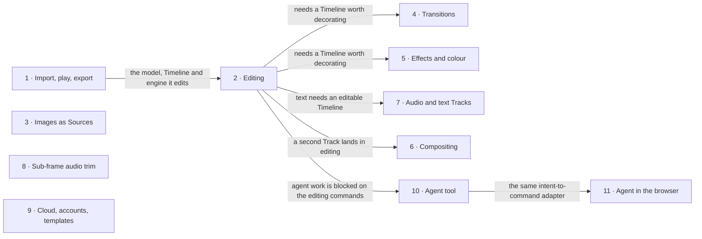

# Roadmap — Cutroom

> **A decomposition, not a promise.** The overall idea broken into incremental steps: what each
> step is, where it comes from, how big it is — or that nobody has looked at it yet — and in which
> order, and parallel lanes, we walk them. **No dates** (except shipped history), **no scores** —
> order is the prioritization. The *solution* for any step lives in its `docs/features/<slug>/`
> spec, not here.

## Destination

A person edits their own footage into a finished multi-track video — video, audio and text Tracks, Effects, colour and transitions — and exports it, entirely in their browser, with no media ever leaving their machine.

## Steps

| # | Step | Source | Size | Status |
|---|---|---|:---:|---|
| 1 | Import, play, export: the user's own file becomes a Clip they can scrub, play in sync and export as an MP4 → [import-play-export](./features/import-play-export/spec.md) | `docs/features/import-play-export/spec.md` §1 Context | L | shipped |
| 2 | Editing: several Clips on a Track, trim from either end, split, move and reorder, delete with and without closing the gap, undo/redo in the interface, a second Track and audio | `docs/future.md` §The next slice: editing | L | idea |
| 3 | Images as Sources → see [Not yet specified](#not-yet-specified) | `docs/future.md` §Images as Sources | fog | idea |
| 4 | Transitions → see [Not yet specified](#not-yet-specified) | `docs/future.md` §Transitions | fog | idea |
| 5 | Effects and colour grading → see [Not yet specified](#not-yet-specified) | `docs/future.md` §Effects and colour grading | fog | idea |
| 6 | Compositing: more Tracks, transform, blend modes → see [Not yet specified](#not-yet-specified) | `docs/future.md` §Compositing: more Tracks, transform, blend modes | fog | idea |
| 7 | Audio and text Tracks → see [Not yet specified](#not-yet-specified) | `docs/future.md` §Audio and text Tracks | fog | idea |
| 8 | Sub-frame audio trimming → see [Not yet specified](#not-yet-specified) | `docs/future.md` §Sub-frame audio trimming | fog | idea |
| 9 | Cloud storage, accounts, templates → see [Not yet specified](#not-yet-specified) | `docs/future.md` §Cloud storage, accounts, templates | fog | idea |
| 10 | Cutroom as a tool an agent drives → see [Not yet specified](#not-yet-specified) | `docs/future.md` §Cutroom as a tool an agent drives | fog | idea |
| 11 | An agent working the editor through the browser → see [Not yet specified](#not-yet-specified) | `docs/future.md` §An agent working the editor through the browser | fog | idea |

## Not yet specified

| Area | What we'd have to learn | Blocks | How it gets sharpened |
|---|---|:---:|---|
| Images as Sources | How a still sits on a video Track. It changes `Source`, not `Track`. Does `Source.duration` become optional, or gain a "still" address kind? The import path stops refusing images, and the engine returns one bitmap for every Frame. This needs a schema version. | 3 | A recon pass over `Source`, the import refusal (T040) and the engine's per-Source sink |
| Transitions | Whether a transition takes its Frames from the Clips (the Clips shorten) or overlaps them (the Timeline shortens). Then the time arithmetic in the Scene projection, the export loop and the Timeline's hit-testing. This needs `Track.transitions` and a schema version. | 4 | A conversation that settles the Frames question, which is close to unchangeable afterwards, then a recon of the Scene projection |
| Effects and colour grading | A parameter description language expressive enough for a chroma key's eyedropper and a mask's geometry, or an escape hatch into bespoke UI (ADR 0009). It adds `Clip.effects`, an `effects/` registry and the Inspector. One schema change adds the array. | 5 | Design it when the second awkward Effect appears, not the first |
| Compositing | `Clip.transform` and `Clip.blendMode`, the Track kind union, and widening `SceneClip` in the same change. `packages/model/test/scene.test.ts` fails on the day `Clip` gains a transform. This needs a schema version. | 6 | A recon of the Scene projection and the renderer once a second Track exists |
| Audio and text Tracks | Their own Track kinds (`TrackKind` is a union of one), the Scene projection, and per-Track routing in the audio graph. This needs a schema version. | 7 | A recon of the audio graph and the Scene projection |
| Sub-frame audio trimming | The optional sample offset on the Clip. Positions stay in Frames, and only the In-point gains sub-Frame precision (ADR 0002). This needs a small schema version. | 8 | Wait until someone needs a cut finer than a Frame (33 ms at 30 fps) |
| Cloud storage, accounts, templates | A second `SourceAddress` member `{ kind: "cloud-object", url }` (ADR 0005), the server that replaces the local Project library (ADR 0007), and what makes Safari work (ADR 0006). Adding the address member is a version bump. | 9 | A backend design pass |
| Cutroom as a tool an agent drives | The commands worth issuing, a compact read projection, and an intent-to-command adapter that mints ids and timestamps. Content it can reason about (a transcript, silence detection). It could be a tool server (MCP) or an in-editor panel, and a command registry instead of a closed union is an ADR. A new package. No schema change. | 10 | Prototype the read projection and the adapter after the editing slice |
| An agent working the editor through the browser | Commands for the edit and the screen for the seeing: a hybrid that exposes the store to an in-page caller, the same adapter as step 10. It has to fail loudly. No schema change. | 11 | Follows step 10's adapter |

## Out of scope

- A server-side render path — every Frame is rendered client-side, and a second renderer would have to match every Effect pixel-for-pixel ([ADR 0001](./adr/0001-client-only-rendering-mediabunny-pixijs.md), constitution Principle I).
- Copying Sources into browser storage — Sources are addressed where they live ([ADR 0005](./adr/0005-sources-are-referenced-never-copied.md), Principle V).
- Building on the Lovable prototype's code — it is a visual reference outside the repository ([ADR 0010](./adr/0010-the-lovable-prototype-is-a-reference-not-a-codebase.md)).

## Open decisions

| # | Question | Type | Owner | Blocks |
|---|---|:---:|:---:|:---:|
| D1 | Does an exported file of step 1 play correctly in VLC and in QuickTime Player itself (SC-006, the T096 check a script could not make)? | task | human | — |
| D2 | Does a trim ripple — does trimming a Clip shorter leave a gap or pull everything after it back? | grilling | human | 2 |
| D3 | What is one undo step during a drag — every intermediate position, or the whole Gesture? | grilling | human | 2 |
| D4 | Which time space is a Clip's In-point measured in (container presentation time, or time from the first sample)? It needs an ADR before trimming lands | grilling | human | 2 |
| D5 | Should nested sequences / compound clips exist at all? They change what "the Timeline" means | grilling | human | — |
| D6 | Should variable-frame-rate Sources be supported? The model assumes one Timebase per Source, and VFR breaks that assumption rather than stretching it | grilling | human | — |
| D7 | Is shared editing a real requirement? Collaboration (CRDTs) was rejected once as a large amount of machinery for a product that renders on one machine. Revisit only if the backend makes it one | grilling | human | 9 |

## Decisions so far

- Every Frame is rendered in the browser on Mediabunny + PixiJS → [`docs/adr/0001`](./adr/0001-client-only-rendering-mediabunny-pixijs.md)
- Timeline time is integer Frames in a rational Timebase → [`docs/adr/0002`](./adr/0002-timeline-time-is-integer-frames.md)
- The engine runs in a Worker; audio stays on the main thread and owns the clock → [`docs/adr/0003`](./adr/0003-engine-runs-in-a-worker.md), [`docs/adr/0008`](./adr/0008-audio-stays-on-the-main-thread.md)
- One reducer, with undo as inverse patches; saves follow the Gesture → [`docs/adr/0004`](./adr/0004-single-reducer-with-inverse-patches-for-undo.md), [`docs/adr/0011`](./adr/0011-saves-follow-the-gesture-and-commit-explicitly.md)
- Sources are addressed, never copied; Projects are portable versioned JSON → [`docs/adr/0005`](./adr/0005-sources-are-referenced-never-copied.md), [`docs/adr/0007`](./adr/0007-project-document-is-portable-versioned-json.md)
- Chromium first; cross-browser arrives with cloud Sources → [`docs/adr/0006`](./adr/0006-chromium-first-cross-browser-comes-from-the-cloud.md)
- Effects are registry entries → [`docs/adr/0009`](./adr/0009-effects-are-registry-entries-any-parameter-animates.md)
- `timeline.tracks[0]` is the backmost Track; the Timeline shows Tracks the other way up → [`docs/future.md`](./future.md) §Compositing
- The rest of step 1's decisions → [`docs/features/import-play-export/sad.md`](./features/import-play-export/sad.md) §9

## Dependency graph

## Execution path

| Wave | Steps | Zone per step (why parallel-safe) | Unlocks |
|:---:|---|---|---|
| 1 | 1 | `packages/model`, `packages/engine`, `apps/editor` (the whole slice; shipped) | 2 |
| 2 | 2 | `packages/model/src/commands`, `apps/editor/src/ui` (Timeline), `apps/editor/src/store` | 4, 5, 6, 7, 10 (each once its fog is cleared) |

Steps 3–11 are `fog` and enter no wave until a recon pass sizes them.

## Shipped

| Step | Shipped | Link |
|---|---|---|
| 1 · Import, play, export | `7f5efea`–`a49c7f8` on `main` (date omitted by owner instruction; see `git log`) | No PR (committed to `main`). Record: [docs/features/import-play-export/](./features/import-play-export/spec.md). SC-006 still open (D1) |
